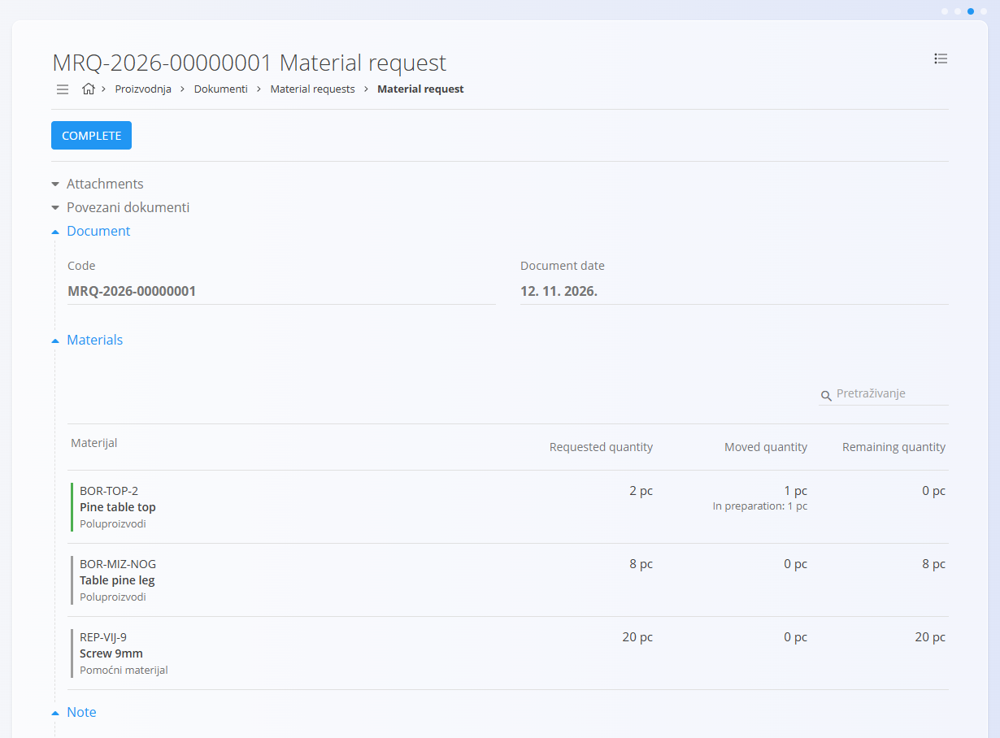
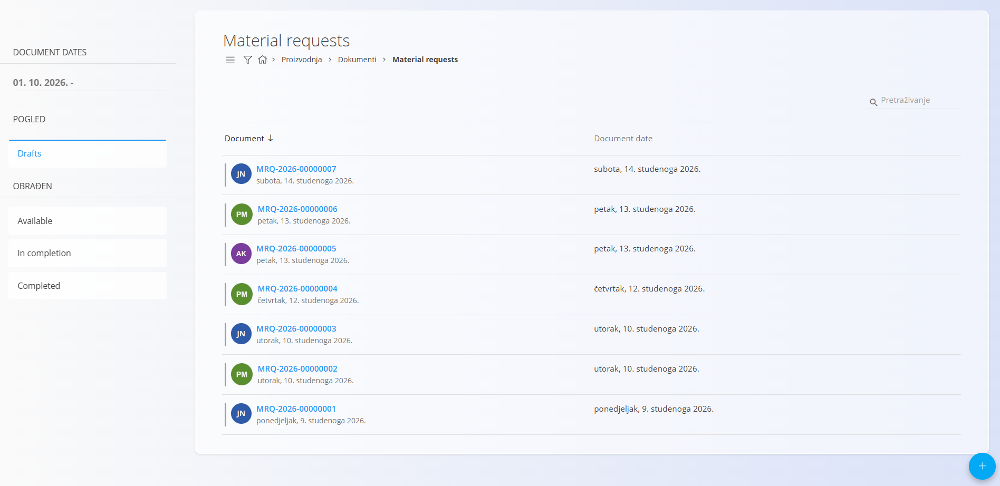
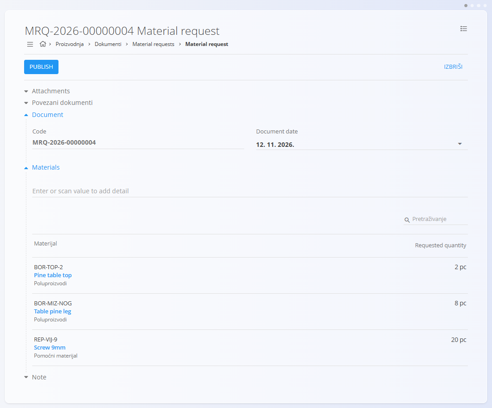
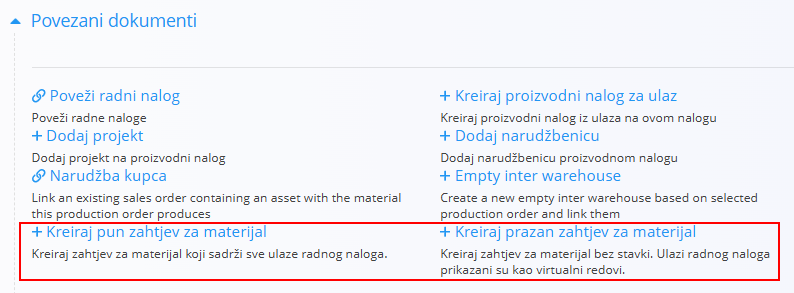
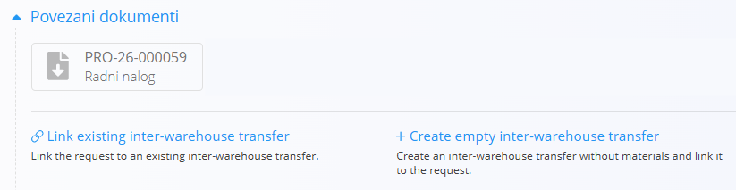

<!-- app_route: /logistics/documents/material-requests -->
<!-- app_label: Material requests -->
<!-- canonical_source_url: https://github.com/Tom-PIT/Connected.Docs/blob/main/hr/Domene/Proizvodnja/Dokumenti/MaterialRequests.md -->
<!-- canonical_source_title: Material requests -->

# Material requests

**Material request** traži od skladišta materijale. Planer ili voditelj smjene navodi materijale i količine koje su potrebne proizvodnom području. Skladište zatim materijale premješta jednim ili više dokumenata [**Međuskladišni promet**](../../Logistika/Dokumenti/MeduskladisniPromet.md).

Material request ne mijenja zalihu. Materijale premještaju tek dokumenti međuskladišnog prometa nastali iz zahtjeva.

Za pristup stranici **Material requests** idite na **Proizvodnja / Dokumenti / Material requests** u [navigaciji](../../../Zajednicko/UI/Navigacija.md).

## Kako zahtjevi za materijal sudjeluju u proizvodnom procesu

1. [**Proizvodni nalog**](ProizvodniNalozi.md) određuje materijale koji su mu potrebni.
2. Iz proizvodnog naloga stvorite zahtjev za materijal pomoću **+ Kreiraj pun zahtjev za materijal** ili **+ Kreiraj prazan zahtjev za materijal**.
3. Skladište s jednim ili više dokumenata međuskladišnog prometa povezuje zahtjev i premješta materijale.

## Shema

<strong>Document</strong>

| Polje | Opis |
|------|------|
| **Code** | Sistemski generiran jedinstveni identifikator zahtjeva za materijal. |
| **Document date** | Datum zahtjeva. |
| **Note** | Dodatne napomene za skladište. |
| **Attachments** | Datoteke povezane sa zahtjevom. |

<strong>Materials</strong>

| Polje | Opis |
|------|------|
| [**Materijal**](../../RobaIUsluge/Materijali/README.md) | Traženi materijal. |
| **Oznaka** | Šifra materijala. Unesite ili skenirajte šifru da biste dodali materijal. |
| **Requested quantity** | Tražena količina u jedinici materijala (na primjer kom). |
| **Moved quantity** | Količina koju su već premjestili dokumenti međuskladišnog prometa nastali iz zahtjeva. Popunjava se automatski. |
| **Remaining quantity** | Količina koju još treba premjestiti. Popunjava se automatski. |

> [!NOTE]
> Stavke ne sadrže cijene ni poreze. Material request je zahtjev za zalihom, a ne financijski dokument.

## Upravljanje

### Stanja dokumenta

Material request je u jednom od četiri stanja:

- **Drafts** – zahtjev se priprema. Nacrte je moguće urediti i izbrisati.
- **Available** – zahtjev je objavljen, a skladište može postupati po njemu.
- **In completion** – zahtjev je djelomično premješten. Dokument međuskladišnog prometa premjestio je dio materijala, ali ne sve. Preostala količina ostaje na zahtjevu.
- **Completed** – zahtjev je dovršen. Pritisnite **COMPLETE** da zahtjev postavite u ovo stanje, čak i ako neki materijali još nisu premješteni.

### Pogled popisa

Popis Material requests prikazuje sve zahtjeve, razvrstane po stanjima u lijevom bočnom stupcu: **Drafts**, **Available**, **In completion** i **Completed**. Zadnja tri su zajedno pod skupinom **OBRAĐEN**. Dokument možete potražiti u polju **Pretraživanje** ili filtrirati popis pomoću lijevog bočnog stupca. Filtri rade isto kao na stranici [**Primke**](../../Logistika/Dokumenti/Primke.md). Filtra po skladištu još nema.

## Akcije

### Stvaranje zahtjeva za materijal

1. Pritisnite [akcijski gumb](../../../Zajednicko/UI/AkcijskiGumb.md) i odaberite **Add new**.
2. U odjeljku **Materials** unesite ili skenirajte šifru ili naziv materijala da ga dodate. Ponovite za svaki materijal koji vam treba i unesite traženu količinu za svaki.
3. Po potrebi unesite **Note** ili priložite datoteke za skladište.
4. Pritisnite **Save** da spremite dokument kao nacrt.

Zahtjev se prikazuje u stanju **Drafts**. Prije nego što ga pošaljete skladištu, možete ga ispisati ili izvesti iz [izbornika](#izbornik).

<!-- TODO: Potvrdite oznake gumba Add new i Save u aplikaciji na hrvatskom jeziku. -->

### Stvaranje zahtjeva za materijal iz proizvodnog naloga

Zahtjev za materijal možete stvoriti izravno iz [**proizvodnog naloga**](ProizvodniNalozi.md). U odjeljku **Povezani dokumenti** naloga odaberite jednu od sljedećih opcija:

- **+ Kreiraj pun zahtjev za materijal** stvara zahtjev koji sadrži sve ulaze proizvodnog naloga.
- **+ Kreiraj prazan zahtjev za materijal** stvara zahtjev bez stavki. Ulazi proizvodnog naloga prikazani su kao virtualni redovi.

Za puni zahtjev sustav prepisuje sve ulaze naloga. Za prazan zahtjev dodajte retke koji su vam potrebni. Materijale možete promijeniti prije spremanja.

Zahtjev za materijal povezan je s proizvodnim nalogom. Na zahtjevu vidite:

- **traženu količinu** i
- **već premještenu količinu** dokumentima međuskladišnog prometa nastalima iz ovog zahtjeva.

To je važno jer se jedan zahtjev može ispuniti u više prijenosa.

### Uređivanje zahtjeva za materijal

Moguće je urediti samo nacrte. Možete promijeniti datum dokumenta i materijale, dodati nove materijale te promijeniti pojedinosti, na primjer **Requested quantity**.

#### Povezani dokumenti

Odjeljak povezanih dokumenata omogućuje stvaranje dokumenata koji slijede ili su povezani sa zahtjevom. Prikazuje i već povezane dokumente.

Za pojedinosti o povezivanju dokumenata, sljedivosti i stvaranju povezanih dokumenata pogledajte [**Povezani dokumenti**](../../../Zajednicko/Koncepti/PovezaniDokumenti.md).

### Brisanje zahtjeva za materijal

Nacrte zahtjeva za materijal možete izbrisati na zaslonu za uređivanje. Da biste iz nacrta uklonili jedan materijal, odaberite ga u odjeljku **Materials** i pritisnite **IZBRIŠI** u prozoru **Edit item**.

<!-- TODO: Potvrdite hrvatske oznake gumba Edit item i IZBRIŠI za uklanjanje stavke. -->

### Vraćanje zahtjeva u nacrt

Radnjom **Return to draft** možete promijeniti zahtjev koji je dostupan, na primjer da ispravite količinu. Zahtjev se zatim vraća u stanje **Drafts**.

<!-- TODO: Potvrdite oznaku radnje Return to draft i stanja u kojima je dostupna. -->

### Stvaranje međuskladišnog prometa iz zahtjeva za materijal

Kada skladište obrađuje zahtjev, poveže s njim dokument međuskladišnog prometa. U odjeljku **Povezani dokumenti** zahtjeva odaberite jednu od sljedećih opcija:

- **+ Create empty inter-warehouse transfer** stvara međuskladišni promet bez materijala i povezuje ga sa zahtjevom.
- **Link existing inter-warehouse transfer** povezuje zahtjev s međuskladišnim prometom koji već postoji.

Odabirete **odredišno skladište**. Ako je organizacijska jedinica koja izvodi nalog u svojim podacima povezana sa skladištem, odredišno se skladište odabire automatski. Objavom dokumenta međuskladišnog prometa zaliha se premješta.

Za premještanje samo dijela materijala pogledajte [**Međuskladišni promet**](../../Logistika/Dokumenti/MeduskladisniPromet.md).

<!-- TODO: Dodajte odjeljak o premještanju dijela zahtjeva na stranici Međuskladišni promet. -->

#### Primjer: premještanje polovice naloga u dva dijela

1. Proizvodni nalog treba materijale za cijelo izvođenje, ali skladište u jednom trenutku može premjestiti samo dio naloga.
2. Na proizvodnom nalogu odaberite **+ Kreiraj pun zahtjev za materijal**. Zahtjev se otvara kao nacrt.
3. Voditelj smjene pregledava zahtjev i objavljuje ga.
4. U ponedjeljak skladište iz zahtjeva stvara dokument međuskladišnog prometa i premješta oko 50 % materijala u proizvodnju.
5. U srijedu skladište iz istog zahtjeva stvara drugi dokument međuskladišnog prometa i premješta ostatak.

## Izbornik

Izbornik nudi dodatne radnje dostupne na ovoj stranici.

Dostupne radnje:

- **Printing**
- **Exporting (PDF)**
- **Return to draft** (samo za zahtjeve koji su dostupni) vraća zahtjev u stanje **Drafts**.
- **Reactivate** (samo za dovršene zahtjeve) vraća zahtjev u prethodno stanje, **In completion** ili **Available**.

<!-- TODO: Potvrdite oznake radnji izbornika na hrvatskom jeziku. -->

Za pojedinosti o radnjama izbornika pogledajte [**Radnje izbornika**](../../../Zajednicko/Koncepti/RadnjeIzbornika.md).
