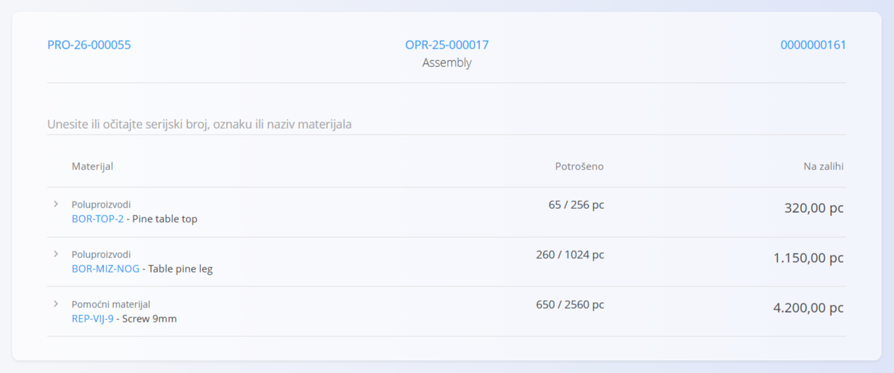
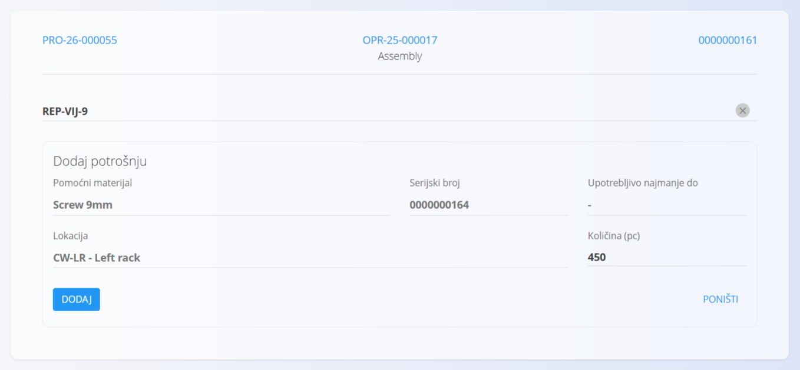
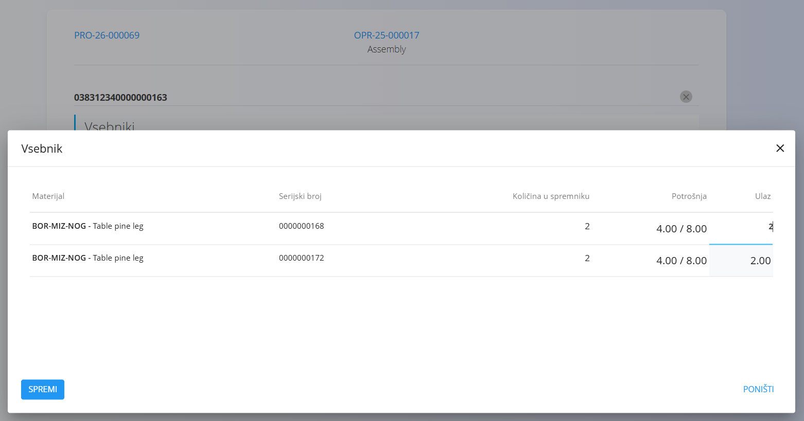

<!-- app_route: /production-orders/execution -->
<!-- app_label: Izvedba -->
<!-- canonical_source_url: https://github.com/Tom-PIT/Connected.Docs/blob/main/hr/Domene/Proizvodnja/Dokumenti/Potroseno.md -->
<!-- canonical_source_title: Potrošeno -->

# Potrošeno

Aktivnost **Potrošeno** evidentira korištenje ulaznih materijala tijekom operacije. Koristite je kada uzimate materijale sa zalihe za izradu proizvoda (na primjer vijke, ljepilo, boju, ožičenje ili određeni serijski broj ili seriju). Tako zalihe ostaju točne, a ulazi (materijali, serijski brojevi, serije) potpuno sljedivi.

Zaslon **Potrošeno** otvorite s glavne stranice [**Izvedba**](Izvedba.md) putem izbornika aktivnosti (kliknite [akcijski gumb](../../../Zajednicko/UI/AkcijskiGumb.md) i odaberite **Potrošeno**).

## Evidentiranje potrošnje

1. Otvorite stranicu **Potrošeno** iz [**izbornika aktivnosti**](Izvedba.md#izbornik-aktivnosti).  
2. Pregledajte popis utrošenih materijala (s podacima o zalihi).  
3. Odaberite materijal s popisa ili ga pretražite ili skenirajte prema nazivu, šifri, serijskom broju, EAN-u ili broju spremnika.  
   - Ako se broj spremnika podudara, otvara se prozor [**Vsebnik**](#potrosnja-iz-spremnika).  
   - Ako materijal, serijski broj ili EAN odgovara samo jednoj stavci, ona se otvara.  
   - Ako odgovara više stavki, prikazuju se za odabir.  
4. Na zaslonu **Dodaj potrošnju** unesite količinu koja se troši. 

   

5. Kliknite **Dodaj** za spremanje potrošnje.  
6. Po potrebi ponovite za druge materijale.

Utrošena količina povezuje se s operacijom i odmah se odražava na zalihama.

### Potrošnja iz spremnika

Kad odaberete spremnik, otvara se prozor **Vsebnik** s jednim retkom za svaki serijski broj u spremniku.

Stupci su:

- **Materijal**: materijal u spremniku.
- **Serijski broj**: serijski broj ovog retka.
- **Količina u spremniku**: količina tog serijskog broja u spremniku.
- **Potrošnja**: dosad utrošena količina u odnosu na količinu potrebnu za operaciju.
- **Ulaz**: količina koju trošite sada. Polje je unaprijed popunjeno cijelom količinom retka.

Za potrošnju cijelog spremnika ostavite vrijednosti u polju **Ulaz** kakve jesu i kliknite **Spremi**. Za potrošnju samo dijela spremnika prije spremanja promijenite vrijednost **Ulaz** za jedan ili više redaka.

### Provjere

Sustav provjerava:

- dostupnost na zalihi (dovoljna količina)
- ispravno skladište i lokaciju
- pripadnost i status serijskog broja ili serije

Ako neka provjera ne uspije, prikazuje se pogreška i potrošnja se ne evidentira.
