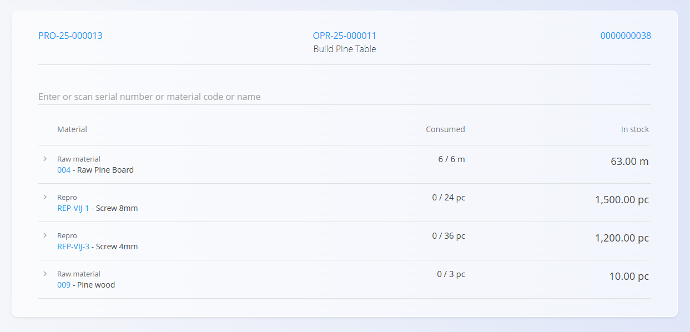
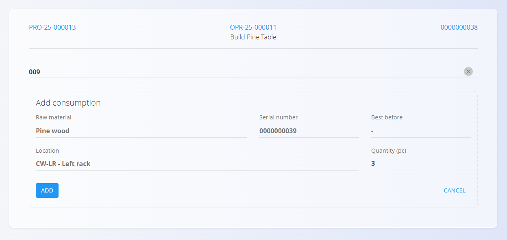

<!-- app_route: /production-orders/execution -->
<!-- app_label: Izvedba -->
<!-- canonical_source_url: https://github.com/Tom-PIT/Connected.Docs/blob/main/hr/Domene/Proizvodnja/Dokumenti/Potroseno.md -->
<!-- canonical_source_title: Potrošeno -->

# Potrošeno

Aktivnost **Potrošeno** evidentira korištenje ulaznih materijala tijekom operacije. Koristite je kada uzimate materijale sa zalihe za izradu proizvoda (na primjer vijke, ljepilo, boju, ožičenje ili određeni serijski broj ili seriju). Tako zalihe ostaju točne, a ulazi (materijali, serijski brojevi, serije) potpuno sljedivi.

Zaslon **Potrošeno** otvorite s glavne stranice [**Izvedba**](Izvedba.md) putem izbornika aktivnosti (kliknite [akcijski gumb](../../../Zajednicko/UI/AkcijskiGumb.md) i odaberite **Potrošeno**).

## Evidentiranje potrošnje

1. Otvorite stranicu **Potrošeno** iz [**izbornika aktivnosti**](Izvedba.md#izbornik-aktivnosti).  
2. Pregledajte popis utrošenih materijala (s podacima o zalihi).  
3. Odaberite materijal s popisa ili ga pretražite ili skenirajte prema nazivu, šifri, serijskom broju ili EAN-u.  
4. Na zaslonu **Dodaj potrošnju** unesite količinu koja se troši. 

   

5. Kliknite **Dodaj** za spremanje potrošnje.  
6. Po potrebi ponovite za druge materijale.

Utrošena količina povezuje se s operacijom i odmah se odražava na zalihama.

### Provjere

Sustav provjerava:

- dostupnost na zalihi (dovoljna količina)
- ispravno skladište i lokaciju
- pripadnost i status serijskog broja ili serije

Ako neka provjera ne uspije, prikazuje se pogreška i potrošnja se ne evidentira.
