<!-- app_route: /production-orders -->
<!-- app_label: Proizvodni nalozi -->
<!-- canonical_source_url: https://github.com/Tom-PIT/Connected.Docs/blob/main/hr/Domene/Proizvodnja/Dokumenti/ProizvodniNalozi.md -->
<!-- canonical_source_title: Proizvodni nalozi -->

# Proizvodni nalozi

Proizvodni nalozi definiraju rad potreban za proizvodnju proizvoda prema odabranom procesu i verziji.  
Prolaze kroz životni ciklus **Nacrt → U pripremi → Aktivan → Zatvoren** i mogu sadržavati više operacija, resursa, unosa, izlaza i kontrola kvalitete, ovisno o dodijeljenom procesu.

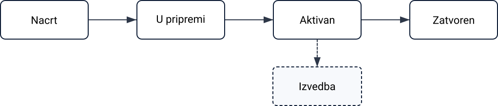

> [!NOTE]
> **Preduvjeti**  
> 
> Prije izrade novog proizvodnog naloga provjerite je li konfigurirano sljedeće:
> - barem jedan **[Proces](../Upravljanje/Procesi.md)** s aktivnom **verzijom**
> - dodijeljene **[Organizacijske jedinice](../Upravljanje/OrganizacijskeJedinice.md)** za proizvodnju  
> - po potrebi dodatne definicije, kao što su **[resursi](../../Resursi/Upravljanje/Resources.md)**, **[oznake zastoja](../Upravljanje/OznakeZastoja.md)**, **[oznake klasifikacije gubitka](../Upravljanje/OznakeKlasifikacijeGubitka.md)** i **[kontrolni popisi](../../Kvaliteta/Upravljanje/KontrolniPopisi.md)**, ovisno o vašem tijeku rada (preporučeno)

> [!TIP]
> Za potpuni prikaz funkcionalnosti pogledajte video vodič **[Production order](https://www.youtube.com/watch?v=q4UjiYpWph8)**.

Za pristup proizvodnim nalozima otvorite **Proizvodnja / Proizvodni nalozi** u [navigaciji](../../../Zajednicko/UI/Navigacija.md).

## Pregled popisa

Stranica Proizvodni nalozi prikazuje sve naloge grupirane po statusu. Za sužavanje popisa koristite filtre na lijevoj strani.

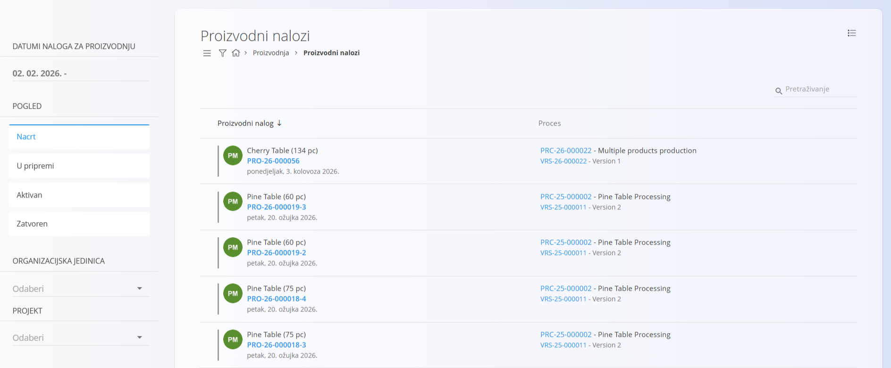

### Filtri

- **Datumi naloga za proizvodnju** – filtriranje naloga prema razdoblju.  
- **Pogled** – prikazuje naloge prema fazi životnog ciklusa:  
  -  **Nacrt** — nalog izrađen pomoću čarobnjaka koji se još može uređivati
  -  **U pripremi** — dovršen nalog spreman za aktivaciju
  -  **Aktivan** — nalog u izvođenju; vidljiv u modulu **[Izvedba](Izvedba.md)**
  -  **Zatvoren** — dovršen nalog; rezultati su evidentirani 
- **Organizacijska jedinica** – filtriranje naloga prema organizacijskoj jedinici.
- **Projekt** – filtriranje proizvodnih naloga povezanih s određenim projektom.

Traka za pretraživanje na vrhu omogućuje filtriranje prema oznaci proizvodnog naloga ili nazivu materijala.

## Izrada proizvodnog naloga

Za izradu proizvodnog naloga kliknite [akcijski gumb](../../../Zajednicko/UI/AkcijskiGumb.md) i slijedite [čarobnjak u tri koraka](ProizvodniNaloziIzrada.md).

## Proizvodni nalozi u statusu Nacrt

Novi nalog dobiva status **Nacrt**.

U nacrtu je moguće uređivati:

- **Oznaku**
- **Količinu**  
- **Seriju** 
- **Upotrebljivo najmanje do**
- **Napomene**  
- **Proces** 
- **Verziju**

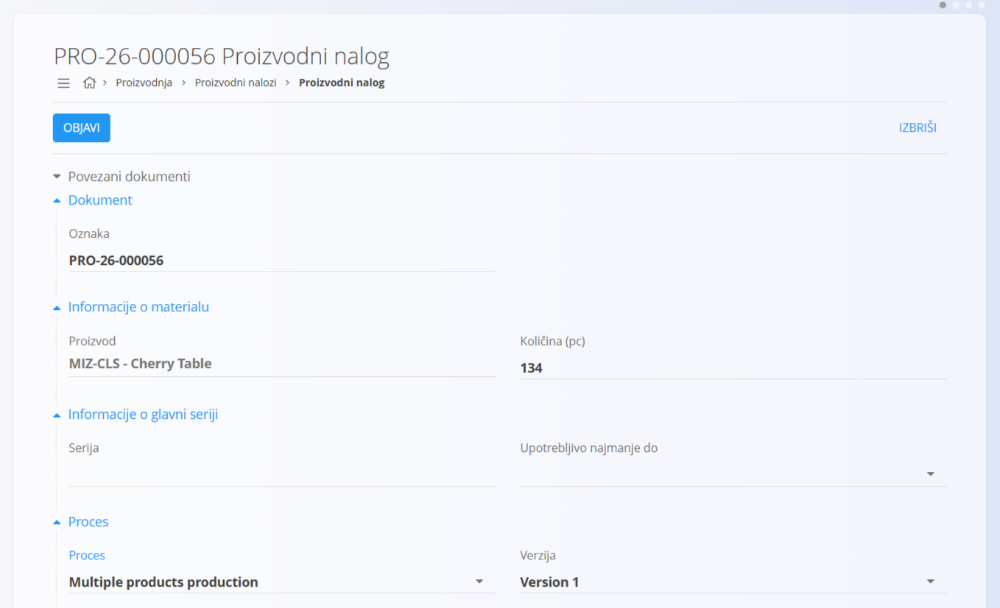

### Objava proizvodnog naloga u nacrtu

Kada je nalog spreman, kliknite **Objavi**. Nalog prelazi u status **U pripremi**.

## Uređivanje proizvodnog naloga

Nalozi u statusu Nacrt mogu se slobodno uređivati, dok je uređivanje naloga u statusima Aktivan i Zatvoren ograničeno. Za uređivanje naloga:

1. Kliknite željeni nalog na popisu kako biste otvorili njegove detalje.
2. Napravite potrebne izmjene.
3. Kliknite **Spremi** za spremanje izmjena ili **Poništi** za odbacivanje.

## Proizvodni nalozi u statusu U pripremi

Nalog u statusu **U pripremi** potpuno je pripremljen i čeka aktivaciju. Izvođenje proizvodnje još ne može započeti.

U statusu U pripremi možete:

- pregledati operacije  
- dodati priloge  
- dodati napomene  
- upravljati povezanim dokumentima

Prije aktivacije u odjeljku **Proces**, na kartici **Operacije**, odaberite **Organizacijsku jedinicu** za svaku operaciju, ako nije unaprijed definirana u [operaciji](../Upravljanje/Operacije.md). Organizacijska jedinica ne može se odabrati dok je nalog u statusu **Nacrt**.

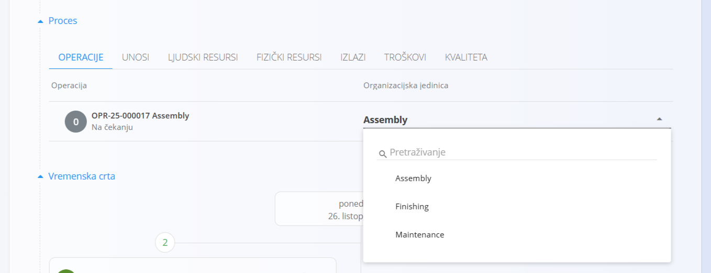

Kada je nalog spreman za proizvodnju, kliknite **Aktiviraj**.

## Povezani dokumenti

Proizvodnom nalogu možete pridružiti druge povezane dokumente, kao što su:

- [**Projekti**](../../Projekti/README.md)  
- [**Narudžbenice**](../../Nabava/Dokumenti/SupplyOrders.md)
- [**Upiti**](../../Nabava/Dokumenti/Inquiries.md)
- [**Međuskladišni promet**](../../Logistika/Dokumenti/MeduskladisniPromet.md)
- drugi proizvodni nalozi (povezani ili nalozi koji proizvode ulazne materijale)  

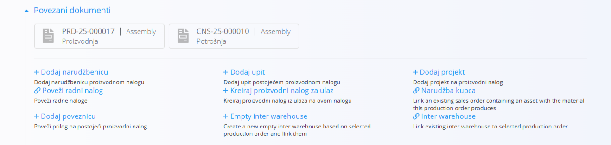

Proizvodni nalozi prikazuju i sve povezane dokumente nastale tijekom životnog ciklusa naloga, kao što su izvješća o troškovima i potrošnji.

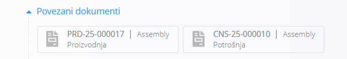

## Aktivni proizvodni nalozi

Nakon aktivacije nalog prelazi u status **Aktivan** i spreman je za izvođenje u pogonu.

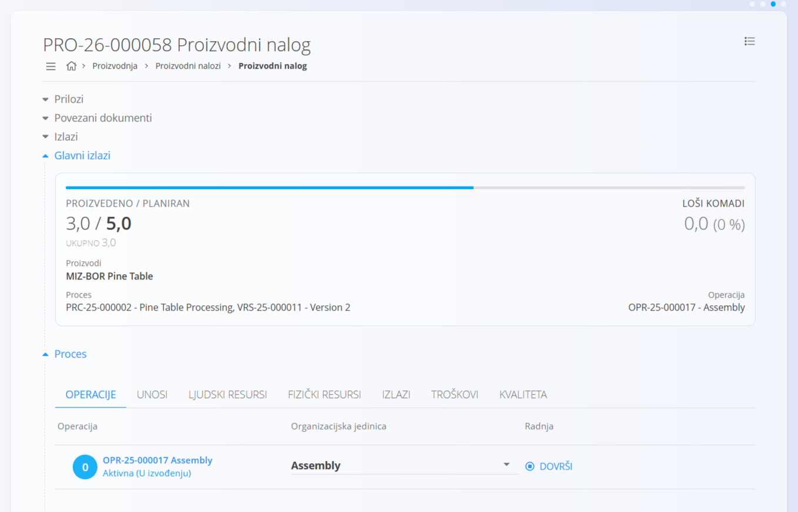

Proizvodni radnici sada mogu izvoditi operacije u modulu **[Izvedba](Izvedba.md)**.

Odjeljak **Proces** prikazuje sve planirane [operacije](../Upravljanje/Operacije.md), [unose](../Upravljanje/Unosi.md), resurse, [izlaze](../Upravljanje/Izlazi.md), [troškove](ProizvodniNaloziTroskovi.md) i [kontrole kvalitete](ProizvodniNaloziKvaliteta.md) za odabranu verziju i njezine operacije.

> [!NOTE]
> Odjeljci unosa i izlaza: 
> - prikazuju **planirane** i **stvarne** količine. Planirana količina određena je odabranom verzijom procesa i količinom naloga, a stvarna količina odražava podatke izvođenja proizvodnje. 
> - prikazuju **zalihu** materijala, tako da radnici mogu provjeriti dostupnost prije početka proizvodnje.

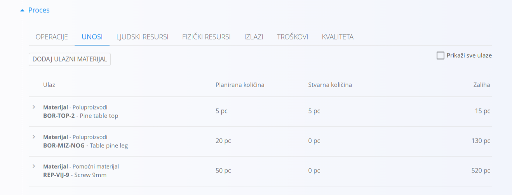

Klikom na operaciju otvara se detaljan prikaz u kojem radnici mogu evidentirati podatke izvođenja, kao što su:

- **Proizvodnja**
- **Potrošeno**
- **Loši komadi**
- **Rad**

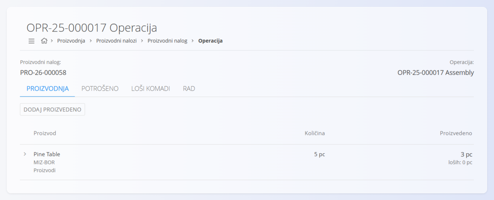

Svaka kartica ima gumb za dodavanje zapisa izvođenja (npr. **Dodaj proizvedeno**). Na primjer, na kartici **Proizvodnja** možete evidentirati proizvedeni materijal, proizvedenu količinu i vrijeme proizvodnje.

### Troškovi

**[Troškovi proizvodnog naloga](ProizvodniNaloziTroskovi.md)** omogućuju praćenje planiranih i stvarnih operativnih troškova. 

### Kvaliteta

Odjeljak [**Kvaliteta**](ProizvodniNaloziKvaliteta.md) prikazuje sve [**kontrolne popise**](../../Kvaliteta/Upravljanje/KontrolniPopisi.md) povezane s odabranim proizvodnim nalogom.

## Zatvoreni proizvodni nalozi

Kada je proizvodnja dovršena i sve operacije izvedene, nalog dobiva status **Zatvoren** i prikazuje se na popisu pod statusom **Zatvoren**.

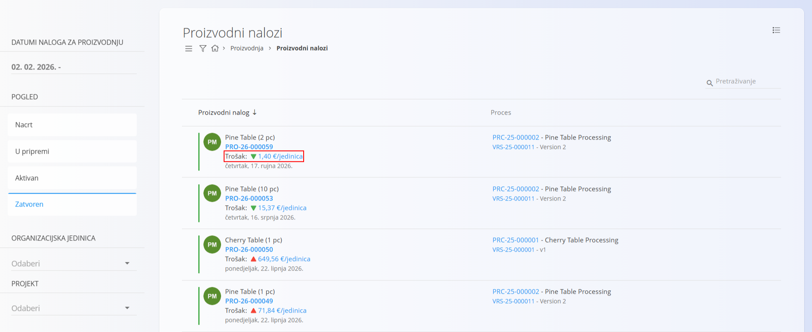

Popis prikazuje i trošak po proizvedenoj jedinici te strelicu koja pokazuje je li se trošak povećao ili smanjio u odnosu na prethodni zatvoreni nalog za isti materijal. Klikom na trošak po jedinici otvara se prikaz [**Troškovi zadataka**](../../Resursi/Pogledi/WorkItemsCosts.md) filtriran na odabrani nalog, u kojem možete analizirati raspodjelu troškova zadatka i detaljno pregledati troškove.

Zatvoreni nalozi:

- ne mogu se mijenjati  
- pružaju potpunu povijest proizvodnje  
- prikazuju proizvedene u odnosu na planirane količine, gubitke i izlaze 

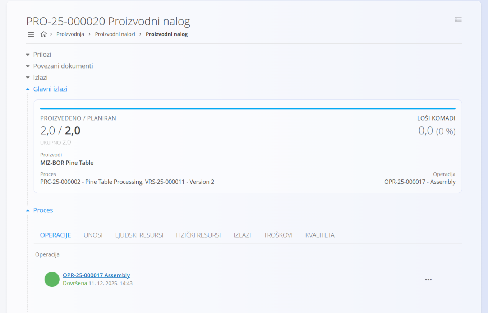

Odjeljak **Proces** prikazuje potpunu povijest izvođenja. Kliknite različite kartice za prikaz detalja, na primjer unosa korištenih tijekom proizvodnje:

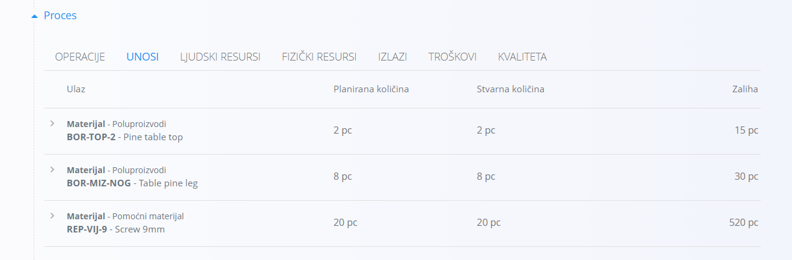

### Vraćanje zatvorenog proizvodnog naloga u status Aktivan

Ako su nakon zatvaranja potrebne izmjene, nalog možete vratiti u status **Aktivan**:

1. Otvorite zatvoreni proizvodni nalog.
1. U izborniku odaberite **Vrati na aktivno**.
1. Kliknite **Aktiviraj ponovno** na željenoj operaciji.

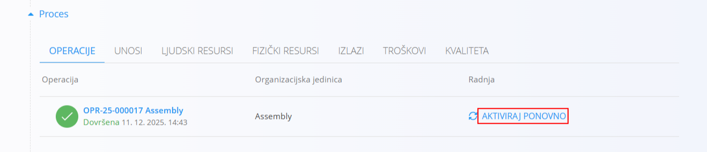

## Brisanje proizvodnog naloga

Proizvodni nalog može se izbrisati samo u statusu **Nacrt ili U pripremi** i ako se na njega ne pozivaju drugi dokumenti.  

Za brisanje proizvodnog naloga:

1. Odaberite nalog u statusu Nacrt ili U pripremi na popisu kako biste otvorili njegove detalje.
2. Kliknite **Izbriši**. Prikazat će se dijaloški okvir za potvrdu. Nakon potvrde nalog se trajno uklanja iz sustava.

> [!NOTE]
>
> Zatvoreni nalozi ne mogu se izbrisati, ali se po potrebi mogu vratiti u status Aktivan radi izmjena.

## Izbornik

Ova stranica sadrži radnje izbornika na dva mjesta.

Radnje izbornika dostupne su putem gumba **Izbornik** u gornjem desnom kutu popisa ili stranice dokumenta.

### Izbornik popisa

Izbornik popisa sadrži radnje za trenutno prikazani popis.

Dostupne radnje:
 
- **Masovna obrada statusa** – omogućuje istodobnu promjenu statusa više proizvodnih naloga (npr. iz statusa U pripremi u Aktivan).

### Izbornik dokumenta

Izbornik dokumenta sadrži radnje za trenutno otvoreni dokument.

Dostupne radnje:

- **Ispis**
- **Izvoz u PDF**
- **Vrati na aktivno** (samo za zatvorene naloge)
- **Vrati na nacrt** (samo za naloge u statusu **U pripremi**)

Više informacija o radnjama izbornika potražite u odjeljku [**Radnje izbornika**](../../../Zajednicko/Koncepti/RadnjeIzbornika.md).
