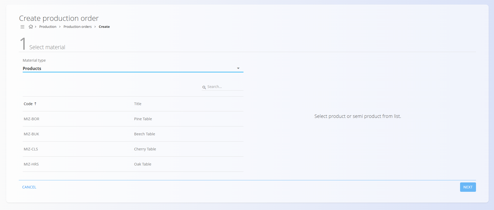
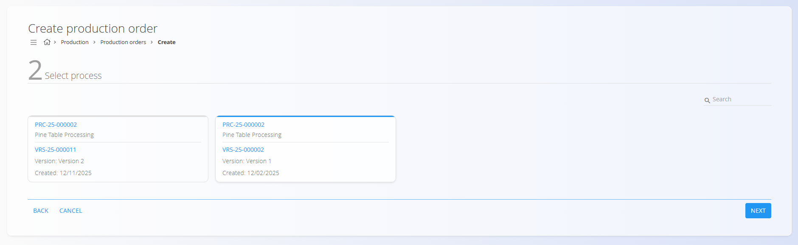
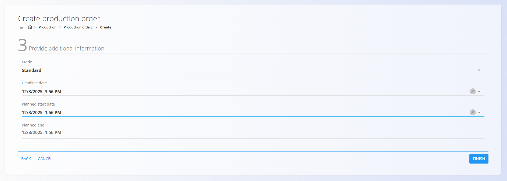
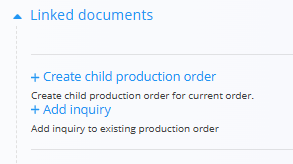
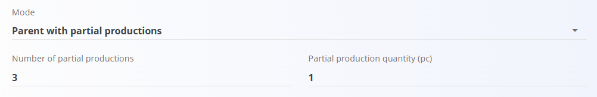

<!-- app_route: /production-orders/create -->
<!-- app_label: Novi proizvodni nalog -->
<!-- canonical_source_url: https://github.com/Tom-PIT/Connected.Docs/blob/main/hr/Domene/Proizvodnja/Dokumenti/ProizvodniNaloziIzrada.md -->
<!-- canonical_source_title: Kako kreirati proizvodni nalog -->

# Kako kreirati proizvodni nalog

Za izradu novog proizvodnog naloga kliknite [akcijski gumb](../../../Zajednicko/UI/AkcijskiGumb.md) na stranici [**Proizvodni nalozi**](ProizvodniNalozi.md) i slijedite čarobnjak u tri koraka:

## Koraci konfiguracije

### **Korak 1 — Odabir materijala**

Odaberite **Tip materijala** (npr. **Proizvodi** ili **Poluproizvodi**), a zatim odaberite određeni [**materijal**](../../RobaIUsluge/Materijali/README.md) i količinu koju treba proizvesti.

### **Korak 2 — Odabir procesa**

Odaberite **[Proces](../Upravljanje/Procesi.md)** i **Verziju procesa** koja definira način proizvodnje materijala.

> [!NOTE]
> Ako u ovom koraku nije prikazan nijedan proces, provjerite konfiguraciju u šifrarniku **[Procesi](../Upravljanje/Procesi.md)**. Proces mora imati oznaku **Proizvodnja** i aktivnu verziju. Nedostatak oznake čest je razlog zbog kojeg se proces ovdje ne prikazuje.

### **Korak 3 — Unos dodatnih podataka**

U ovom koraku definiraju se raspored i vrsta naloga.

#### **Način izvršenja proizvodnog naloga**

Određuje kako će se proizvodni nalog ponašati:

- **Standardni** — izrađuje jedan proizvodni nalog za ukupnu količinu.
- **Nadređeni** — izrađuje nadređeni (glavni) nalog koji služi samo kao spremnik za podređene naloge. Nadređeni nalog **nema operacija** i ne izvodi se. Podređeni nalozi izrađuju se ručno i mogu imati drugačije [verzije procesa](../Upravljanje/Procesi.md#verzije) od nadređenog naloga. Za izradu podređenog naloga otvorite **Povezani dokumenti** → **Kreiraj podređeni proizvodni nalog**.

   

- **Nadređeni sa djelomičom izradom** — izrađuje nadređeni nalog i automatski generira nekoliko podređenih proizvodnih naloga, od kojih svaki proizvodi dio ukupne količine.  
  Prikazuju se dva polja:
  - **Broj djelomičnih izrada** — koliko podređenih naloga treba izraditi  
  - **Količina djelomične izrade** — automatski se izračunava na temelju ukupne količine
- **Djelomična proizvodnja** — automatski generira nekoliko proizvodnih naloga, od kojih svaki proizvodi dio ukupne količine, bez izrade nadređenog naloga. Prikazuju se ista dva polja kao kod prethodnog načina.

**Primjer:**  
Ako je ukupna količina = **6 komada**  
- 3 djelomične izrade → svaka = **2 komada**  
- 2 djelomične izrade → svaka = **3 komada**

#### Datumi

Po potrebi navedite podatke o rasporedu za potrebe [planiranja](../../Planiranje/Pogledi/Planiranje.md):
- **Datum roka izrade** – datum do kojeg proizvodnja treba biti dovršena.
- **Planiran datum početka** – kada je planiran početak proizvodnje.
- **Planirani datum završetka** – kada je planiran završetak proizvodnje; popunjava se automatski na temelju odabranog [procesa](../Upravljanje/Procesi.md) i njegovih vremena.

Kliknite **Dovrši** za izradu proizvodnog naloga u statusu **Nacrt**.
