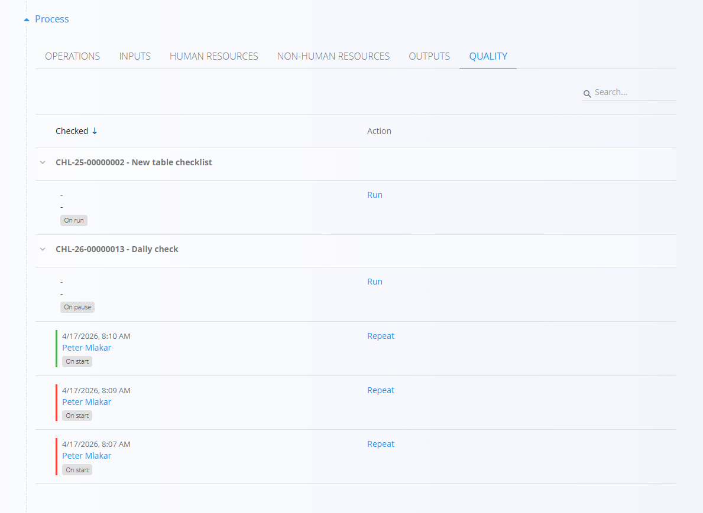

<!-- app_route: /production-orders -->
<!-- app_label: Proizvodni nalog -->
<!-- canonical_source_url: https://github.com/Tom-PIT/Connected.Docs/blob/main/hr/Domene/Proizvodnja/Dokumenti/ProizvodniNaloziKvaliteta.md -->
<!-- canonical_source_title: Proizvodni nalog – odjeljak Kvaliteta -->

# Proizvodni nalozi – Kvaliteta

Odjeljak **Kvaliteta** prikazuje sve [**kontrolne popise**](../../Kvaliteta/Upravljanje/KontrolniPopisi.md) povezane s odabranim **[proizvodnim nalogom](ProizvodniNalozi.md) ili [nalogom za održavanje](../../Odrzavanje/Dokumenti/NaloziZaOdrzavanje.md)**. 

Ti se kontrolni popisi dodaju određenom **[procesu](../Upravljanje/Procesi.md) ili [operaciji](../Upravljanje/Operacije.md)** kako bi se osiguralo provođenje postupaka kontrole kvalitete tijekom izvođenja naloga.

## Pregled

Popis prikazuje sve kontrolne popise povezane s nalogom, s nazivom i oznakom. Za svaki kontrolni popis prikazuju se različiti zapisi izvršavanja. Svaki zapis prikazuje:

- **datum i vrijeme** dovršetka  
- **operatera** koji je izvršio kontrolni popis  
- **oznaku okidača** – pokazuje kada je bilo planirano izvršavanje kontrolnog popisa (npr. *Na početku*, *Pri pokretanju*, *Za pauzo*)  

Dovršeni kontrolni popisi vizualno su označeni:

- **zeleno** – kontrolni popis uspješno je dovršen  
- **crveno** – kontrolni popis nije uspio (npr. vrijednosti izvan dopuštenih granica)  

## Akcije

Dostupne su sljedeće akcije:

- **Započni** – ručno pokreće kontrolni popis. Kontrolni popisi obično su konfigurirani za automatsko pokretanje u određenom trenutku (npr. *Na početku*, *Za pauzo*), ali ih je moguće pokrenuti i ručno ovom akcijom.

- **Ponovi** – ponovno izvršava kontrolni popis i izrađuje novi zapis izvršavanja. Korisno je kada kontrolni popis treba ponoviti (npr. nakon otklanjanja problema).

- **Izbriši** – briše **kontrolni popis koji je trenutno u izvršavanju**.

> [!IMPORTANT]
> Akcija **Izbriši** koristi se za **prisilno zaustavljanje i uklanjanje** kontrolnog popisa koji je zapeo i sprječava dovršetak proizvodnog naloga.
