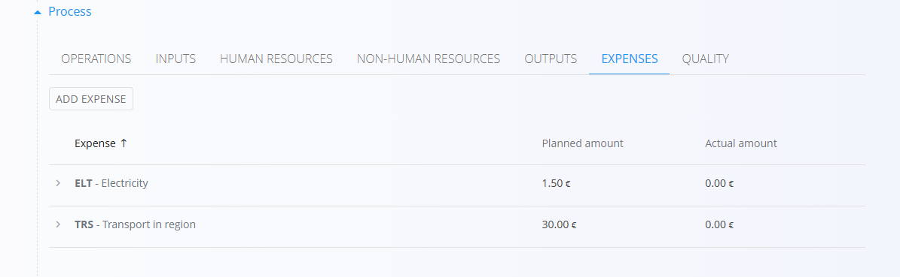
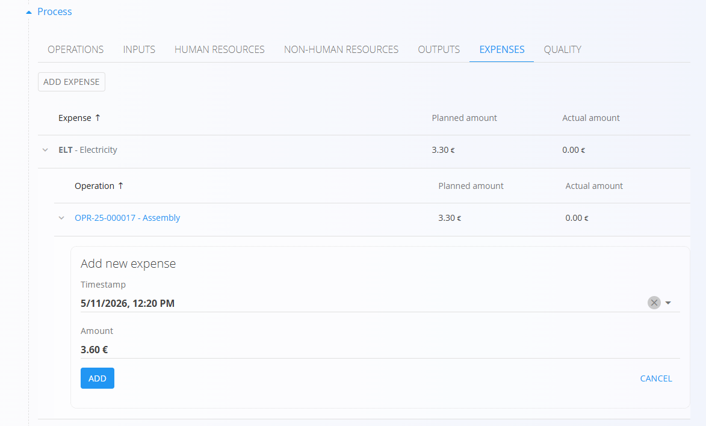
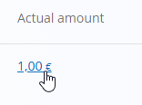
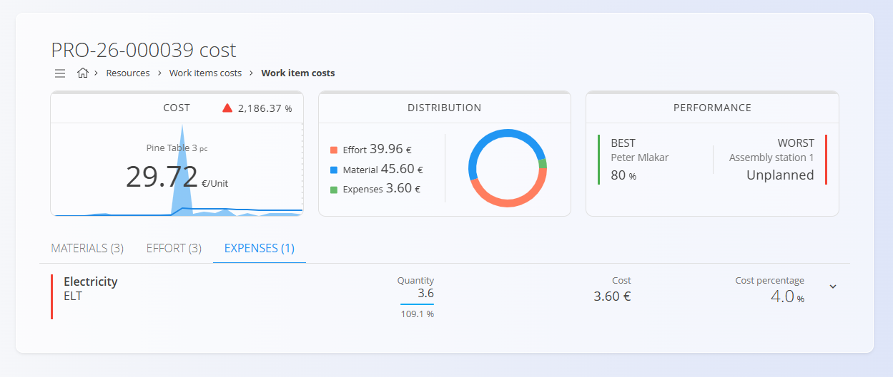

<!-- app_route: /production-orders -->
<!-- app_label: Proizvodni nalog -->
<!-- canonical_source_url: https://github.com/Tom-PIT/Connected.Docs/blob/main/hr/Domene/Proizvodnja/Dokumenti/ProizvodniNaloziTroskovi.md -->
<!-- canonical_source_title: Proizvodni nalog – odjeljak Troškovi -->

# Proizvodni nalozi – Troškovi

[Troškovi](../../Nabava/Upravljanje/Expenses.md) povezani s [proizvodnim nalogom](ProizvodniNalozi.md) mogu se evidentirati u odjeljku **Troškovi** u detaljima naloga. Tako se mogu pratiti planirani i stvarni troškovi proizvodnog naloga, što daje bolji uvid u troškove proizvodnog procesa.

Troškovi se obično [dodaju operaciji](../Upravljanje/TroskoviOperacije.md) u proizvodnom procesu, ali se mogu dodati i izravno proizvodnom nalogu ako nisu povezani s određenom operacijom.

## Dodavanje ili uređivanje troška

Kako bi se točnije izračunali stvarni troškovi proizvedenog artikla, planirani troškovi mogu se dodati ili urediti na kartici **Troškovi**: 

- Za uređivanje planiranog troška kliknite trošak na popisu kako biste otvorili njegove detalje, napravite potrebne izmjene i kliknite **Spremi**.
- Za dodavanje novog troška:
    1. Kliknite gumb **Dodaj planiran trošak**.
    2. Odaberite trošak operacije i iznos.
    3. Kliknite **Dodaj** za spremanje novog troška.

> [!IMPORTANT]
> Planirani trošak izračunava se **po nalogu**. Na primjer, ako trošak iznosi **2 €** po komadu, a planirana količina proizvodnje je 10, trošak iznosi **20 €**.

## Evidentiranje stvarnog troška

Planirani troškovi predstavljaju očekivane troškove, a stvarni troškovi stvarno evidentirani trošak tijekom izvođenja proizvodnje. Stvarni troškovi mogu se evidentirati ako se razlikuju od planiranog troška. Tako se može pratiti razlika između planiranih i stvarnih troškova, što je ključno za kontrolu i analizu troškova.

Za evidentiranje stvarnog troška:

1. Kliknite strelicu pokraj troška na popisu kako biste otvorili njegove detalje.
1. Kliknite **Dodajte stvarni trošak**.
2. Unesite stvarni iznos troška, datum i vrijeme.
3. Kliknite **Dodaj**.

Stvarni troškovi mogu se po potrebi urediti ili izbrisati. Za uređivanje ili brisanje stvarnog troška kliknite iznos kako biste otvorili njegove detalje, napravite potrebne izmjene i kliknite **Spremi** ili **Izbriši**.

## Pregled troškova

Evidentirani troškovi zbrajaju se i sažeto prikazuju u prikazu [**Troškovi zadataka**](../../Resursi/Pogledi/WorkItemsCosts.md), u kojem možete analizirati raspodjelu troškova zadatka. 

Ovaj je prikaz dostupan i s popisa proizvodnih naloga, na kojem se za svaki nalog prikazuje trošak po jedinici. Klikom na trošak po jedinici otvara se prikaz [**Troškovi zadataka**](../../Resursi/Pogledi/WorkItemsCosts.md) filtriran na odabrani nalog, u kojem možete analizirati raspodjelu troškova zadatka i detaljno pregledati troškove.
