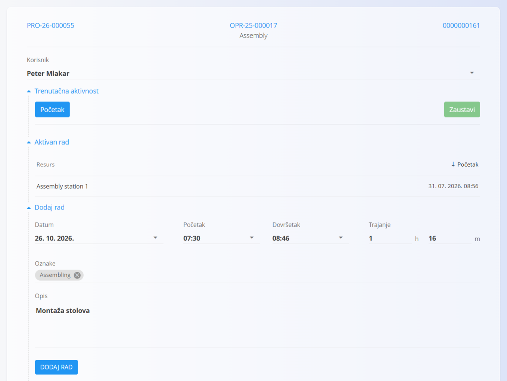
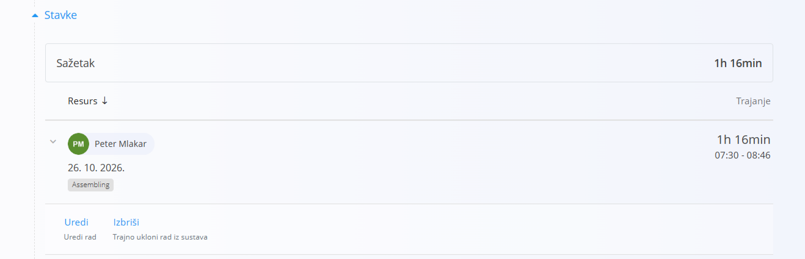

<!-- app_route: /production-orders/execution -->
<!-- app_label: Izvedba -->
<!-- canonical_source_url: https://github.com/Tom-PIT/Connected.Docs/blob/main/hr/Domene/Proizvodnja/Dokumenti/Rad.md -->
<!-- canonical_source_title: Rad -->

# Rad

Aktivnost **Rad** evidentira radno vrijeme utrošeno na operaciju. Koristite je za praćenje vremena operatera automatski (Početak/Zaustavi) ili ručno (unosom vremena ili trajanja).

Aktivnost **Rad** otvorite sa zaslona [**Izvedba**](Izvedba.md) putem izbornika aktivnosti (dodirnite [akcijski gumb](../../../Zajednicko/UI/AkcijskiGumb.md), a zatim odaberite **Rad**).

## Evidentiranje rada

1. Otvorite stranicu **Rad** iz [**izbornika aktivnosti**](Izvedba.md#izbornik-aktivnosti).  
2. Odaberite jedan od načina u nastavku i evidentirajte vrijeme.  
3. Kliknite **Dodaj rad** za spremanje.  
4. Po potrebi ponovite.

### Automatski (Početak/Zaustavi)

- Dodirnite **Početak** za početak praćenja.  
- Radite na operaciji.  
- Dodirnite **Zaustavi** za završetak praćenja.  

Time se vremenski interval evidentira automatski.

### Ručni unos

Izravno unesite podatke:

- **Datum**  
- vrijeme početka i završetka ili ukupno **Trajanje**  
- **Oznake** (nije obavezno)  
- **Opis** (nije obavezno)  

Kliknite **Dodaj rad** za spremanje zapisa.

## Uređivanje zapisa rada

Evidentirani zapisi rada prikazuju se na popisu ispod obrasca.

- Odaberite zapis kako biste uredili vrijeme, trajanje, oznake ili opis.  
- Izbrišite zapis ako je dodan greškom.  

> [!NOTE]
> Gumb **Zaustavi** na stranici Rad završava samo praćenje vremena rada; ne dovršava [izvođenje](Izvedba.md).
