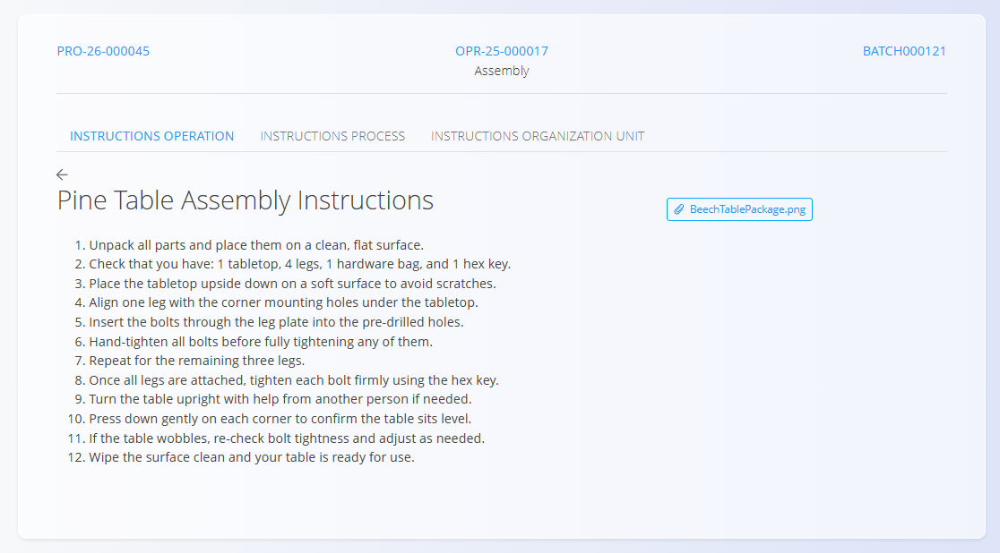

<!-- app_route: /production-orders/execution -->
<!-- app_label: Izvedba -->
<!-- canonical_source_url: https://github.com/Tom-PIT/Connected.Docs/blob/main/hr/Domene/Proizvodnja/Dokumenti/Upute.md -->
<!-- canonical_source_title: Upute -->

# Upute

Aktivnost **Upute** prikazuje članke baze znanja povezane s trenutnom operacijom, procesom ili organizacijskom jedinicom. Koristite je za brz pregled uputa tijekom rada.

Aktivnost **Upute** otvorite sa zaslona [**Izvedba**](Izvedba.md) putem izbornika aktivnosti (dodirnite [akcijski gumb](../../../Zajednicko/UI/AkcijskiGumb.md), a zatim odaberite **Upute**).

## Pregled uputa

1. Otvorite stranicu **Upute** iz [**izbornika aktivnosti**](Izvedba.md#izbornik-aktivnosti).  

   

2. Pročitajte upute, po potrebi uvećajte slike i slijedite smjernice.  
3. Kada završite, vratite se na zaslon [**Izvedba**](Izvedba.md) putem akcijskog gumba → **Proizvodnja**. 

## Vrste uputa

Različite vrste uputa dostupne su na zasebnim karticama:

- **Instructions operation** – upute specifične za trenutnu operaciju, kao što su radni koraci, postavke stroja ili zahtjevi specifični za operaciju.
- **Instructions process** – upute koje se odnose na cijeli proizvodni proces.
- **Upute za organizacijsku jedinicu** – upute povezane s organizacijskom jedinicom u kojoj se operacija izvodi.

Svakom vrstom uputa upravlja se zasebno i može sadržavati različite članke iz [**Baze znanja**](../../Znanje/BazaZnanja/BazaZnanja.md).

## Tipičan sadržaj

Članci s uputama mogu sadržavati:

- korake montaže
- sigurnosne postupke i upozorenja  
- vizualne smjernice (fotografije, crteže)  
- napomene specifične za operaciju ili proizvod  

> [!NOTE]
> Same članke mogu ažurirati ovlašteni djelatnici u domeni [**Baza znanja**](../../Znanje/BazaZnanja/BazaZnanja.md).

## Uređivanje i ažuriranje uputa

Sadržajem uputa može se upravljati na razini operacije, procesa ili organizacijske jedinice.

Za ažuriranje uputa povežite odgovarajuće članke iz [**Baze znanja**](../../Znanje/BazaZnanja/BazaZnanja.md) u konfiguraciji [operacije](../Upravljanje/Operacije.md), [procesa](../Upravljanje/Procesi.md) ili [organizacijske jedinice](../Upravljanje/OrganizacijskeJedinice.md).
