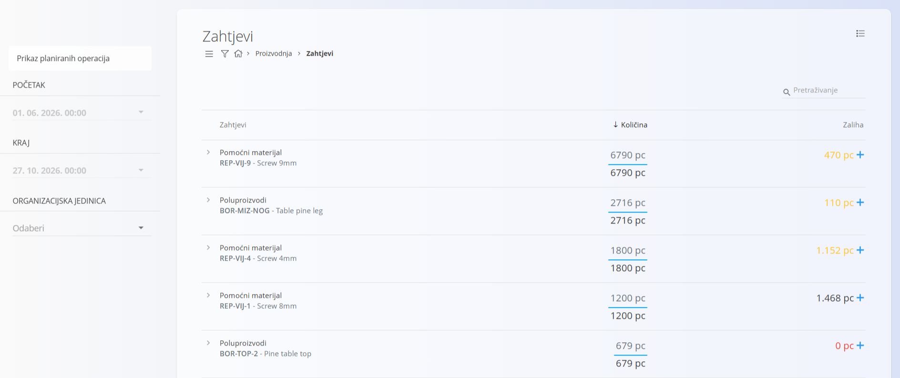
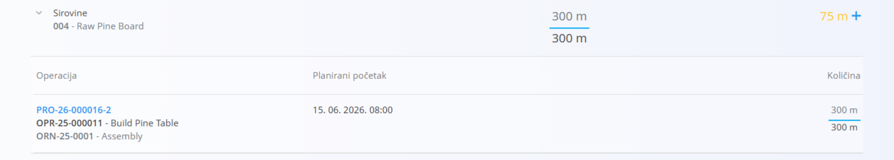
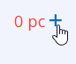

<!-- app_route: /production-orders/requirements -->
<!-- app_label: Zahtjevi -->
<!-- canonical_source_url: https://github.com/Tom-PIT/Connected.Docs/blob/main/hr/Domene/Proizvodnja/Dokumenti/Zahtjevi.md -->
<!-- canonical_source_title: Zahtjevi -->

# Zahtjevi

Stranica **Zahtjevi** pruža pregled svih materijala potrebnih za planirane proizvodne operacije u odabranom vremenskom razdoblju. Planerima pomaže razumjeti ima li dovoljno zaliha te brzo izraditi narudžbenice kada se pojavi manjak.

Stranica Zahtjevi planerima pomaže:

- vidjeti **koji su materijali potrebni** za nadolazeću proizvodnju  
- usporediti **potrebne i dostupne** količine  
- vidjeti **koje operacije** troše pojedini materijal  
- brzo izraditi **narudžbenice** kada zaliha nije dovoljna  

> [!TIP]  
> Za potpuni prikaz funkcionalnosti pogledajte video vodič **[Requirements](https://www.youtube.com/watch?v=eK7ui-ak7J0)**.

Za pristup ovoj stranici otvorite **Proizvodnja / Zahtjevi** u [navigaciji](../../../Zajednicko/UI/Navigacija.md).

## Shema

| Stupac | Opis |
|--------|------|
| **Zahtjevi** | Naziv i šifra materijala. Svaki materijal možete proširiti kako biste vidjeli koje ga operacije troše. |
| **Količina** | Prikazuje dvije vrijednosti: • **Količina u intervalu** — potrebna količina u odabranom razdoblju (gornja vrijednost) • **Ukupna količina** — ukupna planirana potrošnja svih operacija koje koriste taj materijal (donja vrijednost) |
| **Zaliha** | Trenutno dostupna zaliha.  • Ako je zaliha manja od potrebne, prikazuje se **narančasto**, a ako je zaliha **0**, **crveno** (pogledajte [Oznaka bojom](#oznaka-bojom)).  • Klikom na ikonu **+** otvara se prozor za izradu **nove narudžbenice**. |

## Pregled popisa

Svaki redak predstavlja **potrebu za materijalom** na temelju unosa definiranih u procesima i proizvodnim nalozima.

### Filtri

Filtri se nalaze na lijevoj strani zaslona i omogućuju određivanje planiranih operacija koje se uključuju u izračun.

- **Prikaz planiranih operacija** – kada je uključeno, zahtjevi se izračunavaju samo na temelju planiranih (još neizvedenih) operacija.  
- **Početak / Kraj** – definira vremenski interval za izračun potrebnih količina.  
- **Organizacijska jedinica** – filtriranje zahtjeva prema organizacijskoj jedinici.

Uključuju se samo materijali potrebni za operacije koje su u odabranom vremenskom razdoblju i organizacijskoj jedinici.

### Pregled detalja potrošnje

Kliknite strelicu za proširenje pokraj materijala kako biste prikazali sve operacije koje ga koriste:

Za svaku operaciju prikazuje se:

- **oznaka i naziv operacije**  
- datum **Planirani početak**  
- **količina koju troši** ta operacija  

Tako planeri mogu razumjeti *koji* proizvodni zadaci uzrokuju potrošnju.

#### Oznaka bojom

Broj se prikazuje: 

- **crno** ako je zaliha dovoljna za pokrivanje zahtjeva
- **narančasto** ako je zaliha manja od zahtjeva
- **crveno** ako je zaliha **0**

## Izrada narudžbenice

Stupac **Zaliha** prikazuje znak **+** pokraj količine:

Klikom na **+** otvara se obrazac za izradu narudžbenice s unaprijed popunjenim odabranim materijalom.

Tako je moguća brza nadopuna zaliha izravno sa zaslona Zahtjevi.

## Izbornik

Izbornik u gornjem desnom kutu stranice omogućuje izvoz popisa zahtjeva u CSV datoteku za daljnju analizu ili dijeljenje s drugim dionicima.
