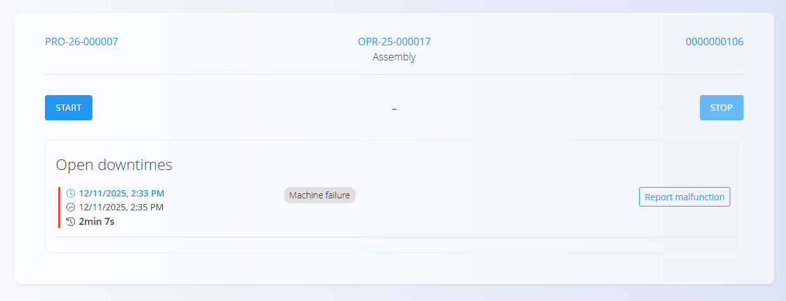
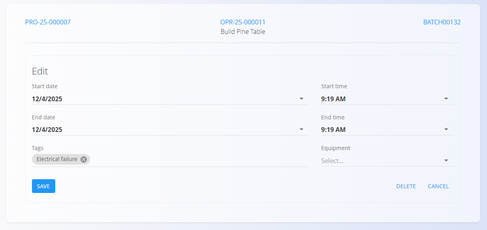

<!-- app_route: /production-orders/execution -->
<!-- app_label: Izvedba -->
<!-- canonical_source_url: https://github.com/Tom-PIT/Connected.Docs/blob/main/hr/Domene/Proizvodnja/Dokumenti/Zastoj.md -->
<!-- canonical_source_title: Zastoj -->

# Zastoj

Aktivnost **Zastoj** evidentira prekide tijekom operacije (npr. čekanje na materijal, problemi sa strojem, prenamjene). Pomaže u praćenju gubitaka vremena i poboljšava preglednost za analizu.

Aktivnost **Zastoj** otvorite sa zaslona [**Izvedba**](Izvedba.md) putem izbornika aktivnosti (dodirnite [akcijski gumb](../../../Zajednicko/UI/AkcijskiGumb.md), a zatim odaberite **Zastoj**).

## Evidentiranje zastoja

1. Otvorite stranicu **Zastoj** iz [**izbornika aktivnosti**](Izvedba.md#izbornik-aktivnosti).  
2. Kliknite **Početak** za početak praćenja prekida.  
3. Kliknite **Zaustavi** kada prekid završi. 
4. Kliknite zapis o zastoju kako biste: 
    1. odabrali razlog pomoću [**oznaka zastoja**](../Upravljanje/OznakeZastoja.md)  
    2. po potrebi prilagodili vrijeme početka i završetka  
    3. dodali opremu na koju je zastoj utjecao (nije obavezno).
5. Kliknite **Spremi**.

Kliknite gumb **Prijavi kvar** za izradu prijave kvara — pogledajte [**Prijavljeni kvarovi**](../../Odrzavanje/Dokumenti/ReportedMalfunctions.md).

Spremljeni zastoji povezuju se s proizvodnim nalogom i operacijom te se prikazuju u pregledu izvođenja.

### Uređivanje zastoja

Odaberite zapis o zastoju kako biste prilagodili vrijeme, promijenili oznaku, dodali opremu ili ga izbrisali ako je dodan greškom.

## Analitika i izvještavanje

Zapisi o zastojima koriste se na nekoliko analitičkih stranica:

- [Sažetak zastoja](../Analiza/SazetakZastoja.md)
- [Ključni pokazatelji uspješnosti proizvodnje](../Analiza/KljucniPokazateljiProizvodnje.md)
- [Organization unit downtime](../Analiza/OrganizationUnitDowntime.md)

Dosljedno označavanje poboljšava točnost ključnih pokazatelja.
