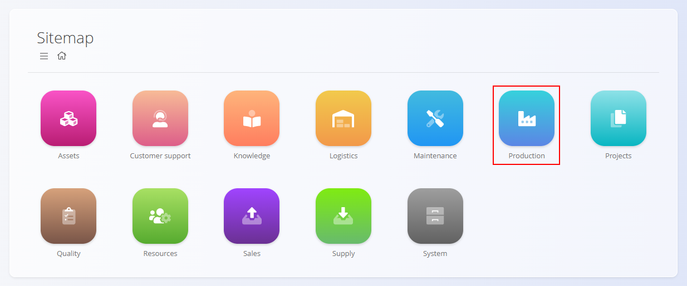
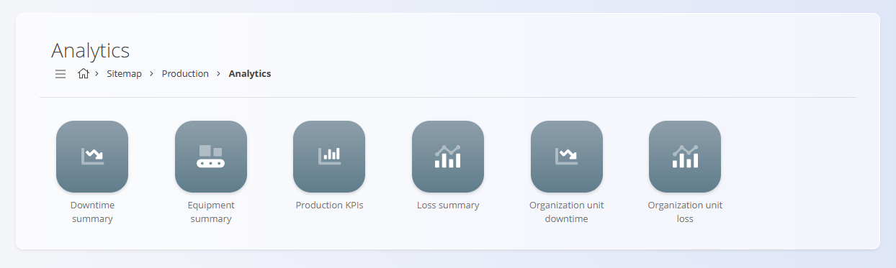
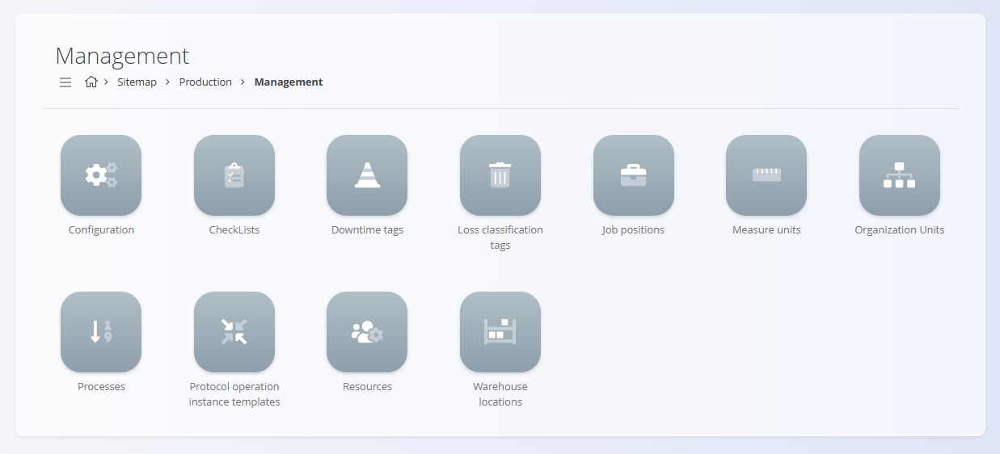

<!-- app_route: /sitemap/production -->
<!-- app_label: Proizvodnja -->
<!-- canonical_source_url: https://github.com/Tom-PIT/Connected.Docs/blob/main/hr/Domene/Proizvodnja/README.md -->
<!-- canonical_source_title: Proizvodnja -->

# Proizvodnja

Domena **Proizvodnja** upravlja svim procesima povezanima s proizvodnjom, izvođenjem u pogonu i analizom proizvodnje. Sadrži alate za planiranje i izdavanje proizvodnih naloga, izvođenje operacija, praćenje potrošnje i proizvodnje te pregled analitike učinkovitosti.

Dok domena **[Nabava](../Nabava/README.md)** osigurava dostupnost materijala, domena Proizvodnja osigurava da se ti materijali pretvore u gotove proizvode ili poluproizvode kroz kontrolirane i sljedive tijekove rada.

Za pristup domeni otvorite **Proizvodnja** u [navigaciji](../../Zajednicko/UI/Navigacija.md).

> [!NOTE]  
> Dostupnost proizvodnih funkcionalnosti ovisi o proizvodnoj konfiguraciji tvrtke, procesima i postavkama resursa.

## Što sadrži domena Proizvodnja?

Domena je organizirana u sljedeća funkcionalna područja:

- **[Proizvodni nalozi](Dokumenti/ProizvodniNalozi.md)** – definiranje i izvođenje proizvodnog rada  
- **[Izvedba](Dokumenti/Izvedba.md)** – evidentiranje aktivnosti u pogonu u stvarnom vremenu  
- **[Zahtjevi](Dokumenti/Zahtjevi.md)** – zbirne potrebe za materijalom za planiranu proizvodnju  
- **[Analiza](#analiza)** – uvid u zastoje, učinkovitost, gubitke, OEE i ključne pokazatelje  
- **[Upravljanje](#upravljanje)** – konfiguracija, oblikovanje procesa i matični podaci  

## Proizvodni nalozi

Odjeljak **[Proizvodni nalozi](Dokumenti/ProizvodniNalozi.md)** sadrži osnovne dokumente za planiranje i izvođenje proizvodnje. Definira što treba proizvesti, prema kojoj verziji procesa, u kojoj količini i pod kojim uvjetima.

Proizvodni nalozi prolaze kroz životni ciklus **Nacrt → U pripremi → Aktivan → Zatvoren** i čine osnovu svih aktivnosti izvođenja.

> [!TIP]
> Za pregled izrade novog proizvodnog naloga korak po korak pogledajte [**Kako kreirati proizvodni nalog**](Dokumenti/ProizvodniNaloziIzrada.md).

## Izvedba

Modul **[Izvedba](Dokumenti/Izvedba.md)** koriste proizvodni radnici za evidentiranje u stvarnom vremenu: proizvedenih količina, utrošenih materijala, zastoja, gubitaka, kontrolnih popisa i rada.

Izvedba osigurava točno prikupljanje podataka, što omogućuje pouzdanu analitiku i sljedivost.

> [!TIP]
> Za pregled tijeka izvođenja korak po korak pogledajte [**Execution – Quick User Guide**](../../Uvod/ExecutionQuickUserGuide.md).

## Zahtjevi

Stranica **[Zahtjevi](Dokumenti/Zahtjevi.md)** objedinjuje sve planirane ulazne materijale proizvodnih naloga u odabranom razdoblju. Prikazuje:

- potrebne i dostupne količine materijala  
- zahtjeve grupirane po materijalu  
- izravne poveznice na proizvodne naloge i operacije koje troše te materijale  

## Analiza

Odjeljak **Analiza** pruža uvid u učinkovitost proizvodnje, zastoje, kvalitetu, raspodjelu gubitaka i OEE.

Dostupni analitički prikazi:

- **[Sažetak zastoja](Analiza/SazetakZastoja.md)** – pregled uzroka, trajanja i utjecaja zastoja.
- **[Sažetak stroja](Analiza/SazetakStroja.md)** – pokazatelji dostupnosti, vremena rada i iskorištenosti strojeva.
- **[Ključni pokazatelji uspješnosti proizvodnje](Analiza/KljucniPokazateljiProizvodnje.md)** – pokazatelji protoka, iskoristivosti, vremena ciklusa i učinkovitosti.
- **[Sažetak gubitka (škarta)](Analiza/SazetakGubitka.md)** – raspodjela gubitaka (škart, dorada, neučinkovitost) po kategorijama.
- **[Organization unit downtime](Analiza/OrganizationUnitDowntime.md)** – analiza zastoja po organizacijskoj jedinici.
- **[Organization unit loss](Analiza/OrganizationUnitLoss.md)** – analiza gubitaka po organizacijskoj jedinici.
- **[Pregled troška verzije](Analiza/TrosakVerzije.md)** – procijenjeni trošak proizvodnje po komadu za određenu verziju procesa, uključujući materijale, rad i troškove.

Ti uvidi podržavaju planiranje proizvodnje, kontinuirano poboljšanje i donošenje operativnih odluka.

## Upravljanje

Odjeljak **Upravljanje** sadrži konfiguraciju, definicije procesa i šifrarnike povezane s proizvodnjom koji su potrebni za nesmetan rad.

Dostupne postavke i šifrarnici:

- **[Konfiguracija proizvodnje](Upravljanje/KonfiguracijaProizvodnje.md)** – globalne postavke proizvodnje za numeriranje i ponašanje.
- **[Kontrolni popisi](../Kvaliteta/Upravljanje/KontrolniPopisi.md)** – kontrolni popisi kvalitete i procesa koji se koriste tijekom izvođenja.
- **[Oznake zastoja](Upravljanje/OznakeZastoja.md)** – klasifikacija razloga zastoja za analizu.
- **[Oznake klasifikacije gubitka (škarta)](Upravljanje/OznakeKlasifikacijeGubitka.md)** – standardne kategorije za evidentiranje i izvještavanje o gubicima.
- **[Sistematizacija radnih mjesta](Upravljanje/SistematizacijaRadnihMjesta.md)** – uloge i radna mjesta osoblja u pogonu.
- **[Mjerne jedinice](../../Zajednicko/Upravljanje/MjerneJedinice.md)** – jedinstvene mjerne jedinice u proizvodnji.
- **[Organizacijske jedinice](Upravljanje/OrganizacijskeJedinice.md)** – hijerarhijske proizvodne jedinice za planiranje i analitiku.
- **[Procesi](Upravljanje/Procesi.md)** i **[Operacije](Upravljanje/Operacije.md)** – definicije proizvodnih procesa, verzija, operacija, unosa i izlaza.
- **[Pravilnici za operacije](Upravljanje/PravilniciZaOperacije.md)** – predlošci za protokole operacija korak po korak.
- **[Resursi](../Resursi/Upravljanje/Resources.md)** – ljudski i fizički resursi koji se koriste u proizvodnji.
- **[Ljudski resursi](Upravljanje/LjudskiResursi.md)** – osobe i uloge dodijeljene proizvodnim operacijama.
- **[Fizički resursi](Upravljanje/FizickiResursi.md)** – strojevi, alati i oprema koji se koriste u proizvodnim operacijama.
- **[Unosi](Upravljanje/Unosi.md)** – ulazni materijali i definicije potrošnje za operacije.
- **[Izlazi](Upravljanje/Izlazi.md)** – proizvedeni artikli i nusproizvodi definirani po operaciji.
- **[Troškovi operacije](Upravljanje/TroskoviOperacije.md)** – kategorije troškova i obračun troškova za operacije.
- **[Kontrolni popisi izvođenja](Upravljanje/KontrolniPopisiKvalitete.md)** – kontrolni popisi i kontrole kvalitete specifični za proizvodnju.
- **[Skladišne lokacije](Upravljanje/SkladisneLokacije.md)** – logističke lokacije za pripremu i skladištenje u proizvodnji.

Ti elementi određuju ponašanje proizvodnje: dostupnost resursa, strukturu procesa, postavke operacija, kontrole kvalitete i klasifikaciju za analitiku.

> [!NOTE]
> Za pregled konfiguracije potrebne za početak proizvodnje korak po korak pogledajte vodič [**Kako kreirati proces**](Upravljanje/ProcesiIzrada.md).

> [!TIP]
> Pregled svih šifrarnika dostupan je u **[Indeksu upravljanja](../../IndeksUpravljanja.md)**.

## Životni ciklus proizvodnog procesa

Proizvodne aktivnosti obično slijede ovaj redoslijed:

### **1. Oblikovanje procesa**  
Konfiguriraju se procesi i verzije, uključujući operacije, unose, izlaze, resurse i kontrolne popise.

### **2. Izrada proizvodnog naloga**  
Proizvodni nalog izrađuje se na temelju potražnje za proizvodom ili planiranja.

### **3. Izvođenje**  
Radnici u stvarnom vremenu evidentiraju napredak, zastoje, gubitke i potrošnju materijala.

### **4. Dovršetak**  
Operacije se dovršavaju, rezultati se evidentiraju i proizvodni nalog se zatvara.

### **5. Analiza**  
Analitika pruža uvid u učinkovitost, kvalitetu, uzroke zastoja i učinak resursa.

## Proizvodnja i druge domene

Proizvodnja je povezana s nekoliko drugih operativnih domena:

| Područje | Povezanost |
|----------|------------|
| **[Materijali](../RobaIUsluge/Materijali/README.md)** | Definira što se proizvodi i troši. |
| **[Nabava](../Nabava/README.md)** | Osigurava materijale potrebne za proizvodnju. |
| **[Logistika](../Logistika/README.md)** | Upravlja skladišnim kretanjima utrošenih i proizvedenih artikala. |
| **[Održavanje](../Odrzavanje/README.md)** | Dijeli procese, organizacijske jedinice, resurse i kontrolne popise; nalozi za održavanje mogu koristiti rasporede temeljene na vremenu ili brojaču i povezivati se s proizvodnim resursima i brojačima. |
