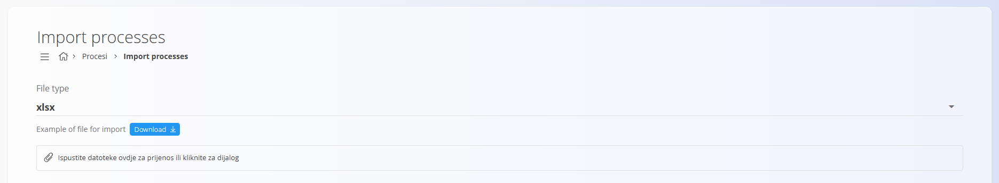
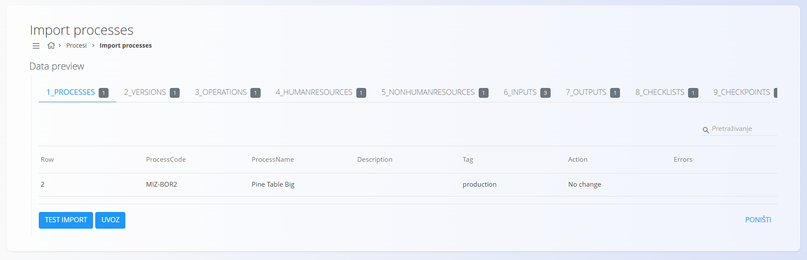
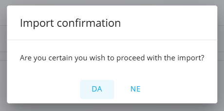
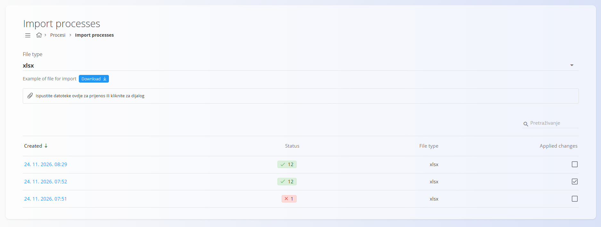
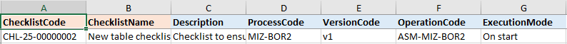

<!-- app_route: /management/processes/import -->
<!-- app_label: Import processes -->
<!-- canonical_source_url: https://tom-pit.github.io/Connected.Docs/hr/Domene/Proizvodnja/Upravljanje/UvozProcesa/ -->
<!-- canonical_source_title: Import processes -->

# Uvoz procesa

Ovaj dokument opisuje kako dodati više procesa odjednom, zajedno s njihovim verzijama, operacijama, resursima, materijalima i kontrolnim popisima, iz datoteke Excel. Uvoz se provodi na zaslonu [Procesi](Procesi.md).

> [!WARNING]
> **Preduvjeti**
> Prije uvoza u Connected moraju već postojati: materijali, radnici i strojevi, kategorije resursa, kompetencije, radna mjesta i organizacijske jedinice. Uvoz ih ne stvara.

Uvozu pristupate tako da otvorite popis **Procesi**, kliknete [akcijski gumb](../../../Zajednicko/UI/AkcijskiGumb.md) i odaberete **Uvoz**.

## Shema

Popis uvoza prikazuje sve učitane datoteke.

| Polje | Opis |
|-------|------|
| **Created** | Datum i vrijeme učitavanja datoteke. Kliknite ga da vidite rezultate. |
| **Status** | Broj stavki u datoteci. Zelena kvačica znači da je uvoz završen. Crveni križ prikazuje broj stavki koje nisu uspjele. |
| **File type** | Format učitane datoteke. Podržana je samo datoteka **xlsx**. |
| **Applied changes** | Označeno kada su promjene upisane u Connected. Nije označeno za testni ili neuspjeli uvoz. |

## Tip datoteke

Uvoz prihvaća samo format **xlsx**. Kliknite **Download** uz **Example of file for import** da preuzmete predložak. Predložak sadrži tražene listove i stupce u ispravnom redoslijedu.

## Učitavanje datoteke

1. Ispunite listove predloška (vidi odjeljak Listovi predloška).
2. Datoteku povucite u područje za učitavanje ili kliknite na njega i odaberite datoteku. Otvara se **Data preview** s karticom za svaki list. Svaka kartica prikazuje broj redaka, radnju za svaki redak (npr. **No change**) i eventualne greške.

   

3. Kliknite **TEST IMPORT** da provjerite datoteku bez promjene podataka.
4. Ako provjera nema grešaka, kliknite **UVOZ**. U dijalogu **Import confirmation** potvrdite klikom na **DA**.

   

## Rezultati uvoza

Svaki uvoz je naveden na popisu uvoza. Kliknite datum u stupcu **Created** da vidite rezultate i eventualne greške.

Rezultati prikazuju ukupan broj stavki, broj neuspjelih stavki te za svaku vrstu zapisa koliko ih je novo, a koliko ažurirano.

## Listovi predloška

Listovi su povezani šiframa: proces, verzija, operacija, zatim resursi, ulazi, izlazi i kontrolni popisi.

| List | Sadržaj |
|------|---------|
| **1_Processes** | Šifra procesa, naziv, opis i oznaka. Oznaka **production** dodaje se automatski. |
| **2_Versions** | Verzije svakog procesa, npr. v1. |
| **3_Operations** | Operacije svake verzije redom, s organizacijskom jedinicom. |
| **4_HumanResources** | Radnici, radna mjesta ili kompetencije potrebni za svaku operaciju. |
| **5_NonHumanResources** | Strojevi ili kategorije resursa potrebni za svaku operaciju. |
| **6_Inputs** | Ulazni materijali svake operacije. |
| **7_Outputs** | Izlazni materijali svake operacije. Za glavni izlaz postavite **OutputType** na **Main**. |
| **8_Checklists** | Kontrolni popisi, određeni **ChecklistCode**. Po želji povezani s operacijom pomoću **ExecutionMode**. Vidi odjeljak [Kontrolni popisi](#kontrolni-popisi). |
| **9_CheckPoints** | Koraci svakog kontrolnog popisa. |
| **Lists** | Moguće vrijednosti padajućih popisa, npr. **Tag**, **ExecutionMode**, **TimeUnit** i **Calculation**. |

> [!WARNING]
> - Ne preimenujte listove i ne mijenjajte prvi redak. Zamijenite primjer u retku 2.
> - Prvi stupac svakog lista mora biti popunjen. Čitanje lista staje na prvom praznom retku.
> - Narančasti stupci su obavezni, plavi neobavezni.
> - Za stupce s padajućim popisom koristite točno vrijednosti s lista **Lists**.
> - Listovi bez podataka se zanemaruju. Za uvoz samo kontrolnih popisa popunite **8_Checklists** i **9_CheckPoints**, a ostale listove ostavite praznima.

- **Calculation** ima dvije mogućnosti:
  - **Dynamic** (zadano): vrijeme se mijenja ovisno o količini naloga.
  - **Static**: vrijeme je fiksno za nalog, npr. za pripremu stroja.
- Primjer: 0,24 minute uz **Dynamic** za nalog od 1000 komada iznosi 240 minuta.

## Kako uvoz radi

- Uvoz upisuje sve ili ništa. Ako datoteka sadrži grešku, ništa se ne uvozi.
- Retci su povezani šiframa. Svaki redak mora upućivati na proces, verziju i operaciju koji su u datoteci ili već postoje u Connected.
- Novi procesi, verzije, operacije, resursi, ulazi, izlazi i kontrolni popisi se stvaraju. Postojeći zapisi podudaraju se po šiframa: resursi po nazivu, kontrolni popisi po **ChecklistCode**, kontrolne točke po uputi. Podudarajući zapisi ažuriraju se na vrijednosti iz datoteke.
- Ništa se ne briše. Zapisi koji nisu u datoteci ostaju nepromijenjeni.
- Ako proces već ima omogućenu verziju, nova verzija se uvozi kao onemogućena.
- Zaključane verzije ne mogu se ažurirati.

## Kontrolni popisi

Kontrolne popise možete stvoriti ili ažurirati i bez uvoza procesa. Kontrolni popisi određeni su **ChecklistCode** na listu **8_Checklists**, a njihove kontrolne točke navedene su na listu **9_CheckPoints** s istom šifrom.

Odaberite mogućnost koja odgovara vašem cilju:

- **Stvorite novi kontrolni popis.** Upotrijebite **ChecklistCode** koji još ne postoji. Na **8_Checklists** upišite **ChecklistName** i **Description**, a na **9_CheckPoints** dodajte kontrolne točke. Za povezivanje s operacijom ispunite i **ProcessCode**, **VersionCode** i **OperationCode** te postavite **ExecutionMode**.
- **Ažurirajte postojeći kontrolni popis.** Upotrijebite šifru postojećeg kontrolnog popisa. Promijenite **ChecklistName** i **Description** na **8_Checklists** i navedite kontrolne točke na **9_CheckPoints**. Postojeće kontrolne točke podudaraju se po uputi. Ažurirane upute mijenjaju kontrolne točke, a nove upute dodaju se kao nove kontrolne točke.
- **Dodajte postojeći kontrolni popis novom procesu.** Na **8_Checklists** upotrijebite šifru postojećeg kontrolnog popisa i ispunite **ProcessCode**, **VersionCode** i **OperationCode** za novu operaciju te **ExecutionMode**. Retke tog kontrolnog popisa ne upisujte na **9_CheckPoints**, kako bi kontrolne točke ostale iste. Ne mijenjajte **ChecklistName** i **Description**, jer bi se prepisale trenutne vrijednosti.

> [!WARNING]
> Ažuriranje postojećeg kontrolnog popisa mijenja ga za sve procese koji ga koriste, ne samo za proces u datoteci.

Ništa se ne briše. Kontrolne točke koje nisu u datoteci ostaju na kontrolnom popisu.

Za uvoz samo kontrolnih popisa popunite samo **8_Checklists** i **9_CheckPoints**, a listove procesa ostavite praznima. Polja procesa na **8_Checklists** mogu ostati prazna, pa se kontrolni popis stvara ili ažurira bez povezivanja s operacijom. Operacija mora već postojati u Connected ako kontrolni popis na taj način povezujete s njom.
