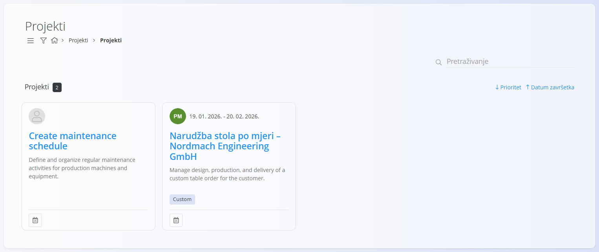
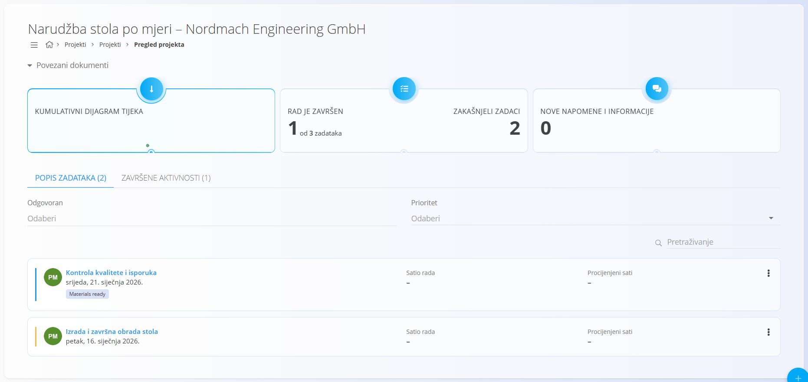
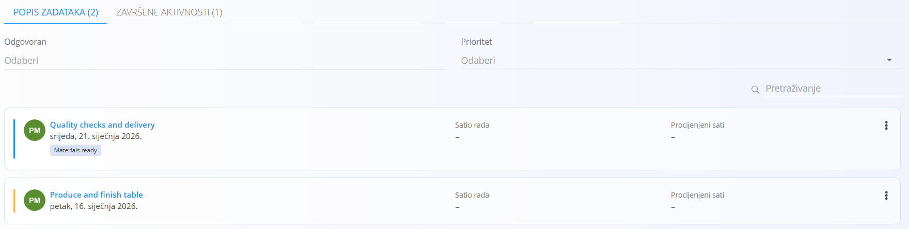
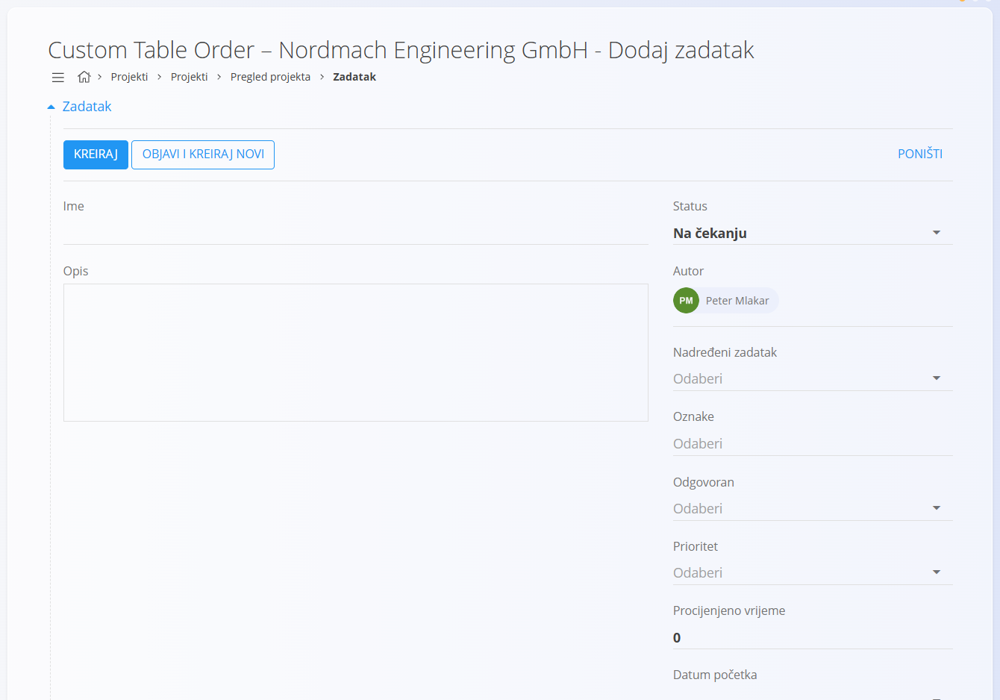
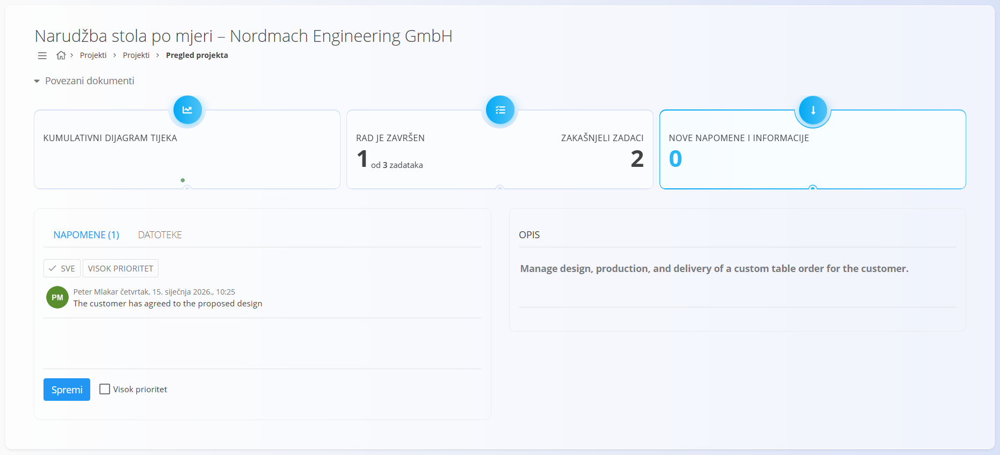

<!-- app_route: /projects/projects -->
<!-- app_label: Projekti -->
<!-- canonical_source_url: https://github.com/Tom-PIT/Connected.Docs/blob/main/hr/Domene/Projekti/Dokumenti/Projekti.md -->
<!-- canonical_source_title: Projekti -->

# Projekti

Odjeljak **Projekti** pruža pregled tekućih i dovršenih projekata i služi kao glavni radni prostor za **praćenje napretka i izvođenje zadataka** unutar projekta.

Projekti se izrađuju i konfiguriraju u **[Upravljanju projektima](../Upravljanje/UpravljanjeProjektima.md)**.
Ovaj odjeljak usredotočen je na **rad s postojećim projektima**: praćenje statusa, pregled zadataka i suradnju tijekom izvođenja.

Za pristup projektima u [navigaciji](../../../Zajednicko/UI/Navigacija.md) idite na **Projekti / Projekti**.

## Životni ciklus projekta

Projekt može biti u jednom od sljedećih stanja:
- **Na čekanju** — isplanirano, ali još nije započeto
- **Aktivan** — trenutno se izvodi
- **Zatvoren** — dovršeni projekti

Status projekta odražava ukupni napredak, a upravlja se u **[Upravljanju projektima](../Upravljanje/UpravljanjeProjektima.md)**.

## Pregled projekata

Stranica Projekti prikazuje sve dostupne projekte kao kartice.

Svaka kartica projekta prikazuje:
- **naziv projekta**
- **kratki opis**
- **planirani raspon datuma**
- **oznake** (ako su definirane)
- **pokazatelj prioriteta** (ako je definiran)

Kliknite karticu projekta da otvorite **prikaz projekta**.

### Filtri i sortiranje

Filtrima s lijeve strane sužavate popis:

- **Status**
  - Čeka na obradu
  - Aktivan
  - Zatvoren
- **Datumi**
- **Voditelj projekta**
- **Oznake**
- **Dodijeljeni članovi**
- **Kupac**

Projekte možete sortirati po **prioritetu** ili **datumu završetka** pomoću kontrola u gornjem desnom kutu.

## Prikaz projekta

Kliknite projekt da otvorite **prikaz projekta**, koji pruža potpun pregled projekta i njegova statusa izvođenja.

Prikaz projekta podijeljen je na tri glavna područja:
- pregled projekta i pokazatelji
- zadaci (popis zadataka i završene aktivnosti)
- bilješke i privici

## Pregled projekta i pokazatelji

Pri vrhu prikaza projekta ključni pokazatelji daju brz sažetak izvođenja projekta.

Svi pokazatelji su **klikabilni** i otvaraju dodatne prikaze ili pojedinosti:
- **Kumulativni dijagram tijeka** otvara vizualni prikaz tijeka zadataka kroz vrijeme
- **Rad je završen** prikazuje napredak na temelju završenih zadataka
- **Zakašnjeli zadaci** ističe zadatke kojima je istekao rok
- **Nove napomene i informacije** otvaraju **prikaz napomena** za projekt

Ti pokazatelji korisnicima omogućuju brzu procjenu statusa projekta bez napuštanja projekta.

## Pregled zadataka

Ispod pokazatelja projekt prikazuje svoje zadatke.

Zadaci se uvijek izrađuju **unutar projekta** i predstavljaju stvarni posao potreban za njegov dovršetak.

Iz ovog prikaza korisnici mogu:
- vidjeti sve zadatke koji pripadaju projektu
- provjeriti status i prioritet zadatka
- otvoriti pojedinačne zadatke
- pratiti utrošene i procijenjene sate (ako su definirani)

Ovaj zaslon pruža **pregled zadataka na razini projekta**.
Pojedinosti o izvođenju zadataka, evidentiranju rada i upravljanju statusom opisane su i u odjeljku **[Zadaci](Zadaci.md)**.

## Izrada novog zadatka

Zadaci se izrađuju **iz projekta**.

Kliknite [akcijski gumb](../../../Zajednicko/UI/AkcijskiGumb.md) u prikazu projekta da otvorite obrazac **Dodaj zadatak**.

Obrazac za izradu zadatka sadrži:
- **Ime**
- **Opis**
- **Status**
- **Autor**
- **Odgovoran**
- **Prioritet**
- **Procijenjeno vrijeme**
- **Datum početka**
- **Datum završetka**

> [!NOTE]
>
> Pojedinosti o poljima zadatka i njihovom upravljanju potražite u posebnoj dokumentaciji za **[Zadatke](Zadaci.md)**.

Kad je zadatak spreman, kliknite **Kreiraj**.

Ako trebate izraditi više zadataka za projekt, možete upotrijebiti gumb **Objavi i kreiraj novi**, koji objavljuje zadatak i otvara novi obrazac za izradu sljedećeg.

Nakon izrade zadatak odmah postaje dio zaostalih zadataka projekta.

## Napomene i suradnja

Svaki projekt ima odjeljak **Napomene** koji služi za komunikaciju i dokumentiranje tijekom izvođenja.

Iz ovog odjeljka korisnici mogu:
- dodavati bilješke povezane s projektom
- označiti napomene kao visokog prioriteta
- priložiti datoteke (kartica **Datoteke**)
- pregledati opis projekta

Napomene pružaju središnje mjesto za odluke, ažuriranja i zajedničke informacije vezane uz projekt.
