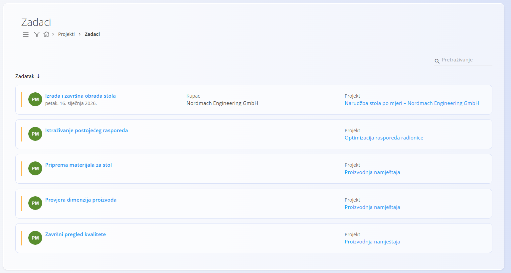
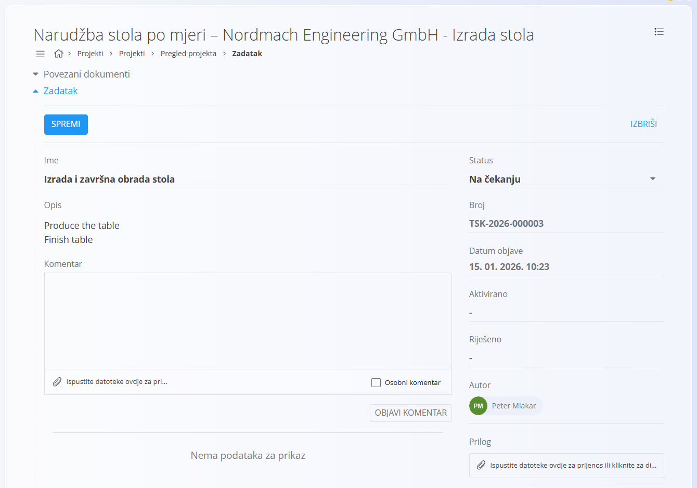
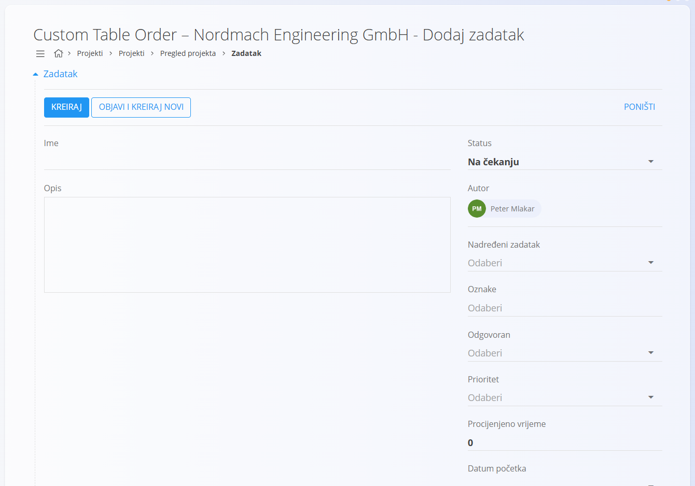
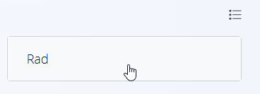
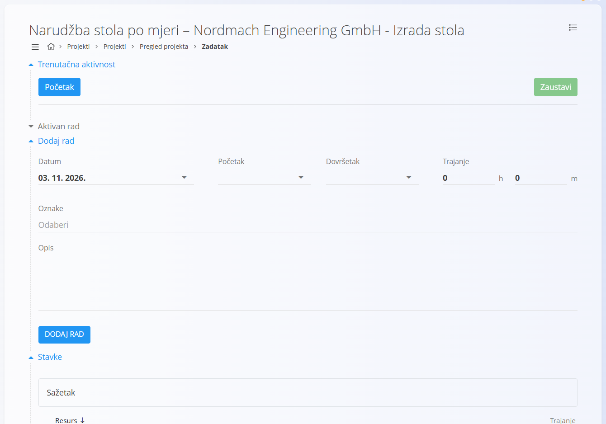
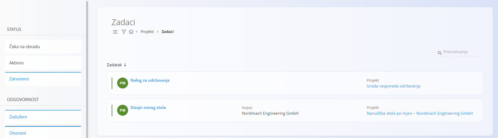

<!-- app_route: /projects/tasks -->
<!-- app_label: Zadaci -->
<!-- canonical_source_url: https://github.com/Tom-PIT/Connected.Docs/blob/main/hr/Domene/Projekti/Dokumenti/Zadaci.md -->
<!-- canonical_source_title: Zadaci -->

# Zadaci

Zaslon **Zadaci** pruža centralizirani pregled svih zadataka projekata.
Koriste ga i voditelji i radnici za praćenje napretka, otvaranje pojedinačnih zadataka i evidentiranje rada.

Zadaci uvijek pripadaju **projektu** i ne mogu postojati samostalno.

Za pristup zaslonu Zadaci u [navigaciji](../../../Zajednicko/UI/Navigacija.md) idite na **Projekti / Zadaci**.

## Shema

| Polje | Opis |
|-----------------|------------------------------------------------------------------|
| **Naziv** | Naslov zadatka prikazan na popisima i u prikazima projekta (obavezno) |
| **Opis** | Detaljno objašnjenje posla koji treba obaviti |
| **Status** | Trenutno stanje zadatka prema **Kanban stupcima** definiranima za [projekt](../Upravljanje/UpravljanjeProjektima.md) |
| **Broj zadatka** | Automatski dodijeljen jedinstveni identifikator |
| **Datum objave** | Datum i vrijeme kad je zadatak izrađen |
| **Autor** | Korisnik koji je izradio zadatak |
| **Odgovoran** | Korisnik dodijeljen za izvođenje zadatka |
| **Procijenjeno vrijeme** | Procijenjeni rad ili trajanje zadatka |
| **Datum početka** | Planirani datum početka |
| **Datum završetka** | Planirani datum završetka |
| **Privici** | Datoteke priložene za podršku izvođenju zadatka (dokumenti, slike i sl.) |
| **Nadređeni zadatak** | (Neobavezno) Poveznica na drugi zadatak radi hijerarhijske strukture |

## Popis zadataka

Popis prikazuje zadatke svih projekata koji odgovaraju odabranim filtrima.

Svaka kartica zadatka prikazuje:
- **naziv zadatka**
- **kupca**
- **projekt**
- **trenutni status**

Kliknite zadatak da otvorite njegov **prikaz pojedinosti zadatka**.

### Filtri

Lijevi panel omogućuje filtriranje zadataka po:

- **Status**
  - Čeka na obradu
  - Aktivno
  - Zatvoreno
- **Odgovornost**
  - Zaduženi
  - Otvoreni
- **Odgovorni**
- **Projekt**
- **Datumi**
- **Oznaka**
- **Kupac**
- **Voditelj projekta**

Filtre možete kombinirati kako biste brzo suzili popis na relevantne zadatke.

## Uređivanje zadatka

Kliknite zadatak da otvorite **zaslon s pojedinostima zadatka**, na kojem korisnici mogu pregledati podatke, dodavati komentare, prilagati datoteke i evidentirati rad.

## Izrada zadatka

Zadaci se izrađuju **iz projekta**, a ne s popisa zadataka.

Za izradu zadatka:
1. Otvorite projekt na zaslonu [**Projekti**](Projekti.md)
2. Kliknite [akcijski gumb](../../../Zajednicko/UI/AkcijskiGumb.md)
3. Ispunite pojedinosti zadatka i kreirajte zadatak

## Tijek rada sa zadacima

Zadaci podržavaju jednostavan i fleksibilan tijek rada koji odražava način na koji se posao zapravo obavlja.
Kako rad napreduje, korisnici ažuriraju **status zadatka**, po želji evidentiraju **rad** i dodaju **komentare ili privitke** prema potrebi.

### 1. Započinjanje rada na zadatku

Kad radnik otvori zadatak s popisa zadataka ili iz projekta:

- prikazuju se pojedinosti zadatka
- trenutni **status** odražava položaj zadatka u tijeku rada projekta
- vidljivi su komentari, privici i prethodne aktivnosti

Zadaci su spremni za rad odmah nakon izrade.

### 2. Ažuriranje statusa zadatka (Kanban tijek rada)

Svaki zadatak ima polje **Status**.
Dostupne vrijednosti statusa dolaze iz **Kanban stupaca definiranih za projekt**.

Tipični primjeri:
- Review requirements
- Design & preparation
- Materials ready
- Production
- Finishing and quality checks
- Delivery

Kako rad napreduje, radnik ažurira zadatak tako da:
1. odabere novi **Status** iz padajućeg izbornika
2. spremi zadatak

Tako zadatak prolazi kroz tijek rada projekta korak po korak, što daje jasnu preglednost i radnicima i voditeljima.

> Životni ciklus zadatka (Na čekanju → Aktivno → Zatvoreno) pokreću te promjene statusa.

### 3. Evidentiranje rada (neobavezno)

Dok radi na zadatku, korisnik može evidentirati vrijeme provedeno na njemu.
Evidentiranje rada je **neobavezno** i ovisi o pravilima specifičnima za tvrtku.

Za evidentiranje rada:
1. u prikazu pojedinosti zadatka otvorite odjeljak **Rad** pomoću izbornika radnji

   

2. odaberite način evidentiranja
3. spremite unos rada

#### Trenutačna aktivnost (Početak / Zaustavi)

- kliknite **Početak** za početak praćenja
- radite na zadatku
- kliknite **Zaustavi** za završetak

Vremenski interval evidentira se kad kliknete **Zaustavi**.

#### Ručni unos

Korisnici mogu i ručno unijeti rad navođenjem:
- datuma
- početnog i završnog vremena *ili* ukupnog trajanja
- oznaka (neobavezno)
- opisa (neobavezno)

Kliknite **Dodaj rad** za spremanje unosa.

Na isti zadatak može se dodati više zapisa o radu.

### 4. Suradnja tijekom izvođenja

Tijekom izvođenja zadatka korisnici mogu:
- dodavati komentare radi dijeljenja napretka ili bilješki
- prilagati dokumente, slike ili datoteke
- označiti komentare kao privatne ili visokog prioriteta

Tako je sva komunikacija vezana uz zadatak na jednom mjestu.

### 5. Dovršavanje zadatka

Kad je posao završen:
1. radnik ažurira **Status** na posljednji Kanban stupac (npr. *Delivery*)
2. radnik ili voditelj (ovisno o politici tvrtke) označava zadatak kao **Zatvoren**

Zatvoreni zadaci:
- ostaju vidljivi kad je uključen filtar **Zatvoren**
- čuvaju potpunu povijest komentara, privitaka i evidentiranog rada

