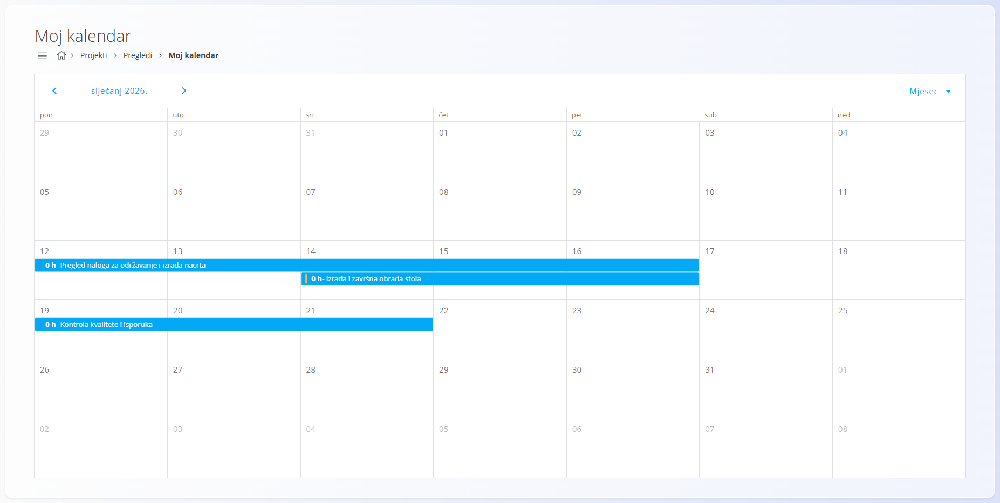
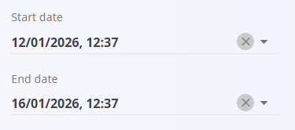

<!-- app_route: /projects/my-calendar -->
<!-- app_label: Moj kalendar -->
<!-- canonical_source_url: https://github.com/Tom-PIT/Connected.Docs/blob/main/hr/Domene/Projekti/Pregledi/MojKalendar.md -->
<!-- canonical_source_title: Moj kalendar -->

# Moj kalendar

Prikaz **Moj kalendar** pruža kalendarski pregled svih **[zadataka dodijeljenih trenutnom korisniku](../Dokumenti/Zadaci.md)**. Pomaže korisnicima razumjeti *kada* je posao planiran i kako su zadaci raspoređeni kroz vrijeme.

Ovom prikazu pristupate u [navigaciji](../../../Zajednicko/UI/Navigacija.md) na način da idete na **Projekti / Pregledi / Moj kalendar**.

## Pregled kalendara

Zadaci se prikazuju u obliku kalendara na temelju njihovih **datuma početka** i **završetka**.

- svaki unos u kalendaru predstavlja zadatak dodijeljen korisniku
- naziv zadatka prikazan je unutar ćelije kalendara
- prikazano trajanje odražava definirane datume početka i završetka zadatka

Dostupni su **mjesečni** i **tjedni** prikaz, a između njih se prebacujete pomoću birača prikaza u gornjem desnom kutu.

## Prikaz zadataka u kalendaru

Da bi se zadatak pojavio u **Mom kalendaru**, mora imati:

- **datum početka**
- **datum završetka**

Ti se datumi definiraju izravno na zadatku.

Nakon što se datumi spreme, zadatak se automatski pojavljuje u kalendaru dodijeljenog korisnika.

## Interakcija s unosima u kalendaru

Kliknite zadatak u kalendaru da otvorite **skočni prozor s pojedinostima zadatka**, u kojem korisnik može:

- pregledati podatke o zadatku
- otići na cjeloviti prikaz zadatka
- nastaviti rad na zadatku (npr. dodavanjem komentara ili evidentiranjem rada)

Tako se zadacima može brzo pristupiti izravno iz kalendara, bez pregledavanja popisa projekata ili zadataka.

## Tipična upotreba

Prikaz **Moj kalendar** obično se koristi za:

- dobivanje osobnog pregleda nadolazećeg posla
- razumijevanje rasporeda zadataka i preklapanja
- brzo otvaranje zadataka planiranih za određeni dan ili razdoblje

Dopunjuje popis **Moji zadaci** jer pruža vremenski usmjerenu perspektivu dodijeljenog posla.

Pojedinosti o strukturi zadatka, životnom ciklusu i evidentiranju rada potražite u:
- **[Zadaci](../Dokumenti/Zadaci.md)** — pojedinosti o izvođenju i praćenju zadataka
- **[Upravljanje projektima](../Upravljanje/UpravljanjeProjektima.md)** — postavljanje i konfiguracija projekata
