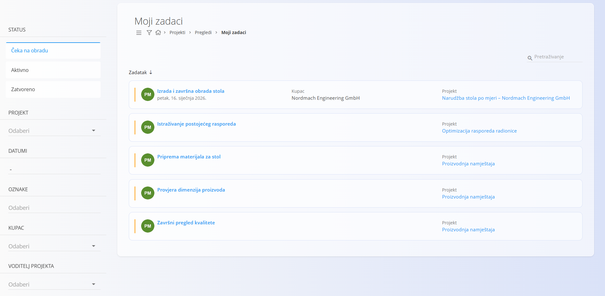

<!-- app_route: /projects/my-tasks -->
<!-- app_label: Moji zadaci -->
<!-- canonical_source_url: https://github.com/Tom-PIT/Connected.Docs/blob/main/hr/Domene/Projekti/Pregledi/MojiZadaci.md -->
<!-- canonical_source_title: Moji zadaci -->

# Moji zadaci

Zaslon **Moji zadaci** pruža personalizirani prikaz svih [zadataka](../Dokumenti/Zadaci.md) **dodijeljenih vama**. Namijenjen je radnicima i voditeljima kako bi se brzo usredotočili na vlastite odgovornosti bez pregledavanja svih projekata.

Zadaci prikazani ovdje uvijek pripadaju nekom [projektu](../Dokumenti/Projekti.md), ali je popis filtriran tako da uključuje samo zadatke relevantne za trenutnog korisnika.

Zaslonu **Moji zadaci** pristupate u [navigaciji](../../../Zajednicko/UI/Navigacija.md) na način da idete na **Projekti / Pregledi / Moji zadaci**.

## Popis mojih zadataka

Popis prikazuje zadatke dodijeljene vama koji odgovaraju odabranim filtrima.

Svaka kartica zadatka prikazuje:
- **naziv zadatka**
- **kupca**
- **projekt**
- **trenutni status**

Kliknite zadatak da otvorite njegov **prikaz pojedinosti**, gdje možete pregledati podatke, dodavati komentare, prilagati datoteke i evidentirati rad.

## Filtri

Lijevi panel omogućuje filtriranje vaših zadataka po:

- **Status**
  - Čeka na obradu
  - Aktivan
  - Zatvoren
- **Projekt**
- **Datumi**
- **Oznaka**
- **Kupac**
- **Voditelj projekta**

Filtre možete kombinirati kako biste brzo suzili vlastito opterećenje.

Polje za pretraživanje u gornjem desnom kutu omogućuje pronalaženje određenih zadataka po nazivu.

## Rad sa zadacima

Na zaslonu **Moji zadaci** možete:

- otvoriti dodijeljene zadatke
- pregledati pojedinosti zadatka
- dodavati komentare i privitke
- evidentirati rad i utrošeno vrijeme
- pratiti promjene statusa zadatka

Izvođenje zadataka i rukovanje pojedinostima zadatka jednako su kao u općem prikazu **Zadaci**.

Pojedinosti o strukturi zadatka, životnom ciklusu i evidentiranju rada potražite u:
- **[Zadaci](../Dokumenti/Zadaci.md)** — pojedinosti o izvođenju i praćenju zadataka
- **[Upravljanje projektima](../Upravljanje/UpravljanjeProjektima.md)** — postavljanje i konfiguracija projekata
