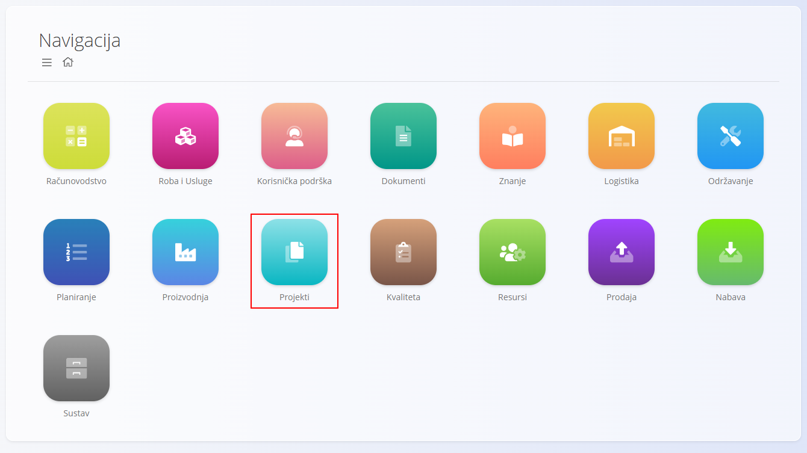
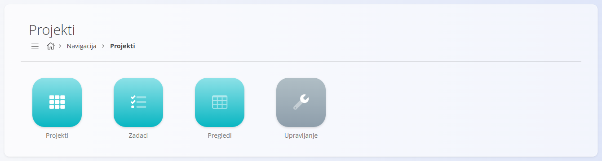
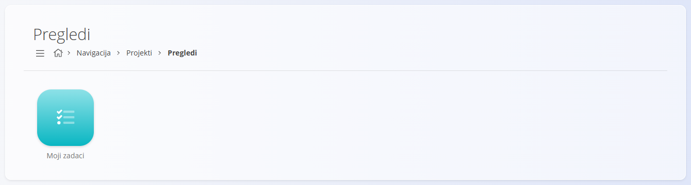
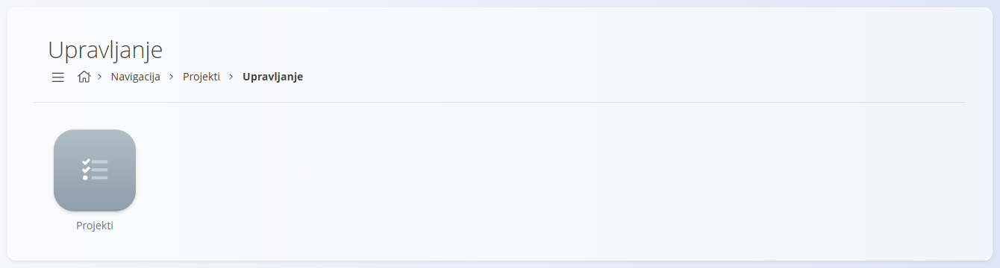

<!-- app_route: /sitemap/projects -->
<!-- app_label: Projekti -->
<!-- canonical_source_url: https://github.com/Tom-PIT/Connected.Docs/blob/main/hr/Domene/Projekti/README.md -->
<!-- canonical_source_title: Projekti -->

# Projekti

Domena **Projekti** podržava strukturirano planiranje, izvođenje i praćenje projektnog rada unutar vaše organizacije.
Pruža alate za organizaciju projekata, upravljanje zadacima, praćenje napretka i personalizirane prikaze za korisnike koji sudjeluju u izvođenju projekata.

Domena Projekti obično se koristi za **interne inicijative**, **aktivnosti koje obuhvaćaju više odjela** ili **rad koji nije proizvodnja** a zahtijeva koordinaciju, praćenje zadataka i preglednost kroz vrijeme.

Za pristup ovoj domeni u [navigaciji](../../Zajednicko/UI/Navigacija.md) odaberite **Projekti**.

> [!NOTE]
> Dostupne domene i funkcionalnosti ovise o konfiguraciji tvrtke i uključenim modulima.

## Što sadrži domena Projekti?

Domena je organizirana u nekoliko funkcionalnih područja:

- **Projekti** – definicije projekata i struktura na visokoj razini
- **Zadaci** – jedinice izvođenja unutar projekata
- **Pregledi** – personalizirani i analitički prikazi zadataka projekata
- **Upravljanje** – konfiguracija i prateće definicije za projekte

## Projekti

Zaslon [**Projekti**](Dokumenti/Projekti.md) središnje je mjesto na kojem se projekti pregledavaju i upravljaju.

Svaki projekt obično predstavlja **inicijativu usmjerenu na cilj** s:
- definiranim opsegom
- vremenskim okvirom
- dodijeljenim sudionicima
- skupom povezanih zadataka

Projekti pružaju strukturni okvir za zadatke i omogućuju praćenje napretka na široj razini.

Projekti djeluju kao organizacijski sloj koji grupira zadatke, korisnike i rokove u jednu cjelinu kojom se lako upravlja.

## Zadaci

Zaslon [**Zadaci**](Dokumenti/Zadaci.md) usredotočen je na **sloj izvođenja** projektnog rada.

Zadaci predstavljaju pojedinačne jedinice rada koje:
- su dodijeljene korisnicima ili ekipama
- imaju statuse i prioritete
- mogu se pratiti kroz vrijeme
- doprinose napretku projekta
- uvijek pripadaju određenom projektu

Ovaj odjeljak obično koriste članovi tima koji obavljaju stvarni rad.

## Pregledi

Odjeljak **Pregledi** pruža perspektive za korisnike i analitičke perspektive o zadacima i projektima.

Dostupni pregledi uključuju:

- [**Moji zadaci**](Pregledi/MojiZadaci.md) – personalizirani popis zadataka dodijeljenih trenutnom korisniku
- [**Moj kalendar**](Pregledi/MojKalendar.md) – kalendarski prikaz zadataka i rokova

Ti su pregledi namijenjeni tome da korisnicima pomognu:
- odrediti prioritete rada
- razumjeti rokove
- učinkovito upravljati opterećenjem

Pregledi su **samo za čitanje** i ne stvaraju niti mijenjaju zadatke ili projekte izravno.

## Upravljanje

Odjeljak [**Upravljanje projektima**](Upravljanje/UpravljanjeProjektima.md) sadrži konfiguraciju i glavne podatke koji definiraju način rada domene Projekti.

Ovo područje obično koriste administratori ili napredni korisnici za:
- definiranje postavki vezanih uz projekte
- konfiguriranje ponašanja zadataka
- upravljanje pomoćnim podacima koji se koriste u svim projektima

Promjene napravljene ovdje utječu na to kako se projekti i zadaci strukturiraju i prikazuju u cijeloj domeni.

> [!TIP]
> Sve stavke upravljanja pogledajte u **[Indeksu upravljanja](../../IndeksUpravljanja.md)**.

## Pregled tijeka rada

Tipičan tijek rada u domeni Projekti sastoji se od sljedećih koraka:

### **1. Definiranje projekta**
- Projekt se stvara kako bi predstavljao određenu inicijativu ili cilj.

### **2. Planiranje zadataka**
- Zadaci se definiraju i povezuju s projektom (ili se upravljaju samostalno).
- Dodjeljuju se odgovornosti i rokovi.

### **3. Izvođenje zadataka**
- Korisnici rade na zadacima, ažuriraju napredak i završavaju dodijeljeni posao.

### **4. Praćenje i koordinacija**
- Napredak se prati kroz popise zadataka i kalendarske prikaze.
- Voditelji i sudionici dobivaju uvid u opterećenje i status.

## Sažetak

Domena Projekti pruža strukturirano okruženje za organizaciju i izvođenje projektnog rada.
Omogućuje:

- jasnu organizaciju projekata
- izvođenje temeljeno na zadacima
- osobnu preglednost zadataka
- planiranje vođeno kalendarom
- koordinaciju među timovima

Podržava timove u upravljanju radom koji ne uklapa u transakcijske ili proizvodne procese, a istodobno je u potpunosti integrirana u širi sustav.
