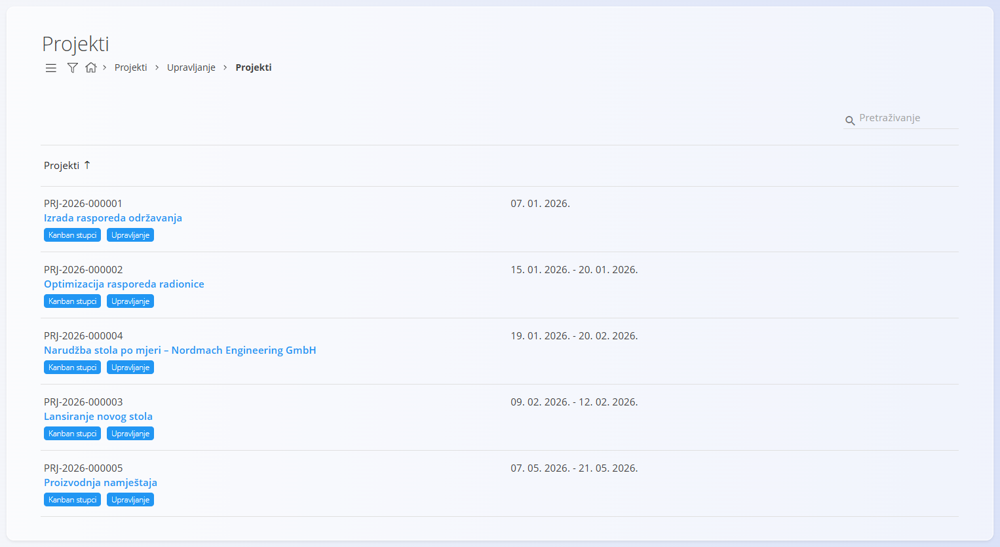
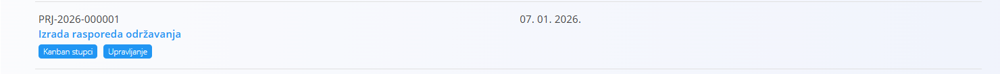
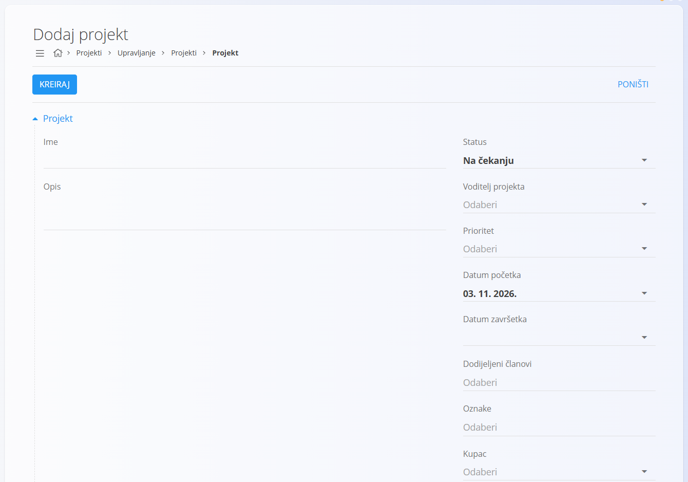
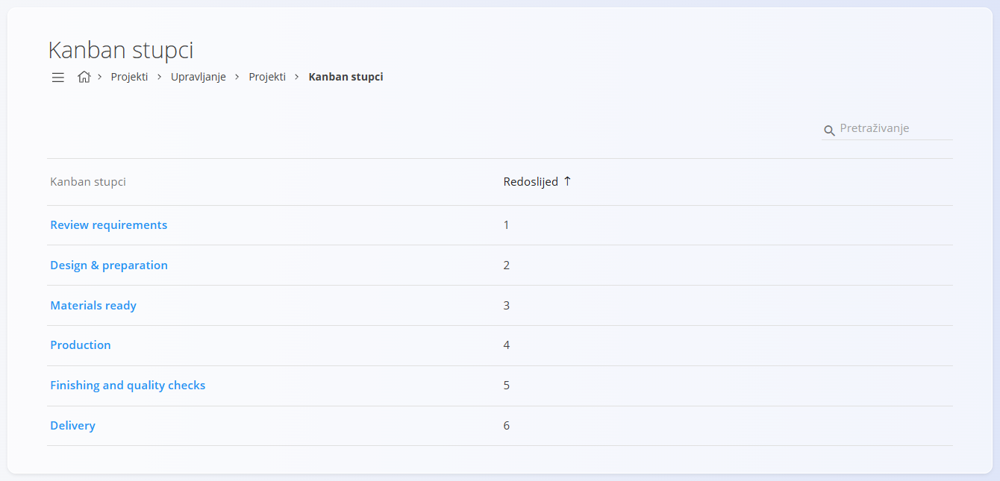
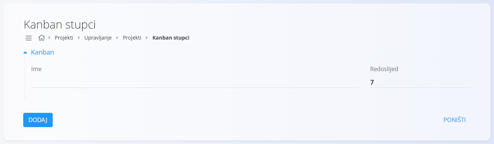
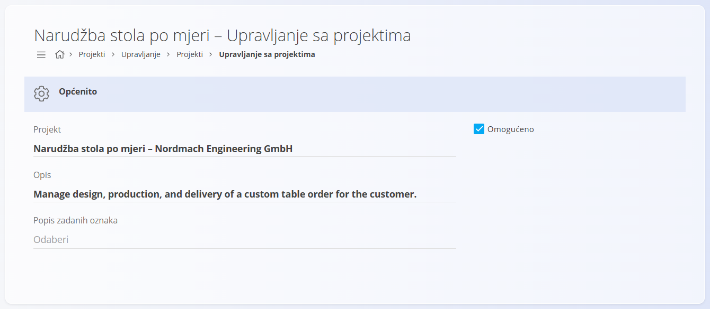

<!-- app_route: /projects/management/projects -->
<!-- app_label: Upravljanje projektima -->
<!-- canonical_source_url: https://github.com/Tom-PIT/Connected.Docs/blob/main/hr/Domene/Projekti/Upravljanje/UpravljanjeProjektima.md -->
<!-- canonical_source_title: Upravljanje projektima -->

# Upravljanje projektima

Upravljanje projektima služi za **izradu, konfiguriranje i održavanje projekata**. Projekti definiraju strukturirani okvir za zadatke, vremenske rokove, odgovornosti i praćenje napretka, a mogu se prikazati i pomoću **Kanban ploča**.

Upravljanju projektima pristupate u [navigaciji](../../../Zajednicko/UI/Navigacija.md) na način da idete na **Projekti / Upravljanje / Projekti**.

## Shema

| Polje | Opis |
|-------------------|---------------------------------------------|
| **Ime** | Naziv projekta (obavezno) |
| **Opis** | Kratki opis projekta |
| **Status** | Trenutni status projekta (Na čekanju, Aktivan, Zatvoren) |
| **Voditelj projekta** | Odgovorna osoba |
| **Prioritet** | Prioritet projekta |
| **Datum početka** | Planirani datum početka |
| **Datum završetka** | Planirani datum završetka |
| **Dodijeljeni članovi** | Korisnici uključeni u projekt |
| **Oznake** | Neobavezna klasifikacija |
| **Kupac** | Kupac povezan s projektom |

## Prikaz popisa

Popis projekata prikazuje sve projekte izrađene u sustavu. Svaki redak prikazuje:
- **šifru i naziv projekta**
- **planirani raspon datuma**
- dodijeljene **oznake**
- pristup konfiguraciji **stupaca Kanban ploče**
- pristup **upravljanju projektom** (zaslon za uređivanje)

### Filtri

S lijeve strane popisa projekte možete filtrirati po:
- **Kupac** (padajući izbornik)
- **Voditelj projekta** (padajući izbornik)

Polje za pretraživanje omogućuje filtriranje po šifri ili nazivu projekta.

## Radnje

### Izrada novog projekta

Kliknite [akcijski gumb](../../../Zajednicko/UI/AkcijskiGumb.md) da izradite novi projekt.

Pri izradi ili uređivanju projekta dostupna su polja opisana u odjeljku [**Shema**](#shema) iznad.

Kliknite **Kreiraj** da spremite projekt.

### Uređivanje projekta

Kliknite projekt na popisu da otvorite zaslon za uređivanje, s istim poljima kao pri izradi novog projekta.

Kad završite s uređivanjem, kliknite **Spremi** da primijenite promjene.

### Stupci Kanban ploče

Svaki projekt može definirati vlastite **stupce Kanban ploče**, koji se koriste za vizualno praćenje napretka zadataka. Kanban stupci vezani su **uz pojedini projekt**.

Za upravljanje Kanban stupcima:
1. otvorite popis **Projekti**
2. kliknite **Stupci Kanban ploče** na željenom projektu

Na zaslonu stupaca Kanban ploče možete:
- dodavati nove stupce
- uređivati nazive postojećih stupaca
- definirati redoslijed stupaca pomoću vrijednosti **Redni broj**

Kanban stupci primjenjuju se samo na odabrani projekt i koriste se pri radu sa zadacima projekta:
- Kanban stupci definiraju faze tijeka rada za zadatke
- određuju koje su vrijednosti dostupne u padajućem izborniku **Status** zadatka

### Zaslon upravljanja

Kliknite gumb **Upravljanje** da otvorite zaslon upravljanja.

S ovog zaslona možete:
- uređivati pojedinosti projekta
- omogućiti ili onemogućiti projekt
- upravljati zadanim oznakama
- pristupiti konfiguraciji Kanban ploče
- izbrisati projekt

### Brisanje projekta

Projekti se mogu izbrisati na zaslonu **upravljanja projektima**. Pri brisanju prikazuje se dijaloški okvir za potvrdu:

*Jeste li sigurni da želite izbrisati zapis?*

Nakon brisanja projekt se trajno uklanja.
