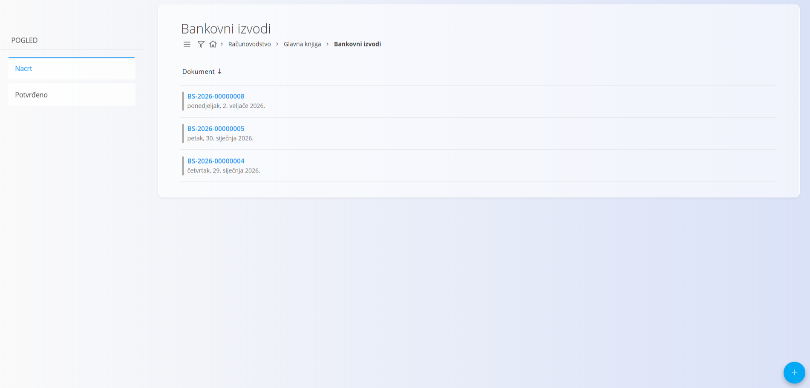
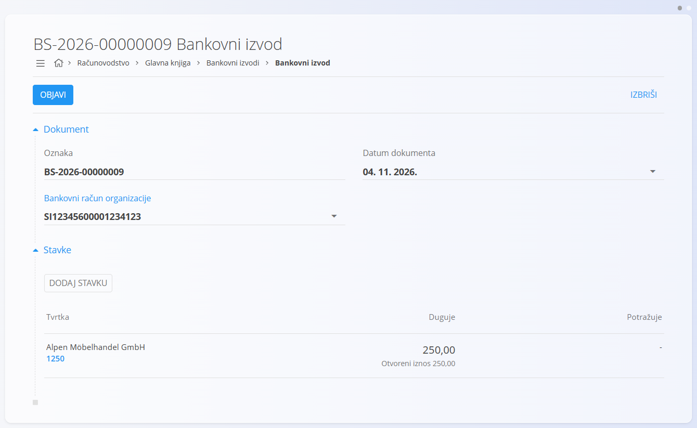
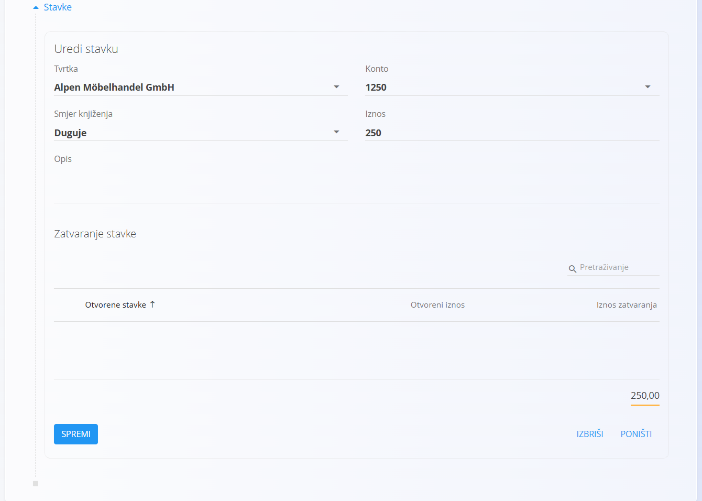

<!-- app_route: /accounting/ledger/bank-statements -->
<!-- app_label: Bankovni izvodi -->
<!-- canonical_source_url: https://github.com/Tom-PIT/Connected.Docs/blob/main/hr/Domene/Racunovodstvo/Dokumenti/BankovniIzvodi.md -->
<!-- canonical_source_title: Bankovni izvodi -->

# Bankovni izvodi

**Bankovni izvodi** služe za evidentiranje kretanja na bankovnim računima organizacije. Svaki bankovni izvod predstavlja skup dolaznih i odlaznih bankovnih transakcija za određeni datum i bankovni račun.

Ovom ekranu pristupate odabirom **Računovodstvo / Glavna knjiga / Bankovni izvodi** u [navigaciji](../../../Zajednicko/UI/Navigacija.md).

> [!NOTE]
> Kada se bankovni izvod objavi, sustav automatski stvara odgovarajuću temeljnicu. Tu temeljnicu možete pogledati pod **Povezani dokumenti** na bankovnom izvodu.

## Shema

<strong>Dokument</strong>

| Polje                         | Opis                                                      |
| ----------------------------- | --------------------------------------------------------- |
| [**Oznaka**](../../../Zajednicko/UI/OznakeDokumenata.md)                      | Identifikator bankovnog izvoda koji generira sustav.      |
| **Datum dokumenta**           | Datum bankovnog izvoda.                                   |
| [**Bankovni račun organizacije**](../../Prodaja/Upravljanje/BankovniRacuniOrganizacije.md) | Bankovni račun na koji se izvod odnosi.                   |

<strong>Pojedinosti</strong>

| Polje                 | Opis                                                          |
| --------------------- | ------------------------------------------------------------- |
| [**Tvrtka**](../../../Zajednicko/Upravljanje/PoslovniImenik.md)           | Poslovni subjekt povezan s bankovnim kretanjem.               |
| [**Konto**](../Upravljanje/GlavnaKnjiga/KontniPlan.md)           | Konto glavne knjige koji se koristi za knjiženje.             |
| **Smjer knjiženja**   | Pokazuje je li kretanje na strani duguje ili potražuje.       |
| **Iznos**             | Novčana vrijednost bankovnog kretanja.                        |
| **Opis**              | Opis bankovne transakcije.                                    |

## Popis

### Prikaz popisa

Prikaz popisa prikazuje sve bankovne izvode.

Dostupni filtri:

* **Pogled**
  * Nacrt
  * Potvrđeno

Potvrđeni bankovni izvodi vizualno su označeni kako bi se vidjelo da su proknjiženi u glavnu knjigu.

### Stanja dokumenta

Bankovni izvodi mogu biti u jednom od sljedećih stanja:

* **Nacrt** – Izvod se može uređivati, a bankovna kretanja mogu se dodavati ili mijenjati.
* **Potvrđeno** – Izvod je objavljen i pripadajuća temeljnica je stvorena.

## Radnje

Kliknite [gumb radnji](../../../Zajednicko/UI/AkcijskiGumb.md) za pristup dostupnim radnjama:

* **Novi** – Stvara novi bankovni izvod.
* **Uvoz** – Uvozi bankovne izvode iz vanjskih datoteka u XML formatu.

### Stvaranje bankovnog izvoda

1. Kliknite [gumb radnji](../../../Zajednicko/UI/AkcijskiGumb.md) da stvorite novi bankovni izvod.
2. Odaberite [**Bankovni račun organizacije**](../../Prodaja/Upravljanje/BankovniRacuniOrganizacije.md).
3. Postavite **Datum dokumenta**.

   

### Dodavanje bankovnog kretanja

1. U odjeljku **Stavke** kliknite **Dodaj stavku**.
2. Odaberite [**Tvrtku**](../../../Zajednicko/Upravljanje/PoslovniImenik.md) povezanu s transakcijom.
3. U odjeljku **Zatvaranje stavke** pregledajte popis **Otvorene stavke**.
4. Odaberite jednu ili više transakcija za podmirenje.
5. Provjerite **Iznos zatvaranja** za odabrane transakcije.
6. Kliknite **Spremi** da umetnete kretanje.

> [!TIP]
> Odabir tvrtke prikazuje njezine otvorene transakcije, pa se bankovno kretanje može povezati s postojećim potraživanjima ili obvezama.

### Ručno knjiženje

Ako kretanje nije povezano s nekom otvorenom transakcijom:

1. Odaberite odgovarajući [**Konto**](../Upravljanje/GlavnaKnjiga/KontniPlan.md).
2. Odaberite **Smjer knjiženja** (**Duguje** ili **Potražuje**).
3. Unesite **Iznos** i po želji **Opis**.
4. Kliknite **Spremi**.

### Objava bankovnog izvoda

Kada su sva bankovna kretanja unesena:

* Kliknite **Objavi** da potvrdite izvod.
* Temeljnica se stvara automatski.
* Izvod prelazi iz statusa Nacrt u Potvrđeno.

> [!NOTE]
> Bankovni izvodi bilježe kretanja samo na bankovnom računu. Pri objavi bankovnog izvoda sustav **automatski stvara uravnoteženu temeljnicu** dodavanjem potrebnog protuknjiženja (duguje ili potražuje) kako bi temeljnica bila u skladu s pravilima dvojnog knjigovodstva.

## Povezani dokumenti

Svaki potvrđeni bankovni izvod ima povezanu temeljnicu.

Povezana temeljnica:

* Sadrži knjiženja duguje i potražuje proizašla iz bankovnih kretanja.
* Dostupna je u odjeljku **Povezani dokumenti** bankovnog izvoda.

Ova veza osigurava sljedivost između bankovnih aktivnosti i knjiženja u glavnoj knjizi.

## Brisanje bankovnog izvoda

Nacrti bankovnih izvoda mogu se izbrisati s ekrana za uređivanje klikom na gumb **Izbriši**.

Pojavljuje se dijaloški okvir za potvrdu:
**Jeste li sigurni da želite izbrisati zapis?**

Ako potvrdite, bankovni izvod se trajno uklanja; u suprotnom sustav ga zadržava nepromijenjenim.
