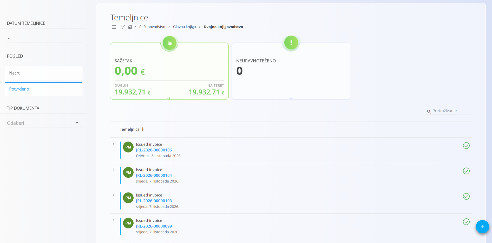
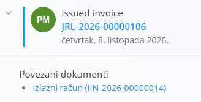
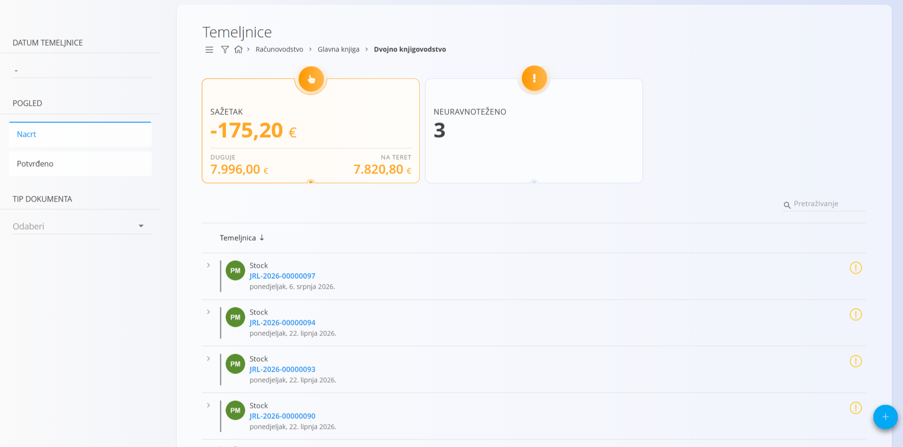
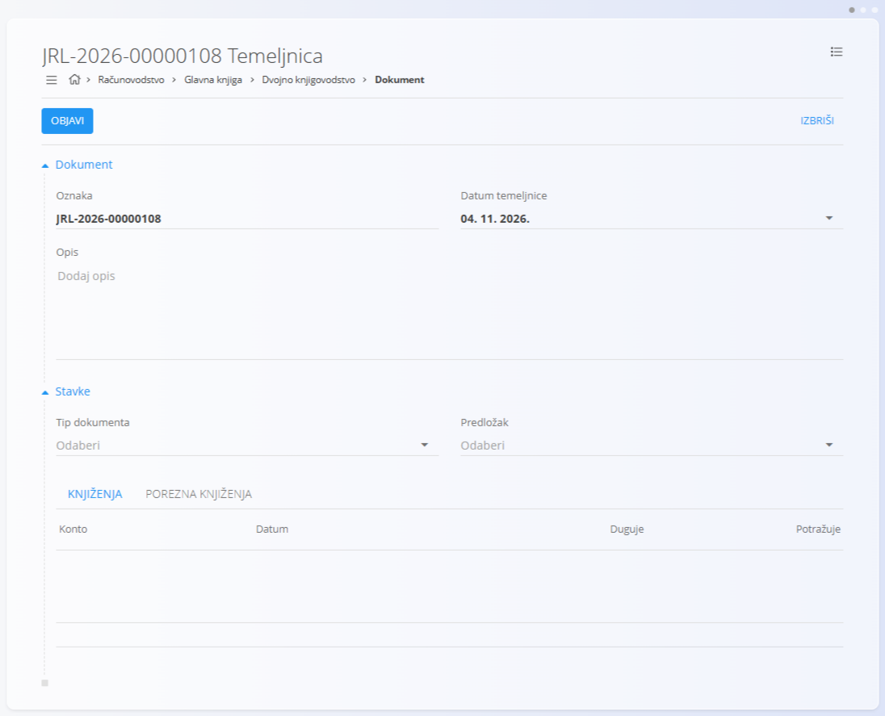
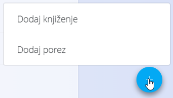
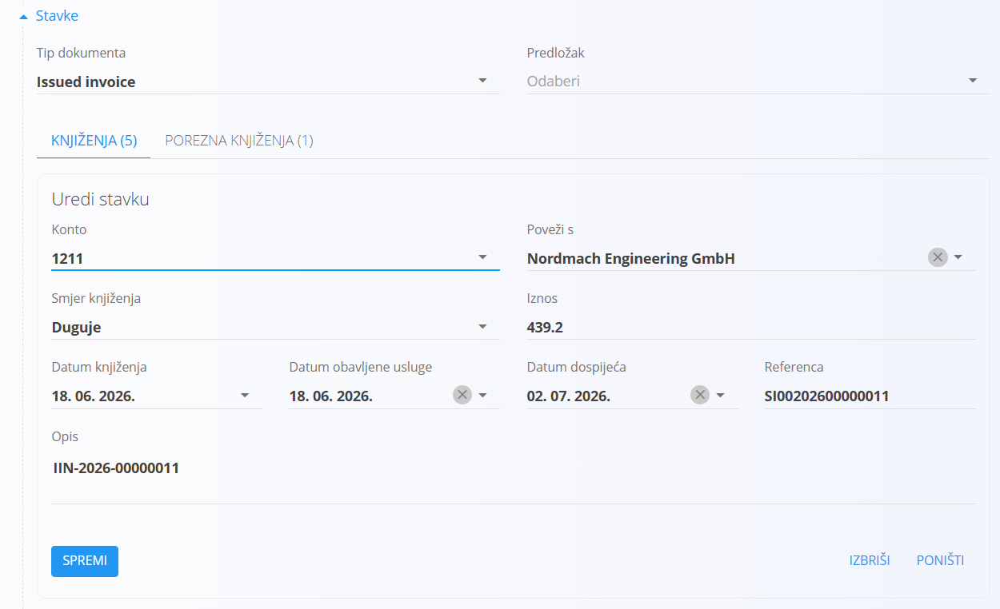
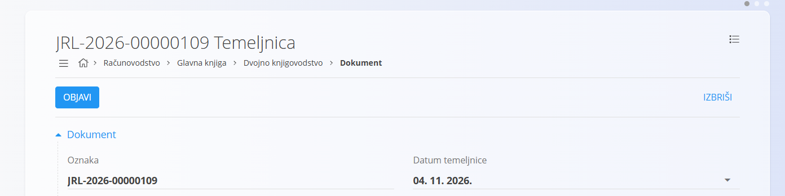

<!-- app_route: /accounting/ledger/journal-entries -->
<!-- app_label: Dvojno knjigovodstvo -->
<!-- canonical_source_url: https://github.com/Tom-PIT/Connected.Docs/blob/main/hr/Domene/Racunovodstvo/Dokumenti/DvojnoKnjigovodstvo.md -->
<!-- canonical_source_title: Dvojno knjigovodstvo -->

# Dvojno knjigovodstvo

**Dvojno knjigovodstvo** je mjesto na kojem se pohranjuju i upravljaju sve temeljnice. Temeljnice predstavljaju konačne knjigovodstvene zapise koji knjiže financijska kretanja u glavnu knjigu.

Ovom ekranu pristupate odabirom **Računovodstvo / Glavna knjiga / Dvojno knjigovodstvo** u [navigaciji](../../../Zajednicko/UI/Navigacija.md).

> [!NOTE]
> Temeljnice se obično stvaraju automatski iz drugih dokumenata (kao što su ulazni računi, prodajni dokumenti, kretanja zaliha ili korekcije zaliha). Ručno stvaranje i uređivanje također je moguće za korekcije i ispravke.

## Shema

<strong>Dokument</strong>

| Polje               | Opis                                                                                       |
| ------------------- | ------------------------------------------------------------------------------------------ |
| [**Oznaka**](../../../Zajednicko/UI/OznakeDokumenata.md)            | Identifikator temeljnice koji generira sustav.                                             |
| **Datum temeljnice** | Datum na koji se temeljnica knjiži u glavnu knjigu.                                        |
| **Opis**            | Neobavezni opis temeljnice.                                                                |
| [**Tip dokumenta**](../Upravljanje/GlavnaKnjiga/TipoviDokumenata.md)   | Klasifikacija temeljnice (npr. opća temeljnica, kretanje zaliha).                          |
| [**Predložak**](../Upravljanje/GlavnaKnjiga/PredlosciZaTemeljnice.md)        | Neobavezni predložak temeljnice kojim se popunjavaju stavke knjiženja.                     |

<strong>Pojedinosti</strong>

| Polje                 | Opis                                                                 |
| --------------------- | -------------------------------------------------------------------- |
| [**Konto**](../Upravljanje/GlavnaKnjiga/KontniPlan.md)        | Konto glavne knjige koji se koristi za stavku knjiženja.             |
| **Smjer knjiženja**   | Pokazuje je li stavka na strani duguje ili na teret.                 |
| **Iznos**             | Novčana vrijednost stavke knjiženja.                                 |
| **Datum knjiženja**   | Datum primijenjen na stavku knjiženja.                               |
| **Opis**              | Opis ili referenca na razini stavke.                                 |

> [!NOTE]
> Svaka temeljnica mora sadržavati barem jednu stavku duguje i jednu stavku na teret, a ukupni iznos duguje mora biti jednak ukupnom iznosu na teret.

## Popis

### Prikaz popisa

Prikaz popisa prikazuje sve temeljnice i sažete pokazatelje.

Svaka se temeljnica može proširiti kako bi prikazala povezane dokumente.

Dostupni filtri:

* **Datum temeljnice**
* **Pogled**
  * Nacrt
  * Potvrđeno
* **Tip dokumenta**

Sažetak na vrhu popisa prikazuje:

* Duguje (ukupni iznos duguje)
* Na teret (ukupni iznos na teret)
* Neuravnoteženo (broj neuravnoteženih temeljnica)

Neuravnoteženi unosi vizualno su istaknuti kako bi se lakše pronašle stavke koje zahtijevaju pozornost.

### Stanja dokumenta

Temeljnice mogu biti u jednom od sljedećih stanja:

* **Nacrt** – Temeljnica se može uređivati i može biti neuravnotežena.
* **Potvrđeno** – Temeljnica je objavljena i proknjižena u glavnu knjigu.

Potvrđena temeljnica ima gumb **Vrati**.

Temeljnica u nacrtu s neusklađenim zbrojevima duguje i na teret ne može se objaviti. Prije objave zbrojevi moraju biti usklađeni.

## Radnje

### Stvaranje temeljnice

S popisa temeljnica kliknite [gumb radnji](../../../Zajednicko/UI/AkcijskiGumb.md) i odaberite **Novi**. Gumb radnji na popisu nudi i opciju **Uvoz**.

1. Odaberite **Tip dokumenta**.
2. Po želji odaberite **Predložak** za popunjavanje stavki knjiženja.
3. Postavite **Datum temeljnice**.
4. Kliknite **Dodaj** da biste stvorili temeljnicu.

### Dodavanje stavki knjiženja

Nakon stvaranja temeljnice upotrijebite [gumb radnji](../../../Zajednicko/UI/AkcijskiGumb.md) unutar dokumenta da dodate stavke knjiženja ili poreza u odjeljak pojedinosti.

Dostupne radnje:

- **Dodaj knjiženje** – dodaje novu stavku knjiženja.
- **Dodaj porez** – dodaje novi porezni unos.

Uredite ili dodajte stavke po potrebi i spremite temeljnicu.

### Uređivanje pojedinosti

Kliknite stavku na kartici **Knjiženja** da je uredite. Otvara se obrazac **Uredi stavku**.

Možete:

* Promijeniti **Konto**
* Promijeniti **Smjer knjiženja**
* Prilagoditi **Iznos**
* Mijenjati **Datum knjiženja**, **Datum obavljene usluge** ili **Datum dospijeća**
* Mijenjati **Opis**

Nakon promjena kliknite **Spremi** da ih primijenite.

### Objava temeljnice

Kada se zbrojevi duguje i na teret podudaraju:

* Kliknite **Objavi** da potvrdite temeljnicu.
* Temeljnica se knjiži u glavnu knjigu.
* Status se mijenja iz Nacrt u Potvrđeno.

## Povezani dokumenti

Temeljnice mogu biti povezane s izvornim dokumentima.

Kada temeljnica potječe iz drugog dokumenta:

* Izvorni dokument prikazuje se pod **Povezani dokumenti**.
* Izmjene ovdje mogu utjecati na povezani dokument; isto tako, uređivanje i ponovna objava izvornog dokumenta mogu ažurirati ili ponovno generirati povezanu temeljnicu.

Ova veza osigurava potpunu sljedivost između operativnih dokumenata i njihova knjigovodstvenog učinka.

### Brisanje temeljnice

Temeljnica se može izbrisati samo ako je u statusu **Nacrt** i nije povezana s dovršenim izvornim dokumentima.

Za brisanje kliknite na temeljnicu u popisu da uđete u način uređivanja i odaberite **Izbriši**.

## Izbornik

Izbornik pruža dodatne radnje dostupne na ovoj stranici.

Dostupne radnje:

- **Izvozi** > **PDF**

Pojedinosti o radnjama izbornika potražite u [**Radnje izbornika**](../../../Zajednicko/Koncepti/RadnjeIzbornika.md).
