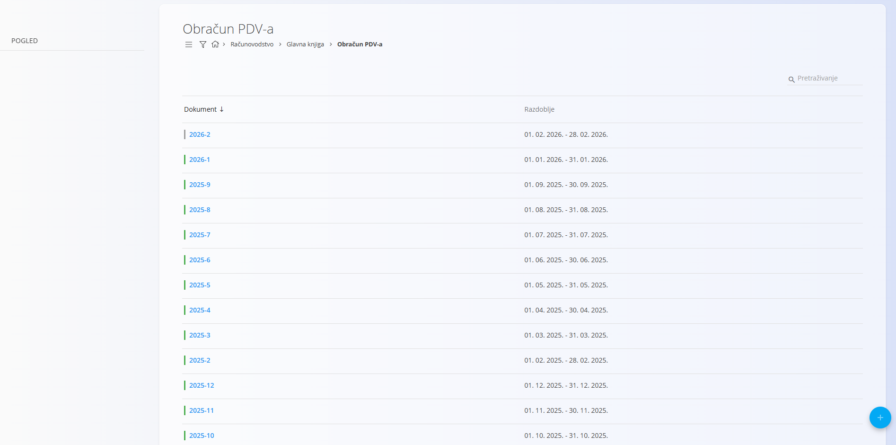
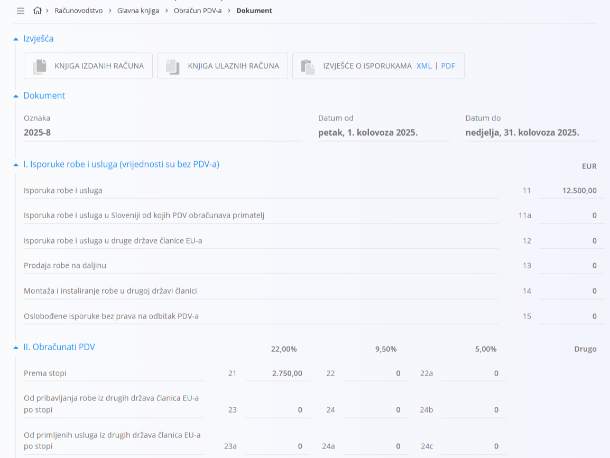
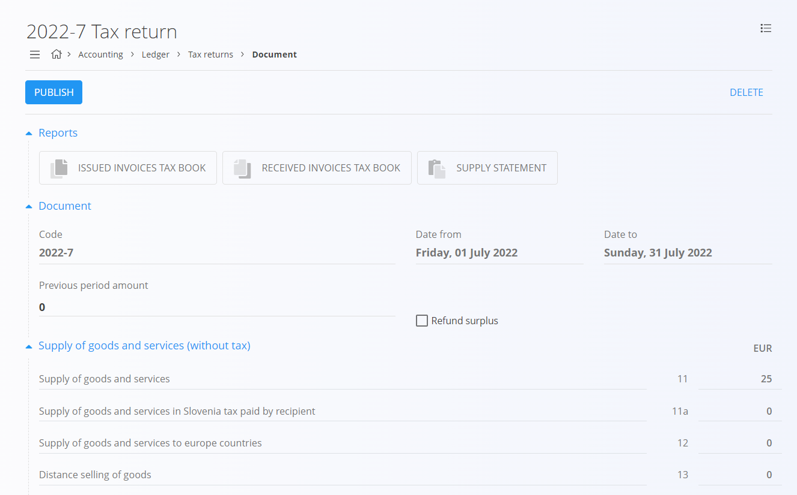

<!-- app_route: /accounting/ledger/tax-returns -->
<!-- app_label: Obračun PDV-a -->
<!-- canonical_source_url: https://github.com/Tom-PIT/Connected.Docs/blob/main/hr/Domene/Racunovodstvo/Dokumenti/ObracunPdv.md -->
<!-- canonical_source_title: Obračun PDV-a -->

# Obračun PDV-a

Obračun PDV-a pruža zbirni pregled podataka o PDV-u za određeno razdoblje. Koristi se za **pregled, provjeru i izvoz** podataka potrebnih za podnošenje službenih poreznih prijava poreznim tijelima.

Ovom ekranu pristupate odabirom **Računovodstvo / Glavna knjiga / Obračun PDV-a** u [navigaciji](../../../Zajednicko/UI/Navigacija.md).

> [!NOTE]
> Ovaj ekran je **informativan**. Vrijednosti se automatski izračunavaju iz proknjiženih računovodstvenih dokumenata (izdanih računa, ulaznih računa, odobrenja i terećenja). Polja se ne mogu ručno uređivati.
>
> **Razlike među državama**: nazivi polja, grupiranje odjeljaka, stope PDV-a i XML sheme mogu se razlikovati ovisno o državi. Prije generiranja izvješća ili izvoza provjerite lokalne zahtjeve.

## Praktična primjena

U praksi se ovaj ekran koristi na kraju poreznog razdoblja (obično mjesečno) kako bi se:

- pregledao PDV obračunat na izdanim računima
- pregledao odbitni PDV s ulaznih računa
- provjerila konačna porezna obveza ili višak poreza
- izvezla izvješća (PDF ili XML) za podnošenje poreznim tijelima

Iznosi prikazani ovdje predstavljaju **neto poziciju PDV-a** za odabrano razdoblje:
- PDV obračunat na prodaju
- umanjen za odbitni PDV na nabave

## Shema

<strong>Dokument</strong>

| Polje | Opis |
|------|-------------|
| **Oznaka** | Identifikator razdoblja obračuna (na primjer, `2025-12`). |
| **Datum od** | Početni datum poreznog razdoblja. |
| **Datum do** | Završni datum poreznog razdoblja. |
| **Iznos iz prethodnog razdoblja** | PDV-ni višak ili obveza prenesena iz prethodnog razdoblja. |
| **Povrat viška** | Pokazuje treba li višak poreza vratiti ili prenijeti dalje. |

<strong>I. Isporuke robe i usluga (vrijednosti su bez PDV-a)</strong>

| Polje | Opis |
|------|-------------|
| **Isporuka robe i usluga** (11) | Ukupne oporezive isporuke bez PDV-a. |
| **Isporuka robe i usluga u Sloveniji od kojih PDV obračunava primatelj** (11a) | Domaće transakcije s obrnutim obračunom. |
| **Isporuka robe i usluga u druge države članice EU-a** (12) | Isporuke unutar EU. |
| **Prodaja robe na daljinu** (13) | Prodaja na daljinu kupcima u EU. |
| **Montaža i instaliranje robe u drugoj državi članici** (14) | Transakcije montaže i instalacije u EU. |
| **Oslobođene isporuke bez prava na odbitak PDV-a** (15) | Isporuke oslobođene PDV-a bez prava na odbitak. |

<strong>II. Obračunati PDV</strong>

| Polje | Opis |
|------|-------------|
| **Prema stopi** (21, 22, 22a) | PDV obračunat na domaće isporuke, grupiran po stopi. |
| **Od pribavljanja robe iz drugih država članica EU-a po stopi** (23, 24, 24b) | PDV na pribavljanja unutar EU, grupiran po stopi. |
| **Od primljenih usluga iz drugih država članica EU-a po stopi** (23a, 24a, 24c) | PDV na usluge primljene iz EU, grupiran po stopi. |
| **Na temelju samooporezivanja kao primatelj robe i usluga po stopi** (25, 25a, 25b) | Stavke obrnutog obračuna, grupirane po stopi. |
| **Na temelju samooporezivanja od uvoza** (26) | PDV obračunat na uvoz. |

<strong>III. Isporuke robe i usluga (vrijednosti su bez PDV-a)</strong>

| Polje | Opis |
|------|-------------|
| **Nabave robe i usluga** (31) | Ukupne nabave bez PDV-a. |
| **Nabave robe i usluga u Sloveniji od kojih PDV obračunava primatelj** (31a) | Domaće nabave s obrnutim obračunom. |
| **Pribavljanja robe iz drugih država članica EU-a** (32) | Pribavljanja robe unutar EU. |
| **Primljene usluge iz drugih država članica EU-a** (32a) | Usluge primljene iz EU. |
| **Oslobođene nabave robe i usluga i oslobođena pribavljanja robe** (33) | Nabave oslobođene PDV-a. |
| **Nabavna vrijednost nekretnina** (34) | Nabave nekretnina. |
| **Nabavna vrijednost drugih osnovnih sredstava** (35) | Nabave ostalih osnovnih sredstava. |

<strong>IV. Odbitak PDV-a</strong>

| Polje | Opis |
|------|-------------|
| **Od nabava roba i usluga, pribavljanje roba i primljenih usluga iz drugih država članica EU-a i od uvoza po stopi** (41, 42, 42a) | Odbitni PDV na nabave, grupiran po stopi. |
| **Od paušalne naknade po stopi od 8 %** (43) | Posebni slučajevi odbitka po paušalnoj stopi. |

<strong>Konačni obračun</strong>

| Polje | Opis |
|------|-------------|
| **Obveza PDV-a** (51) | Iznos PDV-a koji se plaća poreznom tijelu. |
| **Višak PDV-a** (52) | Višak PDV-a koji se može vratiti ili prenijeti dalje. |

## Popis

Prikaz popisa prikazuje sve izrađene obračune PDV-a. Kliknite redak da otvorite pojedinosti pojedinog obračuna.

Potvrđeni obračuni označeni su zeleno, a nacrti sivo.

## Izvješća i izvozi

Na vrhu otvorenog obračuna PDV-a nalaze se brze radnje za izvješća.

Dostupni izvozi uključuju:
- **Knjiga izdanih računa**
- **Knjiga ulaznih računa**
- **Izvješće o isporukama** (XML ili PDF)

Ovi izvozi obično se koriste za:
- internu provjeru
- arhiviranje
- podnošenje poreznim tijelima

## Radnje

### Stvaranje obračuna PDV-a

Novi obračun PDV-a stvara se za određeno razdoblje.

1. Otvorite **Računovodstvo / Glavna knjiga / Obračun PDV-a**.
2. Kliknite **+** u donjem desnom kutu.
3. Pregledajte automatski izračunato razdoblje i vrijednosti.
4. Kliknite **Objavi** da potvrdite obračun.

> [!NOTE]
> Novi obračun PDV-a može se stvoriti samo ako je **prethodni obračun već potvrđen**.

### Brisanje obračuna PDV-a

Samo **neobjavljeni (nacrt)** obračuni PDV-a mogu se izbrisati.

1. Otvorite obračun koji je još u nacrtu.
2. Kliknite **Izbriši**.
3. Potvrdite radnju.

Nakon objave obračun PDV-a više se ne može izbrisati.

## Izbornik

Izbornik pruža dodatne radnje dostupne na ovoj stranici.

Dostupne radnje:

- **XML** ili **PDF**

Pojedinosti o radnjama izbornika potražite u [**Radnje izbornika**](../../../Zajednicko/Koncepti/RadnjeIzbornika.md).
