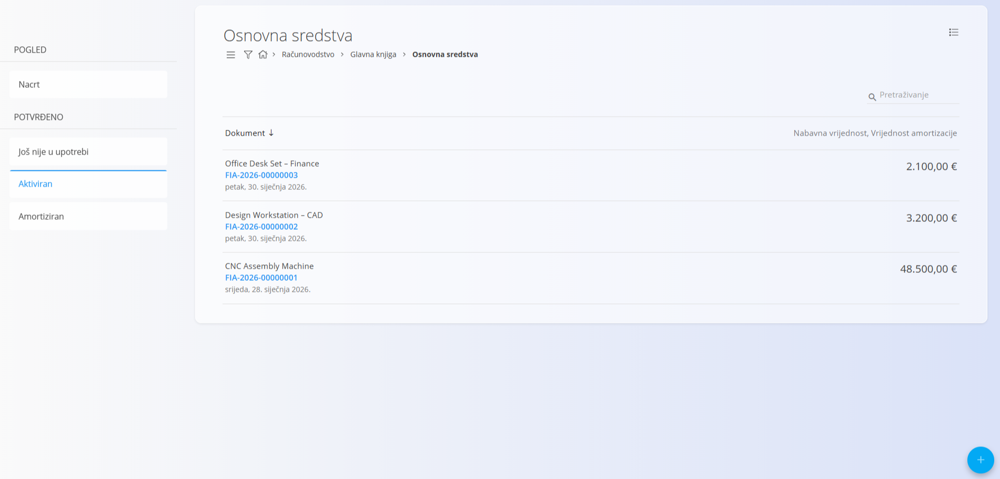
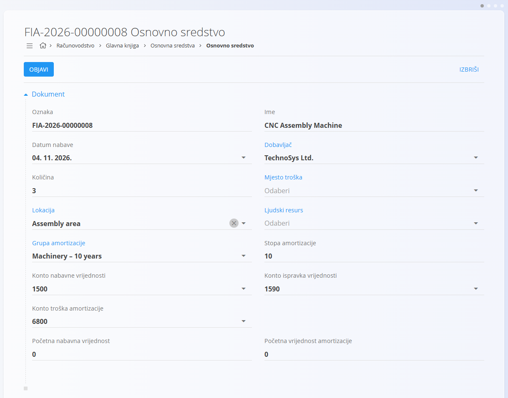
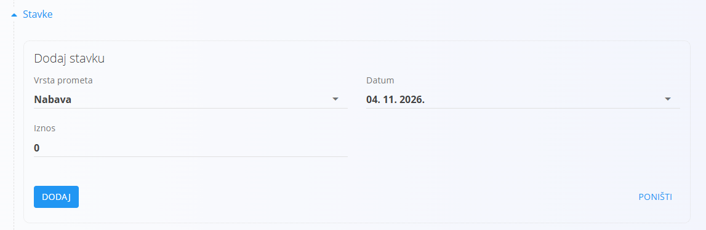
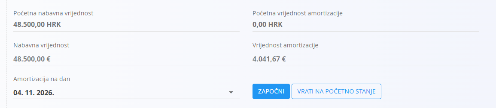

<!-- app_route: /accounting/ledger/fixed-assets -->
<!-- app_label: Osnovna sredstva -->
<!-- canonical_source_url: https://github.com/Tom-PIT/Connected.Docs/blob/main/hr/Domene/Racunovodstvo/Dokumenti/OsnovnaSredstva.md -->
<!-- canonical_source_title: Osnovna sredstva -->

# Osnovna sredstva

**Osnovna sredstva** služe za praćenje dugotrajne imovine u vlasništvu organizacije, kao što su strojevi, oprema, namještaj i informatička oprema. Svaki zapis osnovnog sredstva predstavlja jedno sredstvo ili skupinu istovrsnih sredstava koja se aktiviraju i amortiziraju tijekom vremena.

Ovom ekranu pristupate odabirom **Računovodstvo / Glavna knjiga / Osnovna sredstva** u [navigaciji](../../../Zajednicko/UI/Navigacija.md).

> [!NOTE]
> Osnovna sredstva usko su povezana s [**grupama amortizacije**](../Upravljanje/GlavnaKnjiga/GrupeAmortizacije.md) i [**kontima glavne knjige**](../Upravljanje/GlavnaKnjiga/KontniPlan.md). Način knjiženja i izračun amortizacije ovise o konfiguraciji grupa amortizacije i postavkama glavne knjige.

## Shema

<strong>Dokument</strong>

| Polje | Opis |
|------|-------------|
| [**Oznaka**](../../../Zajednicko/UI/OznakeDokumenata.md) | Identifikator osnovnog sredstva koji generira sustav. |
| **Ime** | Ime sredstva (na primjer, CNC Assembly Machine). |
| **Datum nabave** | Datum nabave sredstva. |
| **Dobavljač** | Dobavljač od kojeg je sredstvo kupljeno. |
| **Količina** | Broj istovrsnih sredstava koje zapis predstavlja. |
| [**Mjesto troška**](../../../Zajednicko/Upravljanje/MjestaTroska.md) | Mjesto troška odgovorno za sredstvo. |
| [**Lokacija**](../Upravljanje/GlavnaKnjiga/Lokacije.md) | Fizička ili organizacijska lokacija sredstva. |
| [**Ljudski resurs**](../../Proizvodnja/Upravljanje/LjudskiResursi.md) | Osoba odgovorna za sredstvo, ako je primjenjivo. |
| [**Grupa amortizacije**](../Upravljanje/GlavnaKnjiga/GrupeAmortizacije.md) | Pravila amortizacije primijenjena na sredstvo. |
| **Stopa amortizacije** | Godišnja stopa amortizacije, preuzeta iz grupe amortizacije. |
| **Konto nabavne vrijednosti** | Konto glavne knjige na koji se evidentira nabavna vrijednost sredstva. |
| **Konto ispravka vrijednosti** | Konto glavne knjige za ispravak vrijednosti (akumuliranu amortizaciju). |
| **Konto troška amortizacije** | Konto glavne knjige za trošak amortizacije. |
| **Početna nabavna vrijednost** | Početna vrijednost sredstva pri aktivaciji. |
| **Početna vrijednost amortizacije** | Početna vrijednost akumulirane amortizacije, ako postoji. |

<strong>Pojedinosti</strong>

| Polje | Opis |
|------|-------------|
| **Vrsta prometa** | Vrsta transakcije vezane uz sredstvo: **Nabava** ili **Aktivacija**. |
| **Datum** | Datum transakcije. |
| **Iznos** | Novčana vrijednost povezana s transakcijom. |

## Upravljanje

### Stanja dokumenta

Osnovna sredstva prolaze kroz sljedeća stanja:

* **Nacrt** – Sredstvo se definira i može se slobodno uređivati.
* **Još nije u upotrebi** – Sredstvo je objavljeno, ali još nije aktivno.
* **Aktiviran** – Sredstvo je u upotrebi i podliježe amortizaciji.
* **Amortiziran** – Sredstvo je dosegnulo kraj svog vijeka amortizacije.

### Prikaz popisa

Prikaz popisa prikazuje sva osnovna sredstva.

Dostupni filtri:

* **Pogled**
  * Nacrt
  * Još nije u upotrebi
  * Aktiviran
  * Amortiziran

Trenutno stanje svakog sredstva odražava njegovu fazu u životnom ciklusu.

## Radnje

### Stvaranje osnovnog sredstva

1. Kliknite [gumb radnji](../../../Zajednicko/UI/AkcijskiGumb.md) da stvorite novo osnovno sredstvo.
2. Ispunite obavezna polja u odjeljku **Dokument**.
3. Dodijelite **Grupu amortizacije** i provjerite povezane konte.
4. Kliknite **Objavi**.

Nakon objave sredstvo prelazi iz stanja **Nacrt** u **Još nije u upotrebi**.

### Dodavanje pojedinosti sredstva

U odjeljku **Stavke** mogu se evidentirati događaji vezani uz sredstvo.

#### Nabava

Za evidenciju nabave sredstva:

* Postavite **Vrstu prometa** na Nabava
* Unesite **Datum**
* Unesite **Iznos**

Na taj način podaci o nabavi evidentiraju se odvojeno od aktivacije.

#### Aktivacija

Za aktivaciju sredstva:

* Kliknite **Dodaj stavku**
* Odaberite **Aktivacija** kao vrstu prometa
* Postavite **Datum** aktivacije
* Kliknite **Dodaj**

Nakon aktivacije sredstvo prelazi u stanje **Aktiviran**.

> [!NOTE]
> Izračun amortizacije primjenjuje se tek nakon aktivacije sredstva.

### Amortizacija na dan

Odjeljak **Amortizacija na dan** omogućuje odabir datuma i pokretanje ili zaustavljanje izračuna amortizacije.

* **Započni** počinje praćenje amortizacije od odabranog datuma.
* **Vrati na početno stanje** zaustavlja praćenje amortizacije.

> [!NOTE]
> Kada se odabere budući datum, sustav može prikazati izračunanu vrijednost amortizacije. Ta vrijednost predstavlja projiciranu amortizaciju temeljenu na konfiguriranoj grupi amortizacije i stopi.
