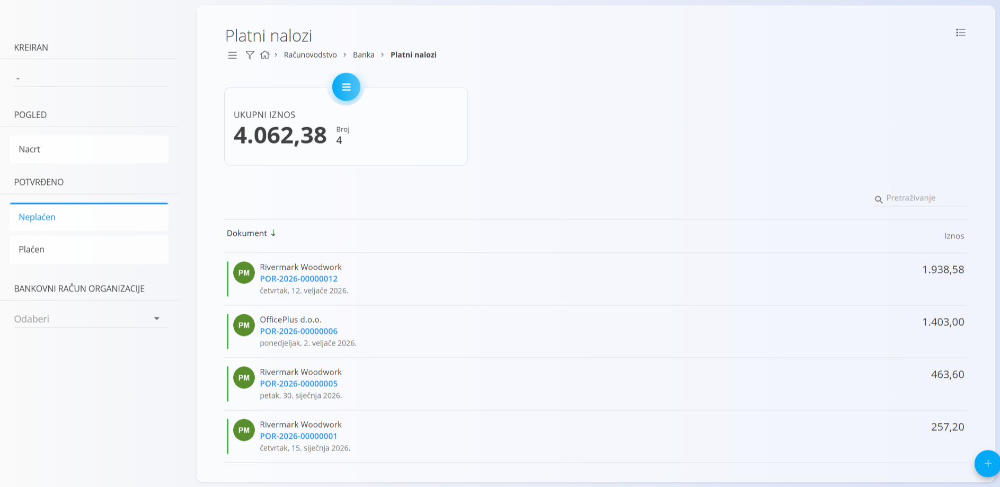
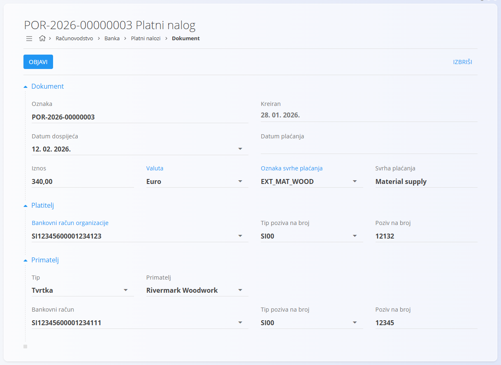
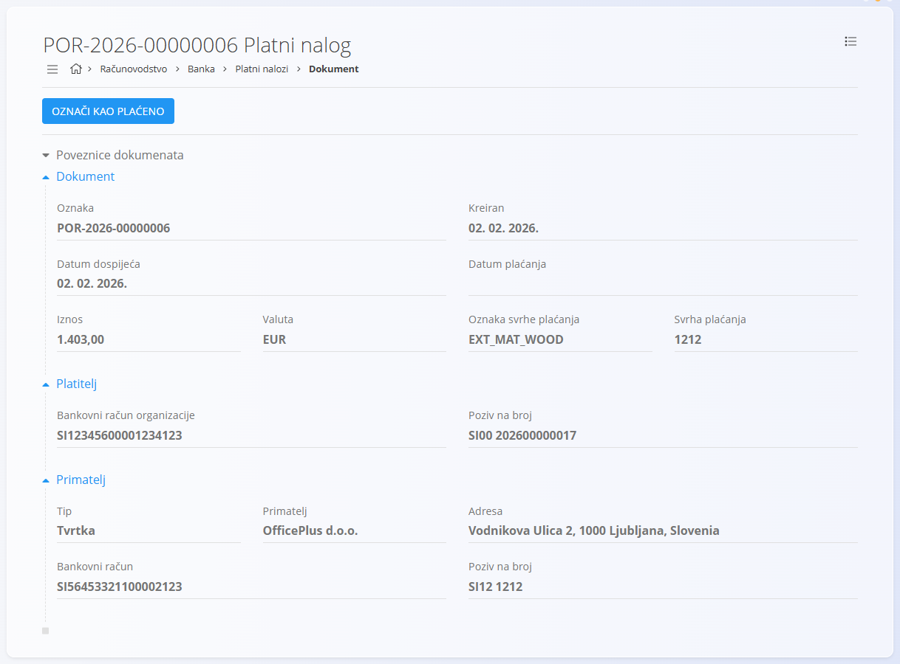

# Platni nalozi

Ekran **Platni nalozi** služi za stvaranje i upravljanje odlaznim nalozima za plaćanje vanjskim primateljima, kao što su dobavljači ili pružatelji usluga. Platni nalozi predstavljaju namjeru plaćanja i prate životni ciklus plaćanja od nacrta do plaćenog statusa.

Platni nalozi sadrže pojedinosti o platitelju, primatelju, iznosu i svrsi plaćanja. Pomažu osigurati da su plaćanja pravilno dokumentirana i praćena u računovodstvenom sustavu.

Ovom ekranu pristupate odabirom **Računovodstvo / Banka / Platni nalozi** u [navigaciji](../../../Zajednicko/UI/Navigacija.md).

> [!NOTE]
> * Platni nalozi obično se stvaraju nakon primitka ulaznih računa dobavljača.
> * Objava platnog naloga ne izvršava automatski bankovnu transakciju.

## Shema

<strong>Dokument</strong>

| Polje | Opis |
|------|-------------|
| [**Oznaka**](../../../Zajednicko/UI/OznakeDokumenata.md) | Jedinstveni identifikator platnog naloga. |
| **Kreiran** | Datum kada je platni nalog stvoren. |
| **Datum dospijeća** | Datum do kojeg plaćanje treba izvršiti (obavezno). |
| **Datum plaćanja** | Datum kada je plaćanje izvršeno. |
| **Iznos** | Iznos plaćanja. |
| [**Valuta**](../../../Zajednicko/Upravljanje/Valute.md) | Valuta plaćanja (npr. euro). |
| **Oznaka svrhe plaćanja** | Šifra koja opisuje svrhu plaćanja (obavezno). |
| **Svrha plaćanja** | Tekstualni opis svrhe plaćanja (obavezno). |

<strong>Platitelj</strong>

| Polje | Opis |
|------|-------------|
| [**Bankovni račun organizacije**](../../Prodaja/Upravljanje/BankovniRacuniOrganizacije.md) | Bankovni račun s kojeg se plaća iznos. |
| **Tip poziva na broj** | Tip poziva na broj koji koristi platitelj (obavezno). |
| **Poziv na broj** | Poziv na broj koji koristi platitelj (obavezno). |

<strong>Primatelj</strong>

| Polje | Opis |
|------|-------------|
| **Tip** | Vrsta primatelja (npr. tvrtka). |
| [**Primatelj**](../../../Zajednicko/Upravljanje/PoslovniImenik.md) | Poslovni subjekt koji prima plaćanje (obavezno). |
| [**Bankovni račun**](../../../Zajednicko/Upravljanje/BankovniRacuni.md) | Bankovni račun primatelja (obavezno). |
| **Tip poziva na broj** | Tip poziva na broj koji zahtijeva primatelj (obavezno). |
| **Poziv na broj** | Poziv na broj koji zahtijeva primatelj (obavezno). |

## Popis

Popis prikazuje platne naloge i nudi filtre za njihovo upravljanje.

Dostupni filtri:

* **Kreiran** (datum dokumenta)
* **Pogled**
  * Nacrt
  * Neplaćen
  * Plaćen
* **Bankovni račun organizacije**

Svaki redak prikazuje oznaku dokumenta, primatelja, datum i iznos.

## Tijek statusa

Platni nalozi prolaze jednostavan životni ciklus:

1. **Nacrt**

   * Platni nalog se priprema
   * Polja se mogu uređivati

2. **Neplaćen**

   * Platni nalog je objavljen
   * Plaćanje je na čekanju

3. **Plaćen**

   * Plaćanje je izvršeno

## Radnje

### Stvaranje platnog naloga

1. Kliknite [gumb radnji](../../../Zajednicko/UI/AkcijskiGumb.md) za stvaranje novog platnog naloga.
2. Unesite potrebne podatke o dokumentu, platitelju i primatelju.
3. Kliknite **Objavi** da platni nalog prijeđe iz nacrta u neplaćen.

### Uređivanje platnog naloga

Platni nalog možete uređivati dok je u statusu **Nacrt**.

* Otvorite platni nalog s popisa
* Izmijenite polja dokumenta (datume, iznos, valutu, svrhu) i podatke o platitelju i primatelju
* Kliknite **Spremi** za primjenu promjena

Objavljeni platni nalozi (neplaćeni ili plaćeni) ograničavaju uređivanje radi očuvanja integriteta knjigovodstva.

### Označavanje kao plaćenog

Kad je platni nalog u statusu **Neplaćen**, može se označiti kao plaćen.

1. Otvorite neplaćeni platni nalog.
2. Kliknite **Označi kao plaćeno**.
3. Status platnog naloga prelazi u **Plaćen**.

## Brisanje platnog naloga

Platni nalozi mogu se izbrisati dok su u statusu **Nacrt**.

Nakon objave brisanje može biti ograničeno radi očuvanja integriteta knjigovodstva.

> [!WARNING]
> Brisanje platnih naloga koji su već neplaćeni ili plaćeni može utjecati na praćenje plaćanja i mogućnost revizije.

## Izbornik

Ovaj ekran ima radnje izbornika na dva mjesta.

Radnjama izbornika pristupa se preko gumba **Izbornik** u gornjem desnom kutu popisa ili dokumenta.

### Izbornik popisa

Dostupna radnja:

* **Uključi/isključi način izvoza**

### Izbornik dokumenta

Dostupna radnja:

* **Izvezi u XML**

Pojedinosti o radnjama izbornika potražite u [**Radnje izbornika**](../../../Zajednicko/Koncepti/RadnjeIzbornika.md).
