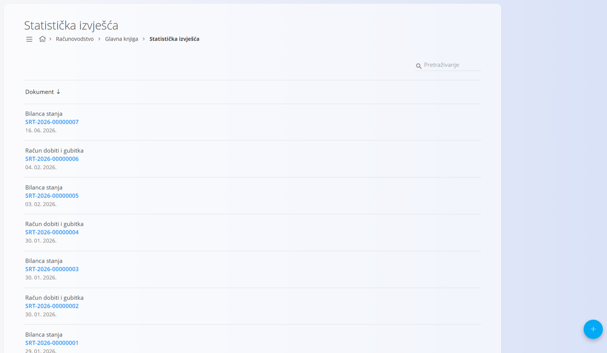
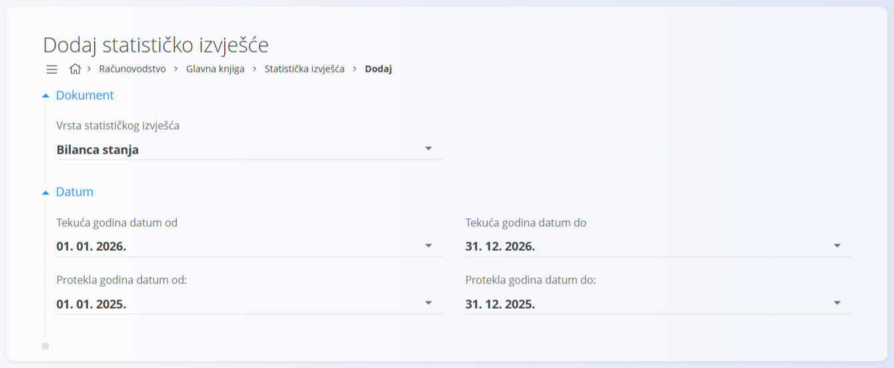

<!-- app_route: /accounting/ledger/statistical-reports -->
<!-- app_label: Statistička izvješća -->
<!-- canonical_source_url: https://github.com/Tom-PIT/Connected.Docs/blob/main/hr/Domene/Racunovodstvo/Dokumenti/StatistickaIzvjesca.md -->
<!-- canonical_source_title: Statistička izvješća -->

# Statistička izvješća

**Statistička izvješća** prikazuju zbirni pregled financijskih podataka prema **AOP pozicijama**, što omogućuje usporedbu **tekućeg razdoblja** i **prethodnog razdoblja** (obično prethodne godine). Ova se izvješća najčešće koriste za bilancu stanja, račun dobiti i gubitka te druga zakonska ili interna financijska izvješća.

Ovom ekranu pristupate odabirom **Računovodstvo / Glavna knjiga / Statistička izvješća** u [navigaciji](../../../Zajednicko/UI/Navigacija.md).

> [!NOTE]
> - Statistička izvješća su nakon generiranja **samo za čitanje**.
> - Podaci se automatski izvode iz proknjiženih računovodstvenih zapisa.
> - Ako se temeljni računovodstveni podaci promijene, mora se generirati **novo statističko izvješće** kako bi se prikazale ažurirane vrijednosti.

## Shema

| Polje | Opis |
|------|-------------|
| **Vrsta statističkog izvješća** | Odaberite vrstu izvješća: **Bilanca stanja** ili **Račun dobiti i gubitka**. |
| **Datum** | Odaberite raspone datuma tekuće i prošle godine za prikaz vrijednosti. |

## Popis statističkih izvješća

Popis prikazuje sva generirana statistička izvješća.

Svaki zapis prikazuje:

- **Vrstu izvješća** (**Bilanca stanja** ili **Račun dobiti i gubitka**)
- **Oznaku dokumenta**
- **Datum izvješća**

Kliknite izvješće na popisu da otvorite njegov pregled.

## Dodavanje statističkog izvješća

Za generiranje novog statističkog izvješća kliknite **+** u donjem desnom kutu.

Odaberite vrstu izvješća (na primjer, **Bilanca stanja**) i odredite razdoblja usporedbe:

- **Tekuća godina datum od / do** – primarno razdoblje izvještavanja
- **Protekla godina datum od / do** – razdoblje za usporedbu

Ti rasponi datuma određuju koja će knjiženja biti uključena u izračun.

Za generiranje izvješća kliknite [gumb radnji](../../../Zajednicko/UI/AkcijskiGumb.md) u donjem dijelu ekrana.

## Pregled statističkog izvješća

Otvaranje statističkog izvješća prikazuje detaljnu raščlambu po **AOP**-u.

Za svaku AOP poziciju izvješće prikazuje:

- **AOP šifru**
- **AOP naziv**
- **Tekući iznos** – izračunat iz odabranog tekućeg razdoblja
- **Prethodni iznos** – izračunat iz razdoblja usporedbe

Vrijednosti se automatski zbrajaju na temelju knjiženja i dodijeljenih AOP pozicija.

> [!NOTE]
> Definicije AOP-a ovise o državi. Primjer prikazan u ovom dokumentu odnosi se na Sloveniju. Za druge države koriste se slične strukture AOP-a, prilagođene lokalnim propisima o izvještavanju.
