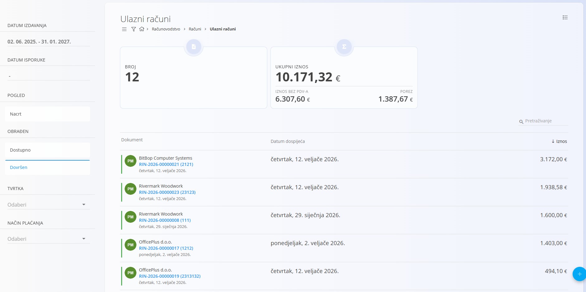
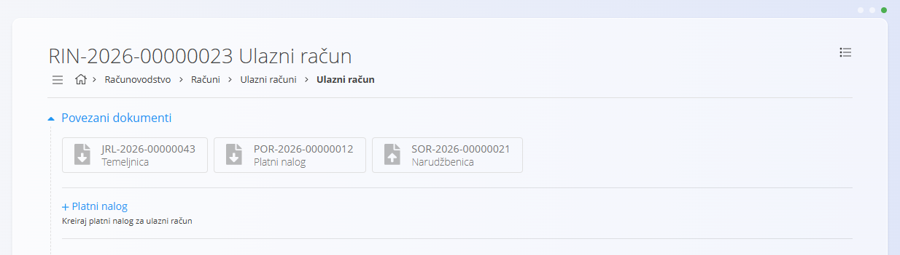
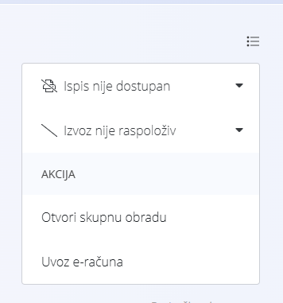

<!-- app_route: /accounting/documents/received-invoices -->
<!-- app_label: Ulazni računi -->
<!-- canonical_source_url: https://github.com/Tom-PIT/Connected.Docs/blob/main/hr/Domene/Racunovodstvo/Dokumenti/UlazniRacuni.md -->
<!-- canonical_source_title: Ulazni računi -->

# Ulazni računi

**Ulazni računi** su financijski dokumenti koji predstavljaju račune primljene od dobavljača za kupljenu robu ili usluge. Koriste se za evidentiranje računa dobavljača, stvaranje računovodstvenih knjiženja i pokretanje odlaznih plaćanja.

Ovom ekranu pristupate odabirom **Računovodstvo / Računi / Ulazni računi** u [navigaciji](../../../Zajednicko/UI/Navigacija.md).

> [!NOTE]
> Ulazni računi obično su povezani s jednom ili više [**narudžbenica**](../../Nabava/Dokumenti/Narudzbenice.md). Povezivanje narudžbenica omogućuje sustavu da unaprijed popuni pojedinosti i predloži računovodstvena knjiženja na temelju primljene robe.
>
> Da bi se stavke evidentirale na ulaznom računu, za svaku stavku mora se odabrati [**trošak**](../../Nabava/Upravljanje/Troskovi.md). Trošak određuje konto glavne knjige, poreznu stopu i logiku knjiženja koja se primjenjuje pri potvrdi dokumenta.

### Životni ciklus ulaznog računa

Kad od dobavljača primimo račun, on prolazi sljedeći tijek:

1. Stvara se novi ulazni račun kao **nacrt**.
2. Jedna ili više [**narudžbenica**](../../Nabava/Dokumenti/Narudzbenice.md) povezuju se pomoću **Poveznica dokumenata**.
3. Unose se podaci zaglavlja i ukupni iznos.
4. Pregledavaju se predložena knjiženja i stvaraju se.
5. Račun se **objavljuje**, čime se knjiži u glavnu knjigu.
6. Dokument prelazi u status **Dovršen**.
7. U pozadini se stvara [**temeljnica**](DvojnoKnjigovodstvo.md).
8. Iz ulaznog računa može se stvoriti [**platni nalog**](PlatniNalozi.md).

## Shema

<strong>Dokument</strong>

| Polje | Opis |
|------|-------------|
| **Interna oznaka** | Identifikator ulaznog računa koji generira sustav. |
| **Vanjska oznaka** | Referentni broj računa dobavljača (obavezno). |
| **Dobavljač** | Dobavljač koji je izdao račun (obavezno). Preuzima se iz [**poslovnog imenika**](../../../Zajednicko/Upravljanje/PoslovniImenik.md). |
| [**Bankovni račun**](../../../Zajednicko/Upravljanje/BankovniRacuni.md) | Bankovni račun dobavljača za plaćanje (obavezno). |
| **Datum izdavanja** | Datum naveden na računu dobavljača. |
| **Datum isporuke** | Datum kada su roba ili usluge isporučene. |
| **Datum zaprimanja** | Datum kada je račun primljen. |
| **Datum dospijeća** | Rok plaćanja (obavezno). |
| **Iznos** | Ukupni neto iznos računa. |
| [**Valuta**](../../../Zajednicko/Upravljanje/Valute.md) | Valuta računa. |
| **Referenca** | Referenca za plaćanje koju navodi dobavljač (obavezno). |
| **Način plaćanja** | Način plaćanja za podmirenje (npr. platni nalog). |
| [**Mjesto troška**](../../../Zajednicko/Upravljanje/MjestaTroska.md) | Neobavezna dodjela mjesta troška. |
| [**Konto**](../Upravljanje/GlavnaKnjiga/KontniPlan.md) | Konto glavne knjige za knjiženje (obavezno). |
| [**Predložak**](../Upravljanje/GlavnaKnjiga/PredlosciZaTemeljnice.md) | Predložak knjiženja primijenjen na račun. |

<strong>Pojedinosti</strong>

| Polje | Opis |
|------|-------------|
| [**Trošak**](../../Nabava/Upravljanje/Troskovi.md) | Trošak ili kategorija zaliha primijenjena na stavku. |
| [**Konto**](../Upravljanje/GlavnaKnjiga/KontniPlan.md) | Konto glavne knjige za stavku. |
| [**Porezne stope**](../../../Zajednicko/Upravljanje/PorezneStope.md) | Primijenjena porezna stopa. |
| **Iznos** | Neto iznos stavke. |
| **Iznos poreza** | Izračunati iznos poreza. |
| **Račun za predujam** | Pokazuje je li stavka račun za predujam. |
| **Samooporezivanje** | Pokazuje primjenjuje li se za stavku samooporezivanje. |
| **Odbij porez** | Pokazuje je li porez odbitan. |
| **Dodaj za financijsko zalihu** | Pokazuje treba li stavka ući u financijsku zalihu. |

## Popis

### Prikaz popisa

Prikaz popisa prikazuje sve ulazne račune i zbrojene pokazatelje. Stupci su **oznaka dokumenta**, **datum dospijeća** i **iznos**, a mogu se sortirati klikom na zaglavlje stupca. Polje za pretraživanje omogućuje filtriranje prema nazivu dobavljača ili datumu.

Dostupni filtri:

* **Datum izdavanja**
* **Datum isporuke**
* **Pogled**
  * Nacrt
  * Dostupno
  * Dovršen
* **Tvrtka**
* **Način plaćanja**

Popis također prikazuje zbrojene pokazatelje, kao što su broj dokumenata i ukupni iznos za aktivni filter: **Broj**, **Ukupni iznos**, **Iznos bez PDV-a** i **Porez**.

### Stanja dokumenta

Ulazni računi prolaze kroz sljedeća stanja:

* **Nacrt** – Dokument se može uređivati i još nije proknjižen.
* **Dostupno** – Dokument je objavljen, ali sadrži neslaganja iznosa.
* **Dovršen** – Dokument je objavljen i svi se iznosi podudaraju.

Stanje dokumenta određuje dostupne radnje i naknadne dokumente.

#### Neslaganja iznosa

Neslaganje obično znači da iznos zaglavlja nije jednak zbroju stavki (neto i/ili porez). To se može dogoditi kad je porez trebao biti uključen, a nije (ili obrnuto), ili kad su zaglavlje ili stavke unesene previsoko ili prenisko.

Za ispravak:

* Upotrijebite izbornik i **Vrati** dokument u nacrt, pa prilagodite iznos zaglavlja ili stavke (preporučeno).
* U dokumentu u statusu Dostupno može se uređivati samo odjeljak **Pojedinosti** radi ispravka neslaganja.

## Radnje

### Stvaranje ulaznog računa

Za stvaranje ulaznog računa upotrijebite postupak opisan u [**Stvaranju ulaznog računa**](UlazniRacuniIzrada.md).

### Vraćanje u nacrt

Ako su nakon objave potrebne izmjene:

1. Otvorite dokument.
2. Otvorite izbornik u gornjem lijevom kutu.
3. Odaberite **Vrati** da dokument vratite u nacrt.

Tako se mogu urediti datumi knjiženja ili konti prije ponovne objave.

### Stvaranje platnog naloga

Za potvrđene račune odjeljak **Povezani dokumenti** nudi mogućnost stvaranja platnog naloga na temelju ulaznog računa.

Pojedinosti o odnosima među dokumentima, sljedivosti i stvaranju povezanih dokumenata potražite u [**Povezanim dokumentima**](../../../Zajednicko/Koncepti/PovezaniDokumenti.md).

## Brisanje ulaznog računa

Nacrti se mogu izbrisati na ekranu za uređivanje, ali samo ako nemaju **stavki**.

Ako nacrt još sadrži stavke u odjeljku **Pojedinosti**:

1. Kliknite plavo polje troška u odjeljku **Pojedinosti** da otvorite prozor **Uredi stavku**.
2. U prozoru **Uredi stavku** kliknite **Izbriši** da uklonite stavku.
3. Ponovite za sve preostale stavke.

Kad dokument nema stavki, kliknite **Izbriši** za brisanje nacrta.

Pojedinosti o radu sa stavkama dokumenta potražite u [**Stavkama**](../../../Zajednicko/Koncepti/Stavke.md).

> [!NOTE]
> - Brisati se mogu samo **nacrti**.
> - Nakon objave dokument se više ne može izbrisati; umjesto toga upotrijebite **Vrati** u izborniku.
> - Ako su zabilježena plaćanja, dokument se ne može izbrisati dok se ta plaćanja ne uklone i dok se dokument ne vrati u nacrt.

## Izbornik

Ovaj ekran ima radnje izbornika na dva mjesta.

Radnjama izbornika pristupa se preko gumba **Izbornik** u gornjem desnom kutu popisa ili dokumenta.

### Izbornik popisa

Dostupne radnje:

- **Otvori skupnu obradu**
- **Uvoz e-računa**

Stavke **Ispis** i **Izvoz** u izborniku nisu dostupne na ovom popisu.

### Izbornik dokumenta

Dostupne radnje:

- **Vrati**

Pojedinosti o radnjama izbornika potražite u [**Radnje izbornika**](../../../Zajednicko/Koncepti/RadnjeIzbornika.md).
