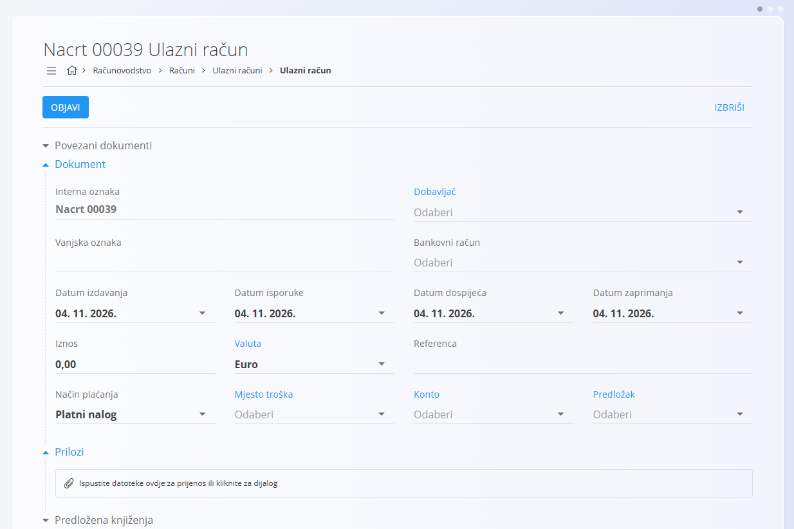
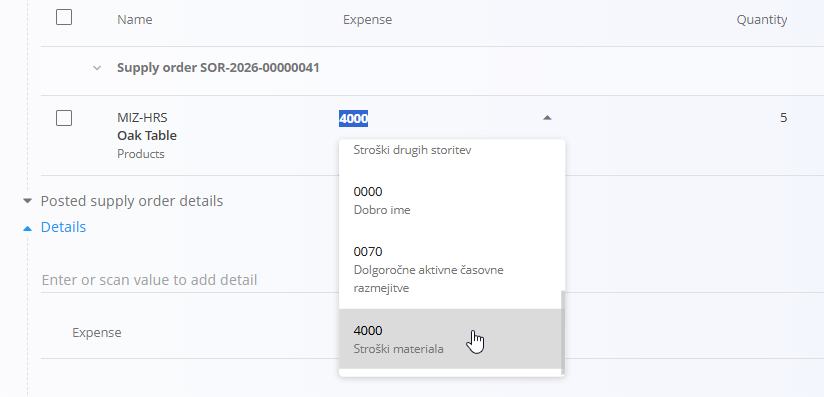
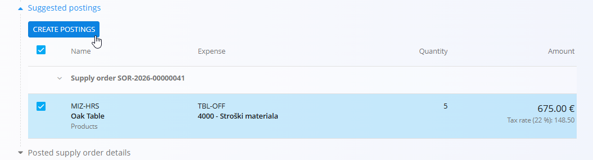
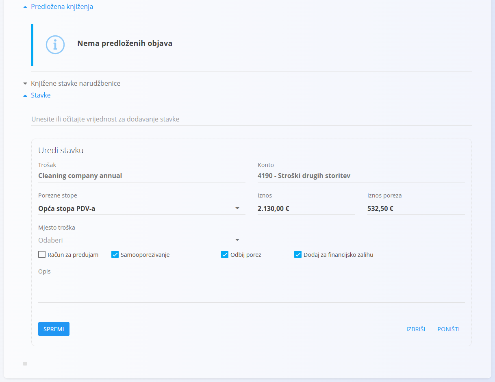
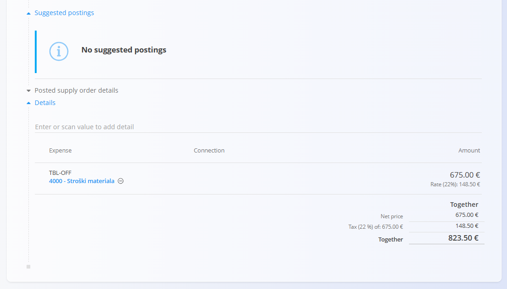
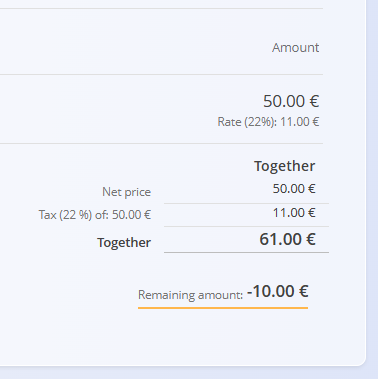

# Kako stvoriti novi ulazni račun

[Ulazni računi](UlazniRacuni.md) stvaraju se radi evidencije računa primljenih od dobavljača. Mogu se povezati s jednom ili više [narudžbenica](../../Nabava/Dokumenti/Narudzbenice.md), što sustavu omogućuje da predloži knjiženja na temelju primljene robe ili usluga i njihovih troškova.

## Stvaranje novog ulaznog računa

1. Kliknite [gumb radnji](../../../Zajednicko/UI/AkcijskiGumb.md) za stvaranje novog ulaznog računa.
2. U odjeljku **Povezani dokumenti** povežite jednu ili više narudžbenica.
3. Pregledajte ili unesite polja zaglavlja dokumenta, uključujući **Iznos**.
4. Odaberite odgovarajući **Konto** i **Predložak** (neobavezno).

## Stvaranje predloženih knjiženja

U odjeljku **Predložena knjiženja** sustav predlaže knjiženja na temelju povezanih narudžbenica.

1. Pregledajte predložene retke.
2. Odaberite relevantne stavke.
3. Po potrebi uredite polja **Trošak** i **Količina** u popisu.

   

4. Kliknite **Kreiraj knjženje** za stvaranje redaka knjiženja.

   

### Prilozi

Odjeljak **Prilozi** služi za učitavanje i upravljanje datotekama povezanima s dokumentom, kao što su fotografije, PDF-ovi, certifikati ili prateći dokumenti.

Pojedinosti potražite u [**Privicima**](../../../Zajednicko/Koncepti/Privici.md).

## Uređivanje stavki

Kliknite plavo polje u odjeljku **Stavke** za uređivanje. Nakon promjena kliknite **Spremi** za primjenu.

Pojedinosti o radu sa stavkama dokumenta potražite u [**Stavkama**](../../../Zajednicko/Koncepti/Stavke.md).

## Objava ulaznog računa

Kad se svi iznosi podudaraju i obavezni podaci su ispunjeni, dno dokumenta izgleda ovako.

* Kliknite **Objavi** za potvrdu dokumenta.
* Račun se knjiži u glavnu knjigu.
* Automatski se stvara [**temeljnica**](DvojnoKnjigovodstvo.md) u [**Dvojnom knjigovodstvu**](DvojnoKnjigovodstvo.md).

> [!NOTE]
> Ako se iznos zaglavlja ne podudara sa zbrojem stavki, dokument prikazuje **Preostali iznos** i ističe se. Objava takvog dokumenta premješta ga u stanje **Dostupno**.
>
> 
