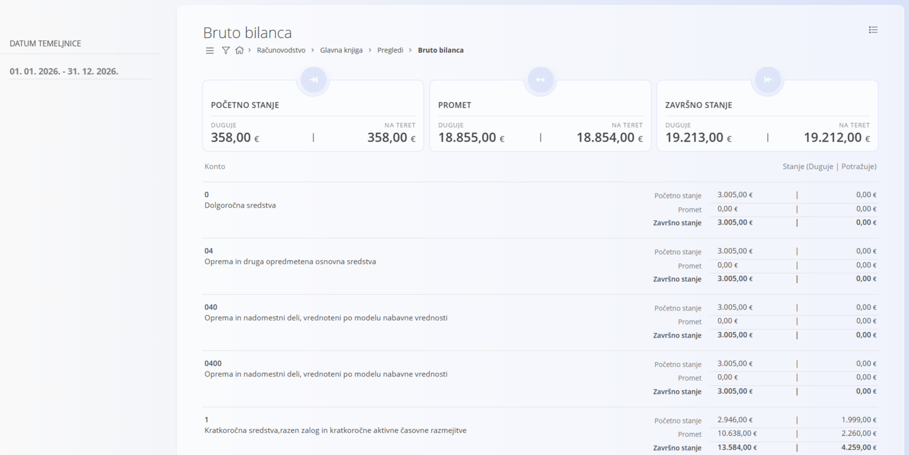

<!-- app_route: /accounting/ledger/account-summary-days -->
<!-- app_label: Bruto bilanca -->
<!-- canonical_source_url: https://github.com/Tom-PIT/Connected.Docs/blob/main/hr/Domene/Racunovodstvo/Pregledi/BrutoBilanca.md -->
<!-- canonical_source_title: Bruto bilanca -->

# Bruto bilanca

Pregled **Bruto bilanca** prikazuje zbirni pregled **početnog stanja, prometa i završnog stanja po kontu** za odabrano obračunsko razdoblje. To je **analitički pregled samo za čitanje** temeljen na proknjiženim temeljnicama i ne stvara niti mijenja dokumente.

> [!NOTE]
> - Vrijednosti se izračunavaju isključivo iz **potvrđenih temeljnica**.
> - Stupci duguje i na teret uvijek se prikazuju odvojeno, kako odražava dvojno knjigovodstvo.
> - Ovaj se pregled obično koristi za **provjere na kraju razdoblja**, **provjeru bruto bilance** i **analizu na visokoj razini** prije ulaska u detaljne promete, na primjer preko pregleda [**Kartica konta**](KarticaKonta.md).

Ovom pregledu pristupate odabirom **Računovodstvo / Glavna knjiga / Pregledi / Bruto bilanca** u [navigaciji](../../../Zajednicko/UI/Navigacija.md).

## Pregled

Za svaki konto pregled prikazuje:

- **Početno stanje** – početna stanja duguje i na teret na početku odabranog razdoblja
- **Promet** – ukupni promet duguje i na teret u razdoblju
- **Završno stanje** – završna stanja duguje i na teret na kraju razdoblja

Zbrojevi na vrhu pregleda sažimaju sve prikazane konte za odabrane filtre.

U tablici je svaki konto prikazan s oznakom i nazivom, a u desnom stupcu **Stanje (Duguje | Potražuje)**.

## Filtri

Filtri s lijeve strane sužavaju rezultate:

- **Datum temeljnice** – određuje razdoblje za izračun početnog stanja, prometa i završnog stanja
- **Konto** – ograničava pregled na jedan ili više odabranih konta
- **Tvrtka** – prikazuje stanja povezana s određenom tvrtkom

> [!NOTE]
> Nazivi konta na slici podaci su aplikacije i prikazuju se na slovenskom jeziku, kako su uneseni u demo podatke.
