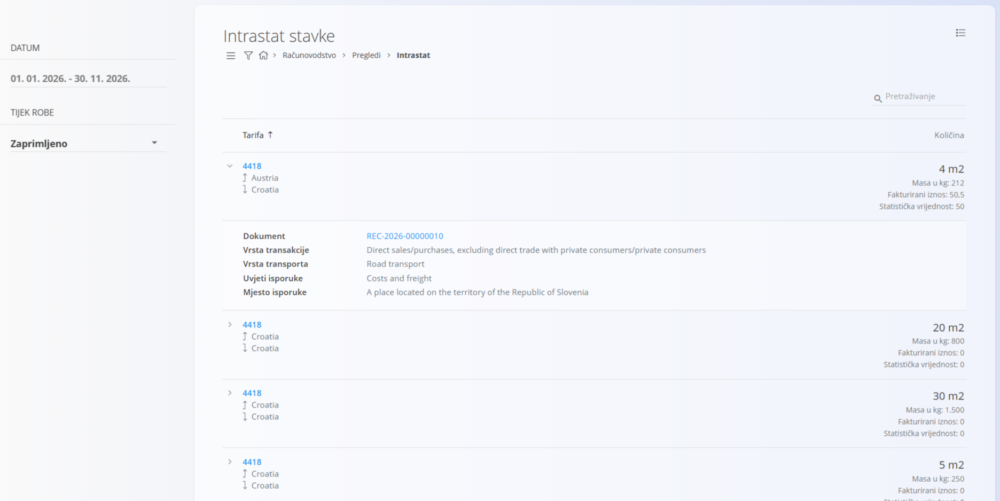

<!-- app_route: /accounting/views/intrastat-entries -->
<!-- app_label: Intrastat stavke -->
<!-- canonical_source_url: https://github.com/Tom-PIT/Connected.Docs/blob/main/hr/Domene/Racunovodstvo/Pregledi/IntrastatStavke.md -->
<!-- canonical_source_title: Intrastat stavke -->

# Intrastat stavke

Pregled **Intrastat stavke** prikazuje transakcije koje podliježu Intrastat izvještavanju. Podatke prikuplja iz računovodstvenih i prodajnih dokumenata te ih prikazuje u obliku prikladnom za pregled i izvještavanje o kretanju robe između država članica EU-a.

Ovom pregledu pristupate odabirom **Računovodstvo / Pregledi / Intrastat** u [navigaciji](../../../Zajednicko/UI/Navigacija.md).

> [!NOTE]
> Ovaj pregled je samo za čitanje. Ispravke se moraju napraviti u izvornim dokumentima ili relevantnim šifarnicima, nakon čega se Intrastat pregled automatski ponovno izračunava.

> [!IMPORTANT]
> U pregled su uključene samo transakcije koje uključuju kretanje robe između država članica EU-a. Domaće transakcije i transakcije izvan EU-a isključene su iz Intrastat izvještavanja.

Vrijednosti na slici uključuju i stavke bez iznosa (0), što znači da dokumenti za te retke još nemaju unesene vrijednosti.

## Svrha pregleda

Pregled se koristi za:

- pregled Intrastat transakcija
- provjeru količina, vrijednosti i klasifikacija prije izvještavanja
- potporu pripremi službenih Intrastat prijava

Svaki redak predstavlja sažetu Intrastat stavku, grupiranu prvenstveno prema **tarifi** i **zemlji partnera**.

## Filtri

Lijevi izbornik omogućuje filtriranje Intrastat stavki:

- **Datum** – odabire razdoblje izvještavanja (od – do).
- **Tijek robe** – odabire smjer kretanja robe:
  - otpremljena roba – roba poslana u drugu državu članicu EU-a
  - primljena roba – roba primljena iz druge države članice EU-a

Filtri utječu i na popis i na zbrojene vrijednosti prikazane u pregledu.

## Popis

Glavni popis grupiran je po [**tarifi**](../Upravljanje/Intrastat/Tarife.md).

Za svaku tarifu stavke se mogu proširiti kako bi se prikazale zemlje partnera i pojedinosti transakcija.

### Zbrojene vrijednosti

Na razini tarife i zemlje prikazuju se sljedeće vrijednosti:

- **Količina** – prikazuje se u odgovarajućoj pomoćnoj jedinici (npr. komad).
- **Masa u kg** – ukupna neto masa robe.
- **Fakturirani iznos** – ukupna fakturirana vrijednost transakcija.
- **Statistička vrijednost** – vrijednost koja se koristi za Intrastat statističko izvještavanje.

## Pojedinosti stavke

Proširivanjem stavke prikazuju se pojedinosti za svaki Intrastat redak:

- **Dokument** – referenca na izvorni računovodstveni dokument.
- **Vrsta transakcije** – razvrstavanje prema odabranoj šifri vrste transakcije (vidi [Vrsta transakcije](../Upravljanje/Intrastat/VrstaTransakcije.md)).
- **Vrsta transporta** – način prijevoza za transakciju (vidi [Vrsta transporta](../../../Zajednicko/Upravljanje/VrstaTransporta.md)).
- **Uvjeti isporuke** – uvjet isporuke, po klasifikaciji sličnoj Incotermsu (vidi [Uvjeti isporuke](../../../Zajednicko/Upravljanje/UvjetiIsporuke.md)).
- **Mjesto isporuke** – klasifikacija mjesta isporuke (vidi [Mjesto isporuke](../Upravljanje/Intrastat/MjestoIsporuke.md)).

## Izvori podataka

Intrastat stavke nastaju automatski iz proknjiženih dokumenata koji ispunjavaju Intrastat uvjete, primjerice:

- izdanih računa
- otpremnica
- drugih računovodstvenih dokumenata koji uključuju kretanje robe između država članica EU-a

Ispravnost ovog pregleda ovisi o ispravnoj konfiguraciji:

- tarifa
- pomoćnih jedinica
- vrsta transakcija
- uvjeta isporuke
- vrsta transporta
- mjesta isporuke

## Izbornik

Ovaj pregled ima radnje izbornika na dva mjesta.

Radnjama izbornika pristupa se preko gumba **Izbornik** u gornjem desnom kutu popisa ili dokumenta.

### Izbornik popisa

Izbornik popisa nudi radnje za trenutno prikazani popis.

Dostupne radnje:

- **Izvozi > CSV**

### Izbornik dokumenta

Izbornik dokumenta nudi radnje za trenutno otvoreni dokument.

Dostupne radnje:

- **Izvozi > CSV**

Pojedinosti o radnjama izbornika potražite u [**Radnje izbornika**](../../../Zajednicko/Koncepti/RadnjeIzbornika.md).
