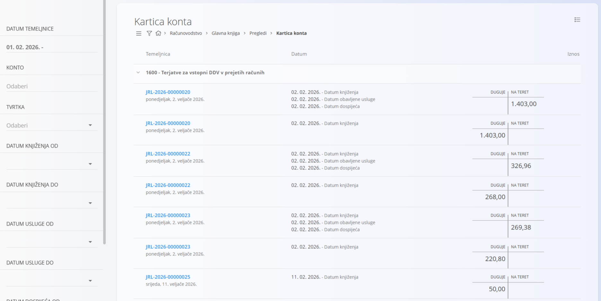

<!-- app_route: /accounting/ledger/views/account-card -->
<!-- app_label: Kartica konta -->
<!-- canonical_source_url: https://github.com/Tom-PIT/Connected.Docs/blob/main/hr/Domene/Racunovodstvo/Pregledi/KarticaKonta.md -->
<!-- canonical_source_title: Kartica konta -->

# Kartica konta

Pregled **Kartica konta** prikazuje detaljan pregled **zaduženja i odobrenja po kontu** na temelju proknjiženih temeljnica. To je **analitički pregled samo za čitanje** i ne stvara niti mijenja dokumente.

Ovom pregledu pristupate odabirom **Računovodstvo / Glavna knjiga / Pregledi / Kartica konta** u [navigaciji](../../../Zajednicko/UI/Navigacija.md).

### Svrha pregleda

Kartica konta koristi se za:

- pregled zaduženja i odobrenja za jedan ili više konta
- analizu salda u odabranom razdoblju
- praćenje knjiženja do temeljnica iz kojih potječu
- potporu usklađivanju i reviziji

Ovaj pregled prikazuje podatke samo iz **potvrđenih temeljnica**.

## Raspored i struktura

Pregled je organiziran po **kontu**, a temeljnice su poredane kronološki ispod svakog konta.

Za svaku temeljnicu prikazuju se:

- **Oznaka temeljnice**
- **Datum knjiženja** (i povezani datumi, ako postoje)
- iznosi **Duguje** i **Na teret**

Klik na **plavu oznaku temeljnice** otvara povezanu [**temeljnicu**](../Dokumenti/DvojnoKnjigovodstvo.md).

### Filtri

Filtri s lijeve strane sužavaju rezultate:

- **Datum temeljnice** – ograničava temeljnice na određeni raspon datuma
- **Konto** – prikazuje promete za jedan ili više odabranih konta
- **Tvrtka** – filtrira knjiženja povezana s određenom tvrtkom
- **Datum knjiženja od / do** – filtrira prema datumu knjiženja
- **Datum usluge od / do** – filtrira prema datumu usluge, ako je primjenjivo
- **Datum dospijeća od / do** – filtrira prema datumu dospijeća, ako je primjenjivo

Filtri se mogu kombinirati radi praćenja određenih razdoblja, konta ili poslovnih partnera.

### Izvoz podataka

Izbornik u gornjem desnom kutu služi za izvoz podataka u PDF.

## Tumačenje vrijednosti

- Stupci **Duguje** i **Na teret** prikazuju smjer knjiženja za svaku stavku temeljnice.
- Knjiženja su grupirana po pripadajućim **kontima**.
- Temeljnica se može pojaviti više puta ako utječe na više konta.

> [!NOTE]
> - U ovom pregledu prikazuju se samo **potvrđene** temeljnice.
> - Nacrti i neuravnotežene temeljnice nisu uključeni.
> - Kartica konta namijenjena je isključivo **analizi i provjeri** i ne podržava uređivanje niti knjiženje.

Za uređivanje ili ispravak knjiženja otvorite povezanu [**temeljnicu**](../Dokumenti/DvojnoKnjigovodstvo.md) izravno.

## Izbornik

Izbornik pruža dodatne radnje dostupne na ovoj stranici.

Dostupne radnje:

- **Izvozi > PDF**

Pojedinosti o radnjama izbornika potražite u [**Radnje izbornika**](../../../Zajednicko/Koncepti/RadnjeIzbornika.md).
