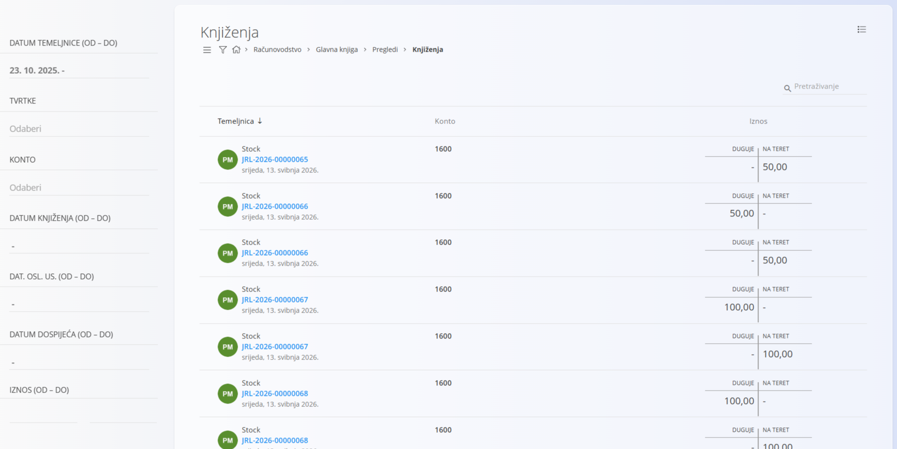

<!-- app_route: /accounting/ledger/views/journal-entry-details -->
<!-- app_label: Knjiženja -->
<!-- canonical_source_url: https://github.com/Tom-PIT/Connected.Docs/blob/main/hr/Domene/Racunovodstvo/Pregledi/Knjizenja.md -->
<!-- canonical_source_title: Knjiženja -->

# Knjiženja

Pregled **Knjiženja** prikazuje ravni pregled svih stavki duguje i na teret, na razini pojedinačnog knjiženja, nastalih iz proknjiženih temeljnica. Svaki redak predstavlja **jednu stavku knjiženja** i prikazuje konto, iznos i temeljnicu iz koje potječe.

To je **analitički pregled samo za čitanje** koji se koristi za pregled i reviziju knjiženja. Podaci se na ovom ekranu ne mogu uređivati.

Ovom pregledu pristupate odabirom **Računovodstvo / Glavna knjiga / Pregledi / Knjiženja** u [navigaciji](../../../Zajednicko/UI/Navigacija.md).

## Kako se pregled koristi

Pregled Knjiženja koristi se za:

- pregled pojedinačnih stavki duguje i na teret u svim temeljnicama
- provjeru koji je konto bio pogođen određenim dokumentom
- praćenje iznosa do temeljnice iz koje potječu
- potporu usklađivanju, reviziji i rješavanju problema

Klik na plavu oznaku temeljnice otvara povezanu [**temeljnicu**](../Dokumenti/DvojnoKnjigovodstvo.md).

## Filtri

Filtri s lijeve strane sužavaju rezultate:

- **Datum temeljnice (od – do)** – ograničava knjiženja na raspon datuma temeljnice
- **Tvrtke** – prikazuje knjiženja povezana s odabranim tvrtkama
- **Konto** – prikazuje knjiženja za jedan ili više odabranih konta
- **Datum knjiženja (od – do)** – filtrira prema datumu knjiženja
- **Dat. osl. us. (od – do)** – filtrira prema datumu obavljene usluge
- **Datum dospijeća (od – do)** – filtrira prema datumu dospijeća
- **Iznos (od – do)** – filtrira prema rasponu iznosa

## Stupci

Svaki redak u popisu prikazuje:

- **Temeljnica** – temeljnica koja je stvorila knjiženje
- **Konto** – konto glavne knjige na koji je knjiženje evidentirano
- **Iznos** – iznos u stupcu **Duguje** ili **Na teret**

> [!NOTE]
> Pregled Knjiženja prikazuje sva knjiženja bez obzira na saldo. Za razliku od temeljnica, ovaj pregled ne grupira stavke duguje i na teret i ne pokazuje je li temeljnica uravnotežena.

## Izbornik

Izbornik pruža dodatne radnje dostupne na ovoj stranici.

Dostupne radnje:

- **Izvozi > CSV**

Pojedinosti o radnjama izbornika potražite u [**Radnje izbornika**](../../../Zajednicko/Koncepti/RadnjeIzbornika.md).
