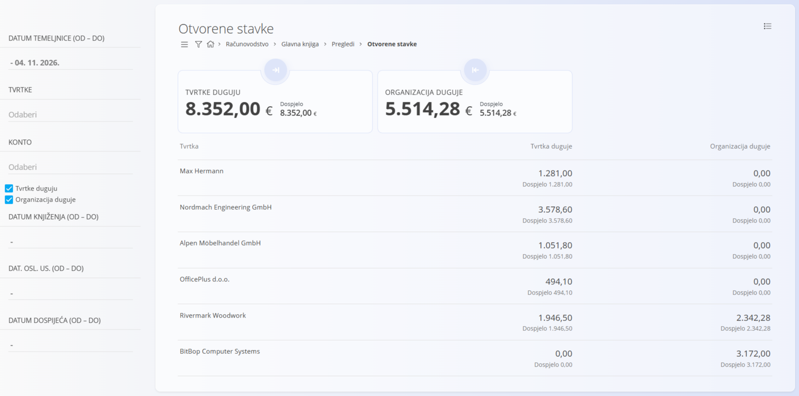

<!-- app_route: /accounting/ledger/views/open-items -->
<!-- app_label: Otvorene stavke -->
<!-- canonical_source_url: https://github.com/Tom-PIT/Connected.Docs/blob/main/hr/Domene/Racunovodstvo/Pregledi/OtvoreneStavke.md -->
<!-- canonical_source_title: Otvorene stavke -->

# Otvorene stavke

Pregled **Otvorene stavke** prikazuje knjigovodstvene zapise nastale iz računa koji još **nisu u potpunosti podmireni**. To je **analitički pregled samo za čitanje** koji se koristi za praćenje nepodmirenih potraživanja i obveza te dospjelih iznosa.

Ovom pregledu pristupate odabirom **Računovodstvo / Glavna knjiga / Pregledi / Otvorene stavke** u [navigaciji](../../../Zajednicko/UI/Navigacija.md).

> [!NOTE]
> Ovaj pregled je samo za čitanje. Otvorene stavke ne mogu se uređivati izravno, nego se moraju riješiti plaćanjima, podmirenjima ili ispravnim knjiženjima.

> [!IMPORTANT]
> Točnost ovog pregleda ovisi o ispravnom knjiženju, podmirenju i usklađivanju računa i plaćanja.

## Svrha pregleda

Pregled Otvorene stavke koristi se za:

- praćenje neplaćenih računa kupaca (potraživanja)
- praćenje neplaćenih računa dobavljača (obveza)
- praćenje dospjelih i prekoračenih iznosa
- potporu analizi novčanog toka i daljnjim koracima naplate

Ovaj pregled prikazuje podatke samo iz **potvrđenih temeljnica**. Svaki redak predstavlja zbirne otvorene stavke po tvrtki.

## Raspored i struktura

Pregled je grupiran po **tvrtki**. Za svaku tvrtku prikazuju se:

- **Tvrtka** – naziv kupca ili dobavljača
- **Tvrtka duguje** – iznos koji tvrtka duguje organizaciji
- **Organizacija duguje** – iznos koji organizacija duguje tvrtki
- **Dospjelo** – dio iznosa koji je prekoračio rok dospijeća

Iznosi su prikazani u valuti dokumenta i odražavaju trenutačno otvoreno stanje.

## Sažeti pokazatelji

Na vrhu zaslona dvije kartice daju brz pregled:

- **Tvrtke duguju** – ukupni iznos koji kupci duguju organizaciji (otvorena potraživanja)
- **Organizacija duguje** – ukupni iznos koji organizacija duguje dobavljačima (otvorene obveze)

Svaka kartica prikazuje i iznos **Dospjelo**, koji predstavlja stavke kojima je prošao rok dospijeća.

## Filtri

Lijevi izbornik omogućuje filtriranje otvorenih stavki prema više kriterija:

- **Datum temeljnice (od – do)** – filtrira stavke prema datumu temeljnice
- **Tvrtke** – filtrira prema kupcu ili dobavljaču
- **Konto** – filtrira prema kontu glavne knjige
- **Tvrtke duguju / Organizacija duguje** – uključuje ili isključuje potraživanja i/ili obveze
- **Datum knjiženja (od – do)** – filtrira prema datumu knjiženja temeljnica
- **Dat. osl. us. (od – do)** – filtrira prema datumu obavljene usluge iz izvornog dokumenta
- **Datum dospijeća (od – do)** – filtrira stavke prema datumu dospijeća

Filtri se mogu kombinirati radi praćenja određenih razdoblja, konta ili poslovnih partnera.

## Izvori podataka

Otvorene stavke nastaju iz proknjiženih računovodstvenih zapisa, najčešće iz:

- izdanih računa
- ulaznih računa
- odobrenja
- djelomičnih plaćanja i podmirenja

Kad se račun u potpunosti plati ili podmiri, automatski se uklanja iz ovog pregleda.

## Izbornik

Izbornik pruža dodatne radnje dostupne na ovoj stranici.

Dostupne radnje:

- **Izvozi > PDF**

Pojedinosti o radnjama izbornika potražite u [**Radnje izbornika**](../../../Zajednicko/Koncepti/RadnjeIzbornika.md).
