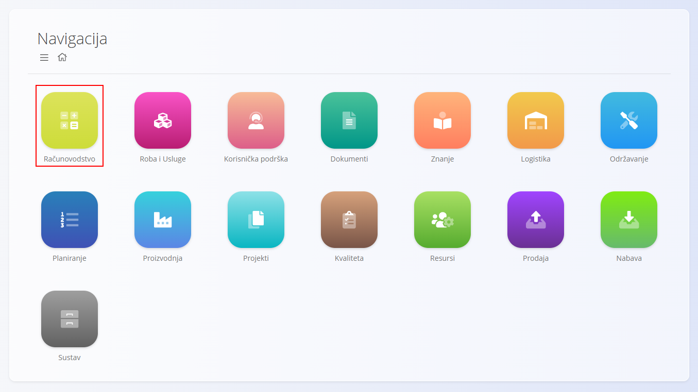
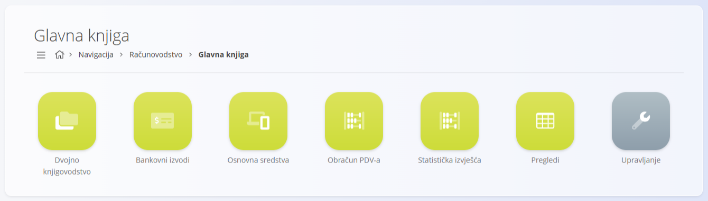
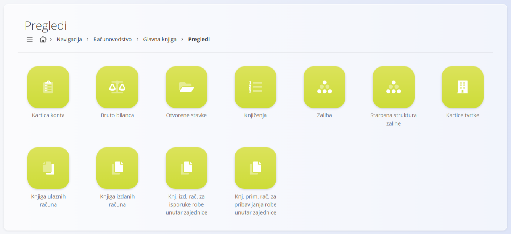
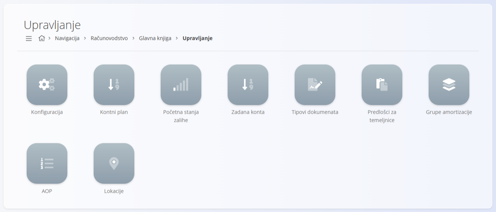
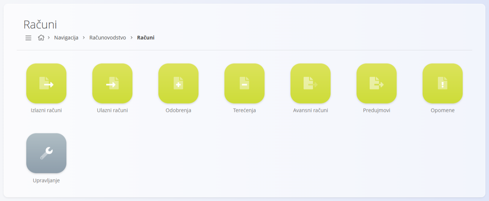
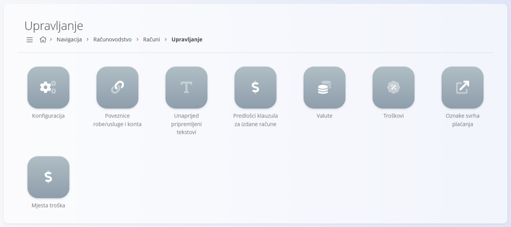
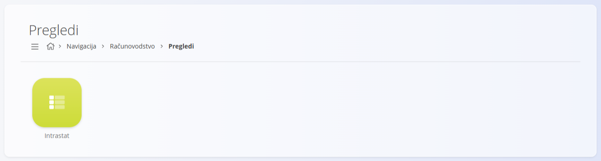
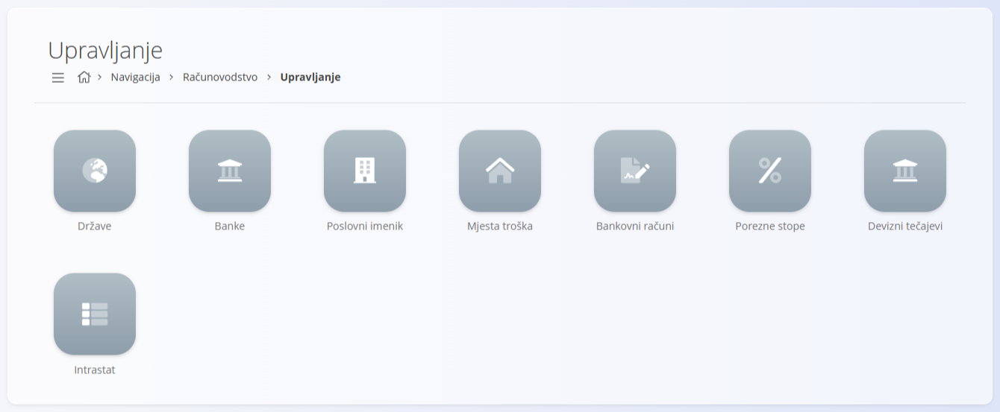

<!-- app_route: /sitemap/accounting -->
<!-- app_label: Accounting domain -->
<!-- canonical_source_url: https://github.com/Tom-PIT/Connected.Docs/blob/main/en/Domains/Accounting/README.md -->
<!-- canonical_source_title: Accounting domain -->

# Računovodstvo

Domena **Računovodstvo** sadrži sve zapise, izvještaje i konfiguraciju potrebnu za **evidentiranje, kontrolu i analizu financijskih transakcija**.  

Domena preuzima operativne dokumente nastale u drugim domenama (kao što su [**Prodaja**](../Prodaja/README.md), [**Nabava**](../Nabava/README.md) i [**Logistika**](../Logistika/README.md)) i pretvara ih u **službena knjigovodstvena knjiženja**, čime se osiguravaju usklađenost, sljedivost i točno financijsko izvještavanje.

Za pristup ovoj domeni u [navigaciji](../../Zajednicko/UI/Navigacija.md) odaberite **Računovodstvo**.

> [!NOTE]  
> Dostupni odjeljci i funkcionalnosti ovise o konfiguraciji tvrtke, uključenim knjigovodstvenim modulima i lokalnom zakonodavstvu.

## Što sadrži domena Računovodstvo?

Domena Računovodstvo znatno je **složenija od većine drugih domena**. Nekoliko njezinih glavnih područja (osobito **Glavna knjiga** i **Računi**) sadrži vlastite odjeljke **Dokumenti**, **Pregledi** i **Upravljanje**.

Domena je organizirana u sljedeća glavna područja:

- **[Glavna knjiga](#glavna-knjiga)** – temeljni knjigovodstveni zapisi, knjiženja i zakonsko izvještavanje  
- **[Banka](#banka)** – knjigovodstvene operacije vezane uz banku  
- **[Računi](#racuni-racunovodstvo)** – dokumenti računa iz knjigovodstvene perspektive  
- **[Pregledi](#pregledi)** – analitički prikazi računovodstva samo za čitanje  
- **[Upravljanje](#upravljanje)** – globalna konfiguracija računovodstva i matični podaci

## Glavna knjiga

**Glavna knjiga** je **srž domene Računovodstvo**.  
Sadrži sva knjiženja, stavke, salda i računovodstvena izvješća nastala iz financijskih dokumenata i poslovnih transakcija.

Unutar glavne knjige funkcionalnost je dodatno podijeljena na **Dokumente**, **Preglede** i **Upravljanje**.

### Glavna knjiga – Dokumenti

Dokumenti glavne knjige predstavljaju **formalne knjigovodstvene zapise** i zakonske podatke.

Dostupni dokumenti glavne knjige uključuju:

- **[Dvojno knjigovodstvo](Dokumenti/DvojnoKnjigovodstvo.md)** – Knjiženja nastala iz računovodstvenih dokumenata ili unesena ručno.
- **[Bankovni izvodi](Dokumenti/BankovniIzvodi.md)** – Bankovna kretanja koja stvaraju knjiženja pri objavi.
- **[Osnovna sredstva](Dokumenti/OsnovnaSredstva.md)** – Zapisi o imovini koji se koriste za amortizaciju i praćenje dugoročne vrijednosti.
- **[Obračun PDV-a](Dokumenti/ObracunPdv.md)** – Periodični porezni sažeci koji se koriste za pripremu službenih poreznih prijava.
- **[Statistička izvješća](Dokumenti/StatistickaIzvjesca.md)** – Generirani financijski izvještaji, poput bilance i računa dobiti i gubitka.

Ovi dokumenti **stvaraju ili sažimaju knjiženja** i temelj su financijskog izvještavanja.

### Glavna knjiga – Pregledi

Pregledi glavne knjige pružaju **analitičke prikaze i prikaze za kontrolu** podataka o računovodstvu.  
Samo su za **čitanje** i ne stvaraju transakcije.

Dostupni pregledi uključuju:

- **[Kartica konta](Pregledi/KarticaKonta.md)** – Detaljna zaduženja i odobrenja po kontu.
- **[Bruto bilanca](Pregledi/BrutoBilanca.md)** – Zbrojeni saldi s početnim stanjem, prometom i završnim stanjem.
- **[Otvorene stavke](Pregledi/OtvoreneStavke.md)** – Nepodmirena potraživanja i obveze po tvrtki.
- **[Knjiženja](Pregledi/Knjizenja.md)** – Popis svih knjiženja s mogućnostima filtriranja.
- **[Zaliha](Pregledi/LedgerStock.md)** – Financijska vrijednost zaliha po datumu.
- **[Starosna struktura zalihe](Pregledi/StockAgeStructure.md)** – Analiza starenja zaliha kroz vrijeme.
- **[Intrastat stavke](Pregledi/IntrastatStavke.md)** – Transakcije koje podliježu Intrastat izvještavanju.
- **[Kartice tvrtke](../Prodaja/Pogledi/KarticeTvrtke.md)** – Financijski pregled po poslovnom partneru.

Ovi pregledi podržavaju **reviziju, usklađivanje i financijsku analizu**.

### Glavna knjiga – Upravljanje

Upravljanje glavnom knjigom sadrži **tehničku i računovodstvenu konfiguraciju** koja određuje kako nastaju knjiženja.

Dostupna konfiguracija uključuje:

- **[Konfiguracija](Upravljanje/GlavnaKnjiga/Konfiguracija.md)** – Globalne postavke ponašanja glavne knjige.
- **[Kontni plan](Upravljanje/GlavnaKnjiga/KontniPlan.md)** – Definicija svih konta glavne knjige.
- **[Početna stanja zalihe](Upravljanje/GlavnaKnjiga/PocetnaStanjaZalihe.md)** – Početni saldi za vrednovanje zaliha.
- **[Zadana konta](Upravljanje/GlavnaKnjiga/ZadaneKonta.md)** – Zadana konta koja se koriste pri knjiženju.
- **[Tipovi dokumenata](Upravljanje/GlavnaKnjiga/TipoviDokumenata.md)** – Pravila koja određuju kako dokumenti stvaraju temeljnice.
- **[Predlošci za temeljnice](Upravljanje/GlavnaKnjiga/PredlosciZaTemeljnice.md)** – Predlošci knjiženja za ponavljajuće stavke.
- **[Grupe amortizacije](Upravljanje/GlavnaKnjiga/GrupeAmortizacije.md)** – Pravila za amortizaciju imovine.
- **[AOP](Upravljanje/GlavnaKnjiga/AOP.md)** – Struktura računovodstvene klasifikacije koja se koristi u izvještajima i sažecima.
- **[Lokacije](Upravljanje/GlavnaKnjiga/Lokacije.md)** – Fizičke ili organizacijske lokacije povezane s imovinom i knjiženjima.

Ovi elementi određuju **kako računovodstvena logika funkcionira na razini cijelog sustava**.

## Banka

Odjeljak **Banka** obuhvaća knjigovodstvene operacije vezane uz bankarsko poslovanje.

Dostupni dokumenti uključuju:

- **[Platni nalozi](Dokumenti/PlatniNalozi.md)** – Upute za odlazna i dolazna plaćanja koja se obrađuju preko banaka.

Bankovni dokumenti često su povezani s **bankovnim izvodima** i **knjiženjima** kako bi se novčani tok u potpunosti odrazio u glavnoj knjizi.

## Računi (računovodstvo)

Odjeljak **Računi** u računovodstvu pruža **dokumente računa**, od kojih se većina dijeli s domenom Prodaja.

Dostupni dokumenti računa uključuju:

- [**Ulazni računi**](Dokumenti/UlazniRacuni.md)
- [**Izlazni računi**](../Prodaja/Dokumenti/IzlazniRacuni.md)
- [**Odobrenja**](../Prodaja/Dokumenti/Odobrenja.md)
- [**Terećenja**](../Prodaja/Dokumenti/Terecenja.md)
- [**Avansni računi**](../Prodaja/Dokumenti/AvansniRacuni.md)
- [**Predujmovi**](../Prodaja/Dokumenti/Predujmovi.md)
- [**Opomene**](../Prodaja/Dokumenti/Opomene.md)

Kako bi se izbjeglo dupliciranje, **struktura dokumenata opisana je u domeni Prodaja**, dok su **ponašanja specifična za računovodstvo** (knjiženje, podmirenje, obrada poreza) opisana ovdje.

### Računi – Upravljanje

Konfiguracija računa koju koristi računovodstvo grupirana je zasebno.

Dostupna konfiguracija uključuje:

- [**Konfiguracija**](Upravljanje/Racuni/KonfiguracijaRacuna.md) – Računovodstveno ponašanje računa i zadane vrijednosti.
- [**Poveznice robe/usluge i konta**](Upravljanje/Racuni/PoveznicaRobeIKonta.md) – Veze između računa i računovodstva imovine.
- [**Unaprijed pripremljeni tekstovi**](../../Zajednicko/Upravljanje/UnaprijedPripremljeniTekstovi.md) – Standardni tekstovi koji se koriste na računovodstvenim dokumentima.
- [**Predlošci klauzula za izdane račune**](../Prodaja/Upravljanje/PredlosciKlauzulaZaIzdaneRacune.md)
- [**Valute**](../../Zajednicko/Upravljanje/Valute.md)
- [**Troškovi**](../Nabava/Upravljanje/Troskovi.md)
- [**Oznake svrha plaćanja**](../Prodaja/Upravljanje/OznakeSvrhaPlacanja.md)
- [**Mjesta troška**](../../Zajednicko/Upravljanje/MjestaTroska.md)

Ove postavke određuju **kako podaci o računima ulaze u računovodstvo**.

## Pregledi

Odjeljak **Pregledi** na razini domene Računovodstvo pruža **izravan pristup analitičkim ekranima** i objedinjuje preglede glavne knjige i izvještaje vezane uz račune.

Ovi ekrani su **samo za čitanje** i namijenjeni su **praćenju i analizi financija**.

## Upravljanje

Odjeljak **Upravljanje** sadrži **zajedničke glavne podatke računovodstva** koji se koriste u glavnoj knjizi, računima i bankovnim operacijama.

Dostupna konfiguracija uključuje:

- [**Države**](../../Zajednicko/Upravljanje/Drzave.md)
- [**Banke**](../../Zajednicko/Upravljanje/Banke.md)
- [**Poslovni imenik**](../../Zajednicko/Upravljanje/PoslovniImenik.md)
- [**Mjesta troška**](../../Zajednicko/Upravljanje/MjestaTroska.md)
- [**Bankovni računi**](../Prodaja/Upravljanje/BankovniRacuniOrganizacije.md)
- [**Porezne stope**](../../Zajednicko/Upravljanje/PorezneStope.md)
- [**Devizni tečajevi**](../Prodaja/Upravljanje/DevizniTecajevi.md)
- **Intrastat** – šifrarnici za izvještavanje o trgovini unutar EU:
  - [**Pregled**](Upravljanje/Intrastat/Index.md)
  - [**Vrsta transakcije**](Upravljanje/Intrastat/VrstaTransakcije.md)
  - [**Uvjeti isporuke**](../../Zajednicko/Upravljanje/UvjetiIsporuke.md)
  - [**Vrsta transporta**](../../Zajednicko/Upravljanje/VrstaTransporta.md)
  - [**Mjesto isporuke**](Upravljanje/Intrastat/MjestoIsporuke.md)
  - [**Pomoćne jedinice**](Upravljanje/Intrastat/PomocneJedinice.md)
  - [**Tarife**](Upravljanje/Intrastat/Tarife.md)

Ovi šifrarnici osiguravaju **dosljednu financijsku klasifikaciju i izvještavanje**.

## Računovodstvo i ostale domene

Računovodstvo je usko povezano s ostalim operativnim domenama:

| Domena | Interakcija |
|------|-------------|
| **[Prodaja](../Prodaja/README.md)** | Izdani računi, priznavanje prihoda, potraživanja. |
| **[Nabava](../Nabava/README.md)** | Primljeni računi, troškovi nabave, obveze. |
| **[Logistika](../Logistika/README.md)** | Kretanja zaliha i vrednovanje. |
| **[Roba i usluge](../RobaIUsluge/README.md)** | Osnovna sredstva, amortizacija, praćenje dugoročne vrijednosti. |
