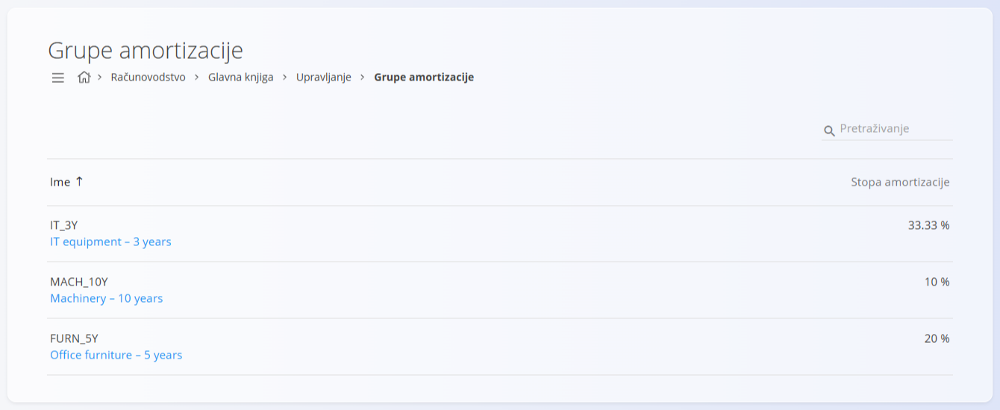

<!-- app_route: /management/accounting/depreciation-groups -->
<!-- app_label: Grupe amortizacije -->
<!-- canonical_source_url: https://github.com/Tom-PIT/Connected.Docs/blob/main/hr/Domene/Racunovodstvo/Upravljanje/GlavnaKnjiga/GrupeAmortizacije.md -->
<!-- canonical_source_title: Grupe amortizacije -->

# Grupe amortizacije

Ekran **Grupe amortizacije** određuje kako se osnovna sredstva amortiziraju u glavnoj knjizi. Grupa amortizacije navodi stopu amortizacije i konte na koje se evidentiraju nabavna vrijednost, ispravak vrijednosti (akumulirana amortizacija) i trošak amortizacije.

Grupe amortizacije navode se uz osnovna sredstva, a sustav ih koristi pri izračunu i knjiženju amortizacije.

Ovom ekranu pristupate odabirom **Računovodstvo / Glavna knjiga / Upravljanje / Grupe amortizacije** u [navigaciji](../../../../Zajednicko/UI/Navigacija.md).

> [!NOTE]
> **Preduvjeti**
>
> [**Kontni plan**](KontniPlan.md) mora imati potrebne konte za **nabavnu vrijednost**, **ispravak vrijednosti** i **trošak amortizacije**.

### Pregled

Grupa amortizacije:

* predstavlja **pravilo amortizacije** za vrstu imovine
* određuje **stopu amortizacije (%)**
* povezuje knjiženja amortizacije s određenim kontima glavne knjige
* može se ponovno koristiti za više osnovnih sredstava

Grupe amortizacije nisu same imovina. To su konfiguracijski zapisi koji standardiziraju ponašanje amortizacije.

## Shema

| Polje | Opis |
|------|-------------|
| **Oznaka** | Tehnički identifikator grupe amortizacije. |
| **Ime** | Opisni naziv grupe amortizacije. |
| **Stopa amortizacije** | Godišnja stopa amortizacije izražena u postotku. |
| **Konto nabavne vrijednosti** | Konto na koji se evidentira izvorna nabavna vrijednost sredstva. |
| **Konto ispravka vrijednosti** | Konto na koji se nakuplja amortizacija (ispravak vrijednosti). |
| **Konto troška amortizacije** | Konto troška na koji se evidentira trošak amortizacije. |

## Popis

Popis prikazuje sve definirane grupe amortizacije.

Svaki redak prikazuje:

* **Ime**
* **Stopa amortizacije**

Kliknite grupu amortizacije na popisu da je otvorite u načinu uređivanja.

## Radnje

### Dodavanje grupe amortizacije

Za dodavanje nove grupe amortizacije:

1. Kliknite [gumb radnji](../../../../Zajednicko/UI/AkcijskiGumb.md) za stvaranje novog unosa.
2. Unesite:

   * **Oznaku**
   * **Ime**
   * **Stopa amortizacije (%)**

3. Odaberite potrebne konte:

   * **Konto nabavne vrijednosti**
   * **Konto ispravka vrijednosti**
   * **Konto troška amortizacije**

4. Kliknite **Dodaj** za spremanje grupe amortizacije ili **Poništi** za odbacivanje unosa.

### Uređivanje grupe amortizacije

Kliknite grupu amortizacije na popisu da je otvorite u načinu uređivanja. Po potrebi izmijenite polja.

Kliknite **Spremi** za primjenu promjena ili **Poništi** za odbacivanje.

## Praktični primjer

Zamislite tvrtku kojoj je za proizvodne strojeve potrebna grupa amortizacije, jer očekivani vijek korištenja iznosi 10 godina.

### Strojevi – 10 godina

* **Oznaka:** MACH_10Y
* **Stopa amortizacije:** 10 %
* **Namjena:** proizvodni strojevi i oprema
* **Konto nabavne vrijednosti:** Machinery
* **Konto ispravka vrijednosti:** Accumulated depreciation – Machinery
* **Konto troška amortizacije:** Depreciation expense

Ova grupa prikladna je za proizvodnu imovinu dugog vijeka.

> [!NOTE]
> Nazivi konta i grupe na slici i u primjeru prikazuju se na engleskom jeziku, kao što ih aplikacija prikazuje.

## Brisanje grupe amortizacije

Grupa amortizacije može se izbrisati samo ako je ne koristi nijedno osnovno sredstvo.

Za brisanje otvorite grupu u načinu uređivanja i odaberite **Izbriši**.

> [!WARNING]
> Brisanje grupe amortizacije koja je u upotrebi može onemogućiti obradu amortizacije za pogođena osnovna sredstva.
