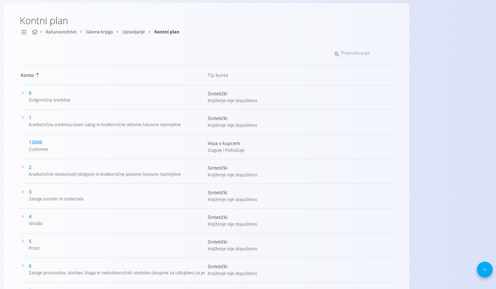
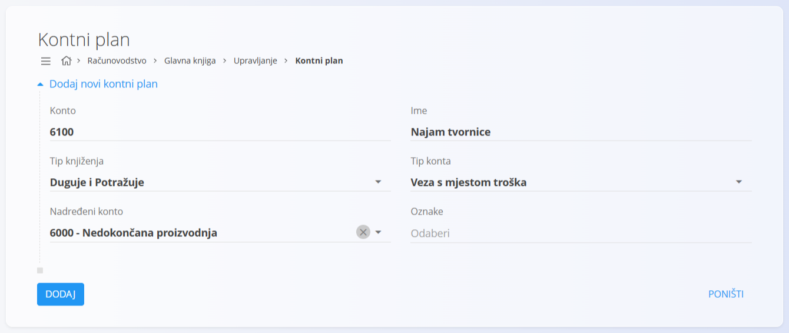

<!-- app_route: /management/ledger/accounts -->
<!-- app_label: Kontni plan -->
<!-- canonical_source_url: https://github.com/Tom-PIT/Connected.Docs/blob/main/hr/Domene/Racunovodstvo/Upravljanje/GlavnaKnjiga/KontniPlan.md -->
<!-- canonical_source_title: Kontni plan -->

# Kontni plan

**Kontni plan** određuje cjelokupnu strukturu financijskih konta koje sustav koristi za evidentiranje, klasifikaciju i izvještavanje o svim računovodstvenim transakcijama. Svaki konto predstavlja određenu financijsku kategoriju, poput imovine, prihoda, troškova proizvodnje ili operativnih rashoda.

**Kontni plan** je **temeljna računovodstvena struktura**. Na njega se pozivaju mnogi drugi dijelovi sustava, uključujući temeljnice, račune, vrednovanje zaliha, mjesta troška i financijska izvješća. Konti se zato moraju definirati prije nego što se mogu koristiti drugdje.

Ovom ekranu pristupate odabirom **Računovodstvo / Glavna knjiga / Upravljanje / Kontni plan** u [navigaciji](../../../../Zajednicko/UI/Navigacija.md).

## Europski računovodstveni kontekst

U većini zemalja EU kontni plan slijedi **strukturirani i hijerarhijski model**, koji često određuju ili snažno oblikuju nacionalni propisi o računovodstvu.

To uobičajeno uključuje:

- razrede konta (npr. 1 do 9) koji predstavljaju najviše financijske kategorije
- sintetičke (grupne) konte koji služe za strukturu i izvještavanje
- analitičke konte za operativna knjiženja

Sustav je osmišljen da podrži taj model, uz zadržavanje fleksibilnosti za proširenja specifična za tvrtku.

> [!NOTE]
> Iako je hijerarhijski model kontnog plana sa sintetičkim i analitičkim kontima čest u većini zemalja EU, sustav podržava i nestandardne ili kontne planove koje definira tvrtka. To uključuje jednostavnije strukture bez unaprijed definiranih razreda konta ili sintetičkih nadređenih konta, koji su češći u zemljama izvan EU-a ili u računovodstvu na razini grupe.

### Nacionalne razlike

Iako je ukupna struktura kontnih planova u EU slična, pojedinačno označavanje, nazivi i obvezne strukture konta mogu se razlikovati po zemljama.

Sustav ne nameće jedinstveni nacionalni kontni plan, nego podržava uvoz i proširenje predložaka specifičnih za pojedinu zemlju.

## Shema

| Polje | Opis |
|------|-------------|
| **Konto** | Jedinstveni brojčani identifikator konta. Numeriranje obično slijedi logičku strukturu (npr. imovina, prihodi, troškovi) (obavezno). |
| **Ime** | Opisni naziv konta koji jasno pokazuje njegovu namjenu (obavezno). |
| **Tip knjiženja** | Određuje može li se i kako na konto knjižiti. |
| **Tip konta** | Određuje zahtjeve za knjiženje i analitiku za konto, npr. vezu s mjestom troška ili kupcem (obavezno). |
| **Nadređeni konto** | Određuje hijerarhijski položaj konta u kontnom planu. U strukturama EU analitički konti se obično kreiraju pod unaprijed definiranim sintetičkim nadređenim kontima. |
| **Oznake** | Oznake za filtriranje, izvještavanje ili integracije. |

### Tip knjiženja

**Tip knjiženja** određuje kako se konto može koristiti u računovodstvenim zapisima:

* **Knjiženje nije dopušteno** – Konto je strukturni ili grupni konto. Na njega se ne može knjižiti izravno.
* **Duguje** – Dopuštena su samo knjiženja na strani duguje.
* **Potražuje** – Dopuštena su samo knjiženja na strani potražuje.
* **Duguje i Potražuje** – Dopuštena su knjiženja na obje strane.

> [!TIP]
> Grupni konti (kao što su *Troškovi proizvodnje* ili *Operativni rashodi*) obično koriste **Knjiženje nije dopušteno**, dok operativni konti koriste **Duguje i Potražuje**.

### Tip konta

**Tip konta** određuje mora li konto biti povezan s drugim poslovnim subjektom:

* **Bez veze** – Konto se koristi samostalno, bez obveznih veza.
* **Veza s mjestom troška** – Svako knjiženje mora upućivati na mjesto troška.
* **Veza s kupcem** – Svako knjiženje mora upućivati na kupca.
* **Sintetički** – Strukturni konto za grupiranje i izvještavanje. Sintetičke konte obično definira nacionalni računovodstveni okvir i ne dopuštaju izravna knjiženja.

> [!NOTE]
> Operativna knjiženja uvijek se evidentiraju na analitičkim kontima, koja su definirana kao podređena sintetičkim kontima.

## Popis

Prikaz popisa prikazuje sve definirane konte u hijerarhijskoj strukturi.

Svaki redak prikazuje:

* **Konto** (broj konta)
* **Ime** konta
* **Tip konta i pravila knjiženja**

Nadređeni konti mogu se proširiti kako bi prikazali podređene konte. Popis se može pretraživati pomoću polja za pretraživanje u gornjem desnom kutu.

## Radnje

Kliknite [gumb radnji](../../../../Zajednicko/UI/AkcijskiGumb.md) za pristup dostupnim radnjama:

- **Novi**
- **Uvoz**

### Dodavanje novog konta

1. Kliknite gumb radnji i odaberite **Novi**.
2. Unesite obavezna polja.
3. Kliknite **Dodaj** za spremanje konta ili **Poništi** za odbacivanje unosa.

### Uvoz konta

Radnja **Uvoz** omogućuje masovno stvaranje konta učitavanjem CSV datoteke. Obično se koristi tijekom početnog postavljanja sustava ili migracije iz drugog računovodstvenog sustava.

CSV datoteka mora slijediti očekivanu strukturu stupaca za konte, uključujući brojeve konta, nazive i polja konfiguracije.

### Uređivanje konta

Kliknite konto na popisu da ga otvorite u načinu uređivanja. Svojstva možete mijenjati dok ih ne ograničavaju postojeća knjiženja ili ovisnosti.

Kliknite **Spremi** za primjenu promjena ili **Poništi** za odbacivanje.

## Napomene o upotrebi

* Nadređeni (grupni) konti ne bi smjeli dopuštati knjiženja.
* Proizvodna poduzeća obično odvajaju **troškove proizvodnje** od **operativnih rashoda**.
* Konti vezani uz mjesta troška uobičajeno se koriste za praćenje proizvodnje, rada i općih troškova.
* Kontni plan treba definirati prije stvaranja temeljnica, računa ili transakcija zaliha.

## Brisanje konta

Konto se može izbrisati na ekranu za uređivanje klikom na gumb **Izbriši**. Može se izbrisati samo ako nije povezan s:

* temeljnicama
* dokumentima (npr. računima, kretanjima zaliha)
* izvješćima ili izračunima

Ako je konto već korišten, brisanje je blokirano kako bi se očuvala cjelovitost računovodstva.
