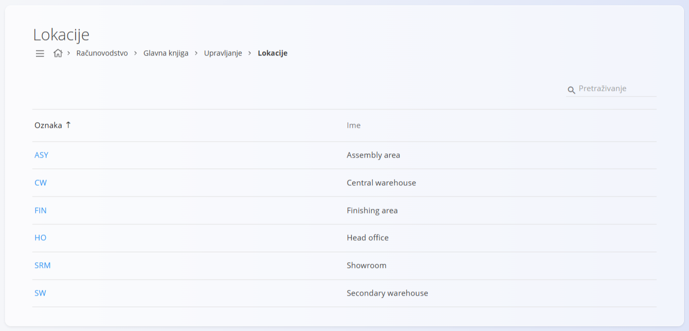
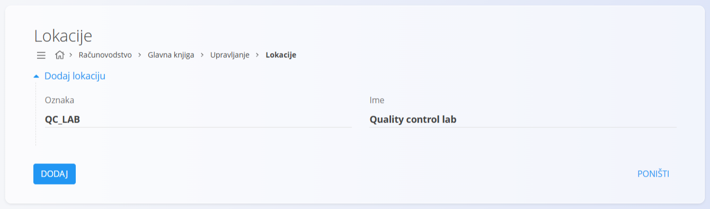

<!-- app_route: /management/accounting/locations -->
<!-- app_label: Lokacije -->
<!-- canonical_source_url: https://github.com/Tom-PIT/Connected.Docs/blob/main/hr/Domene/Racunovodstvo/Upravljanje/GlavnaKnjiga/Lokacije.md -->
<!-- canonical_source_title: Lokacije -->

# Lokacije

Ekran **Lokacije** definira lokacije koje se koriste za računovodstvene i izvještajne potrebe u glavnoj knjizi. Lokacije predstavljaju fizička ili organizacijska mjesta na kojima se nalaze osnovna sredstva, zalihe ili vrijednosti, a na njih se pozivaju drugi računovodstveni objekti.

Lokacije su konfiguracijski zapisi. Same po sebi ne stvaraju knjiženja, nego daju kontekstualne podatke koje koriste osnovna sredstva, zalihe i izvješća.

Kako se ne bi brkale s lokacijama vezanim uz logistiku, u ovoj dokumentaciji ovaj ekran nazivamo **Lokacije glavne knjige**.

Ovom ekranu pristupate odabirom **Računovodstvo / Glavna knjiga / Upravljanje / Lokacije** u [navigaciji](../../../../Zajednicko/UI/Navigacija.md).

### Pregled

Lokacija:

* predstavlja **fizičko ili organizacijsko mjesto**
* može se navesti kod objekata vezanih uz računovodstvo
* podržava klasifikaciju i izvještavanje
* ne utječe izravno na knjiženja

Lokacije se obično koriste za opis mjesta na kojima su osnovna sredstva ili zalihe, kao što su proizvodna područja, skladišta ili uredi.

## Shema

| Polje | Opis |
|------|-------------|
| **Oznaka** | Kratki tehnički identifikator lokacije. |
| **Ime** | Opisni naziv lokacije. |

## Popis

Popis prikazuje sve definirane lokacije.

Svaki redak prikazuje:

* **Oznaku**
* **Ime**

Kliknite lokaciju na popisu da je otvorite u načinu uređivanja.

## Radnje

### Dodavanje lokacije

1. Kliknite [gumb radnji](../../../../Zajednicko/UI/AkcijskiGumb.md) za stvaranje novog unosa.
2. Unesite:

   * **Oznaku**
   * **Ime**

3. Kliknite **Dodaj** za spremanje lokacije ili **Poništi** za odbacivanje unosa.

### Uređivanje lokacije

Kliknite lokaciju na popisu da je otvorite u načinu uređivanja. Po potrebi izmijenite polja.

Kliknite **Spremi** za primjenu promjena ili **Poništi** za odbacivanje.

## Praktični primjeri

Uobičajene lokacije uključuju:

* **Assembly area** – područje na kojem se sastavljaju proizvodi
* **Finishing area** – područje na kojem se proizvodi dorađuju ili obrađuju
* **Central warehouse** – glavno skladište
* **Secondary warehouse** – dodatno ili pomoćno skladište
* **Head office** – uprava ili uredi
* **Showroom** – prostor za izlaganje proizvoda

Ove lokacije daju kontekstualne podatke i mogu se ponovno koristiti u sustavu.

> [!NOTE]
> Nazivi lokacija u primjerima prikazuju se na engleskom jeziku, kao što ih aplikacija prikazuje u demo podacima.

## Brisanje lokacije

Lokacija se može izbrisati samo ako je ne koriste drugi objekti.

Za brisanje otvorite lokaciju u načinu uređivanja i odaberite **Izbriši**.

> [!WARNING]
> Brisanje lokacije koja je u upotrebi može prekinuti veze u računovodstvu ili izvješćima.
