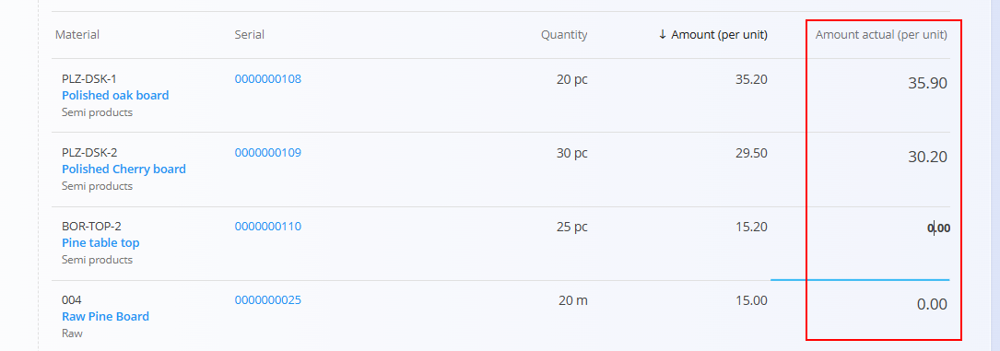
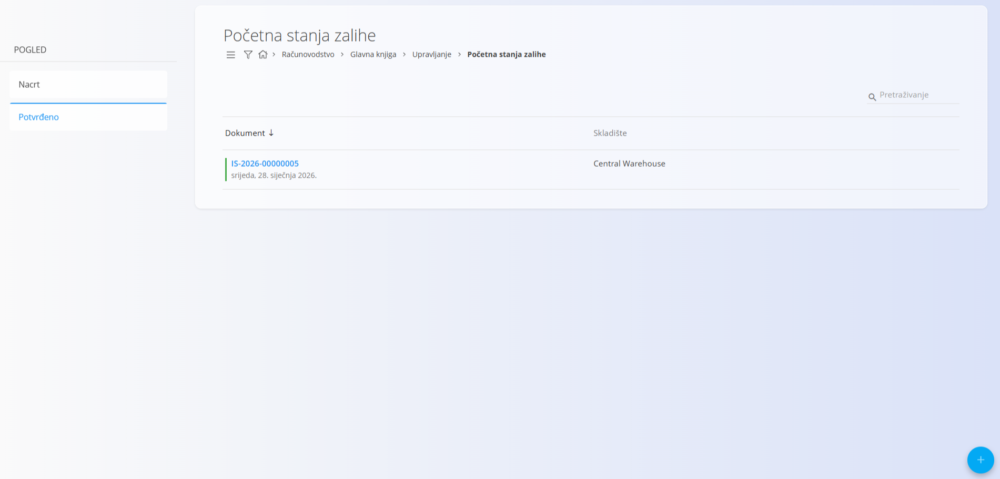
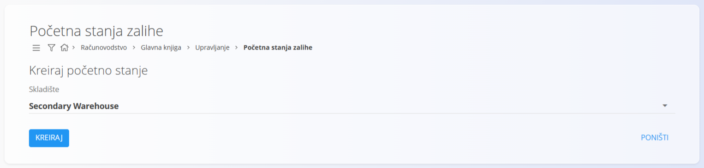

<!-- app_route: /management/ledger/stock/initial-states -->
<!-- app_label: Početna stanja zalihe -->
<!-- canonical_source_url: https://github.com/Tom-PIT/Connected.Docs/blob/main/hr/Domene/Racunovodstvo/Upravljanje/GlavnaKnjiga/PocetnaStanjaZalihe.md -->
<!-- canonical_source_title: Početna stanja zalihe -->

# Početna stanja zalihe

Ekran **Početna stanja zalihe** služi za definiranje početnih količina i vrijednosti zaliha u skladištu. Čini početnu točku za vrednovanje zaliha kad se sustav počinje koristiti ili kad se uključuje financijska zaliha.

Početna stanja zaliha su **dokumenti** koji su izravno povezani s računovodstvom. Kad se objave, inicijaliziraju financijsku vrijednost zaliha u glavnoj knjizi i tvore početno stanje za konte zaliha.

Ovom ekranu pristupate odabirom **Računovodstvo / Glavna knjiga / Upravljanje / Početna stanja zalihe** u [navigaciji](../../../../Zajednicko/UI/Navigacija.md).

## Shema

| Polje | Opis |
|------|-------------|
| **Oznaka** | Automatski generirani identifikator dokumenta početnog stanja zaliha. |
| **Skladište** | Skladište za koje se definira početna zaliha. |
| **Kreiran** | Datum nastanka dokumenta. |
| **Materijal** | Materijal ili artikl koji se nalazi na zalihi. |
| **Serijski broj** | Serijski broj artikla, kada je praćenje po serijskim brojevima uključeno. |
| **Količina** | Fizička količina artikla na zalihi. |
| **Iznos (po jedinici)** | Vrijednost jedinice koju izračunava sustav, prikazana kao referenca. |
| **Stvarni iznos (po jedinici)** | Polje za unos koje služi za upis početne knjigovodstvene vrijednosti po jedinici. |

### Polja iznosa

- **Iznos (po jedinici)** prikazuje vrijednost jedinice koju izvodi sustav, ako je dostupna. Tijekom inicijalizacije ta vrijednost može biti nula ili temeljena na zadanim postavkama vrednovanja materijala.
- **Stvarni iznos (po jedinici)** služi za ručni unos početne vrijednosti zaliha (vrijednost po jedinici). Za materijale s više serijskih brojeva obično se za sve serijske brojeve istog materijala unosi ista vrijednost po jedinici.

## Popis

Popis prikazuje jedan nacrt ili potvrđeno početno stanje po skladištu. Popis podržava pretraživanje i filtriranje.

Svaki redak prikazuje:

- **Oznaku**
- **Skladište**
- **Datum nastanka**

Popis se može filtrirati prema statusu dokumenta (**Nacrt** ili **Potvrđeno**).

## Radnje

### Dodavanje početnog stanja zaliha

Za dodavanje novog početnog stanja zaliha:

1. Kliknite [gumb radnji](../../../../Zajednicko/UI/AkcijskiGumb.md).
2. Odaberite **Skladište**.

   

3. Kliknite **Kreiraj**.

Sustav stvara novi nacrt dokumenta za odabrano skladište.

")

### Uređivanje početnog stanja zaliha

Kliknite dokument na popisu nacrta da ga otvorite u načinu uređivanja. Unesite ili izmijenite **Stvarni iznos (po jedinici)** u detaljima i pregledajte polja zaglavlja.

Kliknite **Spremi** za primjenu promjena ili **Poništi** za odbacivanje.

### Objava početnog stanja zaliha

Kada su unesene sve obavezne vrijednosti, kliknite **Objavi** da biste inicijalizirali vrijednost zaliha u glavnoj knjizi i stvorili početna stanja za konte zaliha. Objava zaključava dokument od daljnjih izmjena.

> [!NOTE]
> Objava zahtijeva da je **financijska zaliha** uključena u glavnoj knjizi. Ako nije, sustav sprječava objavu i prikazuje poruku o pogrešci.
>
> Da biste uključili financijsku zalihu, idite na **Sustav / Konfiguracija / Postavke glavne knjige** i aktivirajte opciju **Financijska zaliha uključena**.

### Brisanje početnog stanja zaliha

Nacrti početnih stanja mogu se izbrisati s ekrana za uređivanje.

> [!NOTE]
> Nakon objave brisanje nije dopušteno kako bi se očuvao integritet zaliha i računovodstva.

## Upotreba

Ovaj ekran obično se koristi jednom tijekom inicijalizacije sustava ili kad se računovodstvo zaliha prvi put uključi.

Početna stanja nisu uobičajena kretanja zaliha i trebaju se stvoriti prije knjiženja primki, izdataka ili proizvodnih kretanja. Točnost unesenih vrijednosti izravno utječe na vrednovanje zaliha i na trošak prodane robe.
