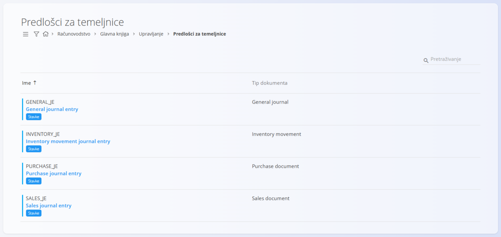
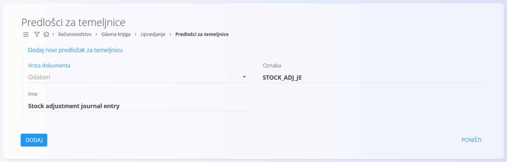
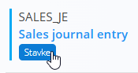
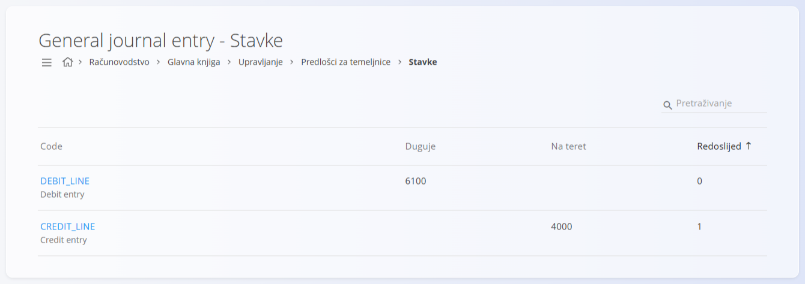
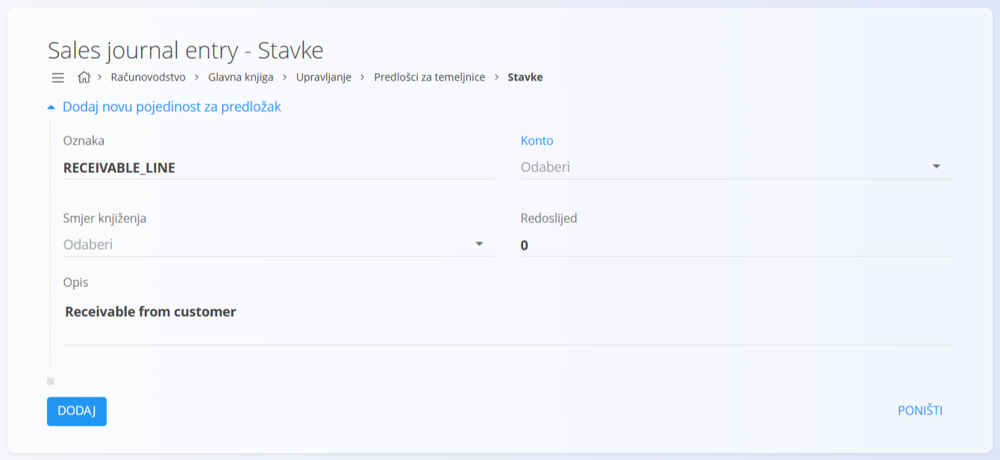

<!-- app_route: /management/ledger/journal-entry-templates -->
<!-- app_label: Predlošci za temeljnice -->
<!-- canonical_source_url: https://github.com/Tom-PIT/Connected.Docs/blob/main/hr/Domene/Racunovodstvo/Upravljanje/GlavnaKnjiga/PredlosciZaTemeljnice.md -->
<!-- canonical_source_title: Predlošci za temeljnice -->

# Predlošci za temeljnice

Šifarnik **Predlošci za temeljnice** definira unaprijed pripremljene predloške za stvaranje temeljnica u glavnoj knjizi. Predložak određuje tip dokumenta i daje ponovno upotrebljivu strukturu koja se primjenjuje pri stvaranju računovodstvenih zapisa.

Predlošci pojednostavljuju unos podataka, osiguravaju dosljednost i smanjuju rizik od pogrešaka jer standardiziraju često korištene strukture temeljnica.

> [!NOTE]
> - Predlošci temeljnica određuju strukturu temeljnica, ali ne sadrže iznose.
> - Usklađivanje duguje i potražuje provodi se pri stvaranju stvarne temeljnice.
> - Konti koji se koriste u stavkama predloška moraju već postojati u kontnom planu.
> - Predlošci se mogu ponovno koristiti za više temeljnica.

Ovom ekranu pristupate odabirom **Računovodstvo / Glavna knjiga / Upravljanje / Predlošci za temeljnice** u [navigaciji](../../../../Zajednicko/UI/Navigacija.md).

## Shema

<strong>Dokument</strong>

| Polje | Opis |
|------|-------------|
| **Tip dokumenta** | Tip dokumenta dodijeljen predlošku temeljnice. Određuje kako se temeljnica razvrstava u glavnoj knjizi. |
| **Oznaka** | Tehnički identifikator predloška temeljnice. |
| **Ime** | Čitljiv naziv koji opisuje namjenu predloška. |

<strong>Stavke</strong>

| Polje | Opis |
|------|-------------|
| **Oznaka** | Tehnički identifikator retka predloška. |
| **Konto** | Konto iz [**kontnog plana**](KontniPlan.md) koji se koristi u ovom retku temeljnice. |
| **Smjer knjiženja** | Pokazuje je li redak knjiženje na strani duguje ili potražuje. |
| **Redoslijed** | Redoslijed kojim se redak pojavljuje u temeljnici. |
| **Opis** | Zadani opis za redak temeljnice. |

## Popis

Popis prikazuje sve definirane predloške temeljnica.

Svaki redak prikazuje:

* **Ime**
* **Tip dokumenta**

Svaki predložak nudi pristup njegovim **stavkama**, gdje se definiraju pojedinačni retci temeljnice.

> [!NOTE]
> Nazivi predložaka na slici (npr. *General journal entry*, *Sales journal entry*) podaci su aplikacije i prikazuju se na engleskom jeziku.

## Radnje

### Dodavanje predloška

1. Kliknite [gumb radnji](../../../../Zajednicko/UI/AkcijskiGumb.md) za stvaranje novog unosa.
2. Odaberite **Vrsta dokumenta**.
3. Unesite:

   * **Oznaku**
   * **Ime**

4. Kliknite **Dodaj** za spremanje predloška ili **Poništi** za odbacivanje unosa.

### Uređivanje predloška

Kliknite predložak na popisu da ga otvorite u načinu uređivanja. Po potrebi izmijenite polja.

Kliknite **Spremi** za primjenu promjena ili **Poništi** za odbacivanje.

### Stavke predloška

Za upravljanje stavkama predloška kliknite **Stavke** na predlošku.

Popis stavki prikazuje sve retke definirane za odabrani predložak. Svaki redak prikazuje:

* **Oznaku**
* **Oznaku**
* **Duguje** ili **Na teret** (iznos po kontu)
* **Redoslijed**

#### Dodavanje stavke predloška

1. Kliknite **Dodaj novu pojedinost za predložak**.
2. Unesite:

   * **Oznaku**
   * **Konto**
   * **Smjer knjiženja**
   * **Redoslijed**
   * **Opis**

3. Kliknite **Dodaj** za spremanje stavke ili **Poništi** za odbacivanje unosa.

## Brisanje predloška

Predložak se može izbrisati samo ako ga ne koriste postojeće temeljnice.

Za brisanje otvorite predložak u načinu uređivanja i odaberite **Izbriši**.

> [!WARNING]
> Brisanje predloška koji je u upotrebi može onemogućiti stvaranje ili ponovno korištenje temeljnica.
