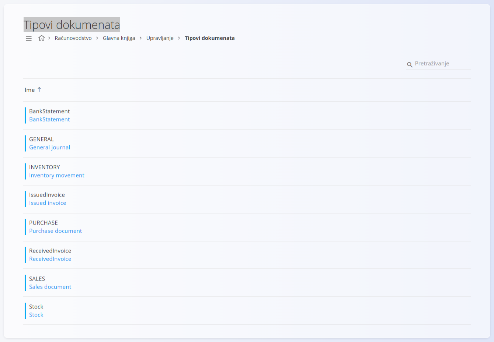
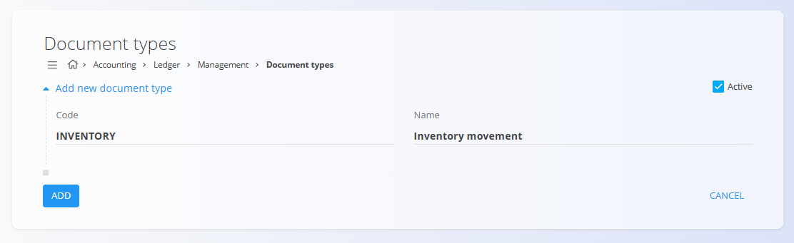

<!-- app_route: /management/ledger/document-types -->
<!-- app_label: Tipovi dokumenata -->
<!-- canonical_source_url: https://github.com/Tom-PIT/Connected.Docs/blob/main/hr/Domene/Racunovodstvo/Upravljanje/GlavnaKnjiga/TipoviDokumenata.md -->
<!-- canonical_source_title: Tipovi dokumenata -->

# Tipovi dokumenata

Šifarnik **Tipovi dokumenata** određuje vrste računovodstvenih dokumenata koji se koriste u glavnoj knjizi. Svaki tip dokumenta razvrstava temeljnice i ostala računovodstvena knjiženja prema poslovnoj namjeni, na primjer prodaji, nabavi, kretanjima zaliha ili općim korekcijama.

Tipovi dokumenata obvezna su konfiguracija glavne knjige. Na njih se pozivaju temeljnice, a sustav ih koristi za grupiranje knjiženja, primjenu pravila knjiženja te za izvještavanje i reviziju.

Ovom ekranu pristupate odabirom **Računovodstvo / Glavna knjiga / Upravljanje / Tipovi dokumenata** u [navigaciji](../../../../Zajednicko/UI/Navigacija.md).

## Shema

| Polje | Opis |
|------|-------------|
| **Oznaka** | Tehnički identifikator tipa dokumenta. Sustav ga interno koristi, a na njega se pozivaju temeljnice. |
| **Ime** | Čitljiv naziv koji opisuje namjenu tipa dokumenta. |
| **Aktivan** | Pokazuje može li se tip dokumenta odabrati pri stvaranju novih dokumenata. |

## Popis

Popis prikazuje sve definirane tipove dokumenata.

Svaki redak prikazuje:

* **Oznaku**
* **Ime**

Neaktivni tipovi dokumenata čuvaju se radi dosljednosti povijesnih podataka, ali se ne mogu koristiti za nova knjiženja.

> [!NOTE]
> Nazivi tipova na slici (npr. *General journal*, *Sales document*) podaci su aplikacije i prikazuju se na engleskom jeziku.

## Radnje

### Dodavanje tipa dokumenta

1. Kliknite [gumb radnji](../../../../Zajednicko/UI/AkcijskiGumb.md) za stvaranje novog unosa.
2. Unesite:

   * **Oznaku**
   * **Ime**
   * **Aktivan** (uključeno prema zadanim postavkama)

3. Kliknite **Dodaj** za spremanje tipa dokumenta ili **Poništi** za odbacivanje unosa.

### Uređivanje tipa dokumenta

Kliknite tip dokumenta na popisu da ga otvorite u načinu uređivanja. Po potrebi izmijenite polja.

Kliknite **Spremi** za primjenu promjena ili **Poništi** za odbacivanje.

## Brisanje tipa dokumenta

Tip dokumenta može se izbrisati samo ako ga ne koriste postojeće temeljnice ni pravila konfiguracije.

Za brisanje otvorite tip u načinu uređivanja i odaberite **Izbriši**.

> [!WARNING]
> Brisanje tipa dokumenta koji je potreban tijekovima temeljnica može onemogućiti knjiženje ili izvještavanje.
