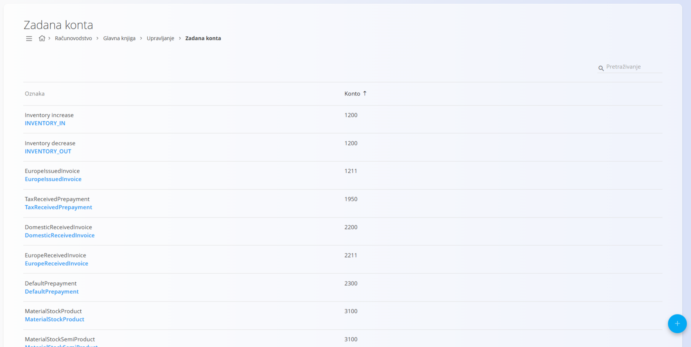
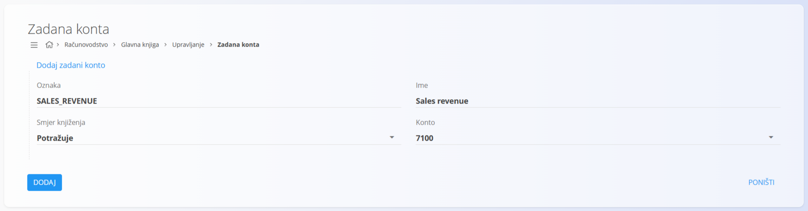

<!-- app_route: /management/ledger/account-defaults -->
<!-- app_label: Zadana konta -->
<!-- canonical_source_url: https://github.com/Tom-PIT/Connected.Docs/blob/main/hr/Domene/Racunovodstvo/Upravljanje/GlavnaKnjiga/ZadaneKonta.md -->
<!-- canonical_source_title: Zadana konta -->

# Zadana konta

Šifarnik **Zadana konta** određuje kako sustav automatski odabire konte pri knjiženju računovodstvenih zapisa koje stvaraju sustavni procesi. Svaka zadana vrijednost predstavlja unaprijed definiranu vezu između poslovnog scenarija i određenog konta, uključujući smjer knjiženja.

Zadana konta koriste se kad se računovodstveni zapisi stvaraju **automatski**, primjerice pri izdavanju računa, kretanjima zaliha ili priznavanju troškova. Time se osigurava dosljedno i predvidljivo knjiženje bez ručnog odabira konta.

> [!NOTE]
> Zadana konta obično se stvaraju tijekom početne konfiguracije sustava. Promjene zadanih konta utječu na buduća automatska knjiženja, a ne na postojeće zapise.

Ovom ekranu pristupate odabirom **Računovodstvo / Glavna knjiga / Upravljanje / Zadana konta** u [navigaciji](../../../../Zajednicko/UI/Navigacija.md).

## Shema

| Polje | Opis |
|------|-------------|
| **Oznaka** | Tehnički identifikator zadanog konta. Sustav ga interno koristi za povezivanje sa svojom logikom. |
| **Ime** | Čitljiv naziv koji opisuje namjenu zadane vrijednosti. |
| **Smjer knjiženja** | Određuje hoće li se navedeni konto knjižiti na strani duguje ili na teret. |
| **Konto** | Konto iz [**kontnog plana**](KontniPlan.md) koji se koristi kad se zadana vrijednost primijeni. |

### Smjer knjiženja

**Smjer knjiženja** određuje kako se odabrani konto koristi kad se zadana vrijednost primijeni:

* **Duguje** – Konto se zadužuje sustavnim knjiženjem.
* **Potražuje** – Konto se knjiži na strani potražuje sustavnim knjiženjem.

Smjer knjiženja fiksno je određen za svaku zadanu vrijednost kako bi se osiguralo dosljedno ponašanje računovodstva u automatiziranim tokovima.

## Popis

Popis prikazuje sve definirane zadane vrijednosti.

Svaki redak prikazuje:

* **Oznaku**
* **Ime**
* **Konto**

Popis se može pretraživati pomoću polja za pretraživanje u gornjem desnom kutu.

## Radnje

### Dodavanje zadane vrijednosti

Za dodavanje nove zadane vrijednosti:

1. Kliknite [gumb radnji](../../../../Zajednicko/UI/AkcijskiGumb.md) za stvaranje novog unosa.
2. Unesite:
   * **Oznaku**
   * **Ime**
   * **Smjer knjiženja**
   * **Konto**
3. Kliknite **Dodaj** za spremanje zadane vrijednosti ili **Poništi** za odbacivanje unosa.

### Uređivanje zadane vrijednosti

Kliknite zadanu vrijednost na popisu da je otvorite u načinu uređivanja. Po potrebi izmijenite polja.

Kliknite **Spremi** za primjenu promjena ili **Poništi** za odbacivanje.

## Uobičajeni primjeri

Uobičajene zadane vrijednosti uključuju:

* **Inventory increase** – zadužuje konto zaliha kad se zaliha povećava
* **Inventory decrease** – tereti konto zaliha kad se zaliha smanjuje
* **Sales revenue** – tereti konto prihoda pri izdavanju prodajnih računa
* **Cost of goods sold (COGS)** – zadužuje konto troška pri prodaji robe

Te zadane vrijednosti koriste sustavni tokovi kao što su prodaja, zalihe i proizvodnja.

> [!NOTE]
> Nazivi zadanih vrijednosti prikazuju se na engleskom jeziku, kao što ih aplikacija prikazuje.

## Brisanje zadane vrijednosti

Zadana vrijednost može se izbrisati samo ako je ne koriste aktivni sustavni procesi ni konfiguracijska pravila.

Za brisanje kliknite zadanu vrijednost na popisu da uđete u način uređivanja i odaberite **Izbriši**.

> [!WARNING]
> Brisanje zadane vrijednosti koja je potrebna nekom tijeku rada može uzrokovati greške pri knjiženju ili nepotpune računovodstvene zapise.
