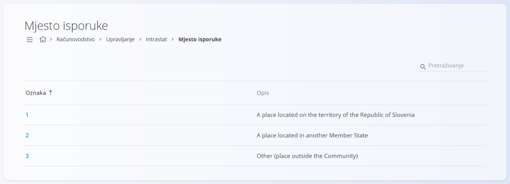
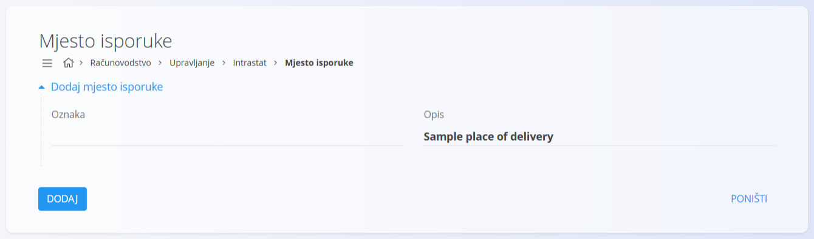

<!-- app_route: /management/intrastat/place-of-delivery -->
<!-- app_label: Mjesto isporuke -->
<!-- canonical_source_url: https://github.com/Tom-PIT/Connected.Docs/blob/main/hr/Domene/Racunovodstvo/Upravljanje/Intrastat/MjestoIsporuke.md -->
<!-- canonical_source_title: Mjesto isporuke -->

# Mjesto isporuke

Šifarnik **Mjesto isporuke** koristi se za Intrastat i računovodstveno izvještavanje kako bi se razvrstalo mjesto na kojem se isporuka robe obavlja. Svaka šifra predstavlja standardiziranu kategoriju mjesta isporuke, potrebnu za regulatorne i statističke svrhe.

Ovom ekranu pristupate odabirom **Računovodstvo / Upravljanje / Intrastat / Mjesto isporuke** u [navigaciji](../../../../Zajednicko/UI/Navigacija.md).

## Shema

| Polje | Opis |
|------|-------------|
| **Oznaka** | Numerički identifikator mjesta isporuke. |
| **Opis** | Objašnjenje kategorije mjesta isporuke. |

## Popis

Popis prikazuje sve definirane šifre mjesta isporuke. Popis se može pretraživati pomoću polja za pretraživanje u gornjem desnom kutu.

Svaki redak prikazuje:

* **Oznaku**
* **Opis**

Primjeri vrijednosti uključuju:

* isporuku unutar vlastite države
* isporuku u drugu državu članicu EU-a
* isporuku izvan Europske unije

> [!NOTE]
> Opisi na slici podaci su aplikacije i prikazuju se na engleskom jeziku. Prvi opis odnosi se na Sloveniju, kako je unesen u demo podatke.

## Radnje

### Dodavanje mjesta isporuke

1. Kliknite [gumb radnji](../../../../Zajednicko/UI/AkcijskiGumb.md) za stvaranje novog unosa.
2. Unesite:

   * **Oznaku**
   * **Opis**

3. Kliknite **Dodaj** za spremanje unosa.

### Uređivanje mjesta isporuke

Kliknite šifru na popisu da je otvorite u načinu uređivanja. Po potrebi izmijenite **Oznaku** ili **Opis**.

Kliknite **Spremi** za primjenu promjena ili **Poništi** za odbacivanje.

### Brisanje mjesta isporuke

Otvorite zapis s popisa i kliknite **Izbriši**. Potvrdite radnju u dijaloškom okviru.

> [!NOTE]
> Šifra se može izbrisati samo ako je ne koriste ovisni zapisi ni izvješća.
