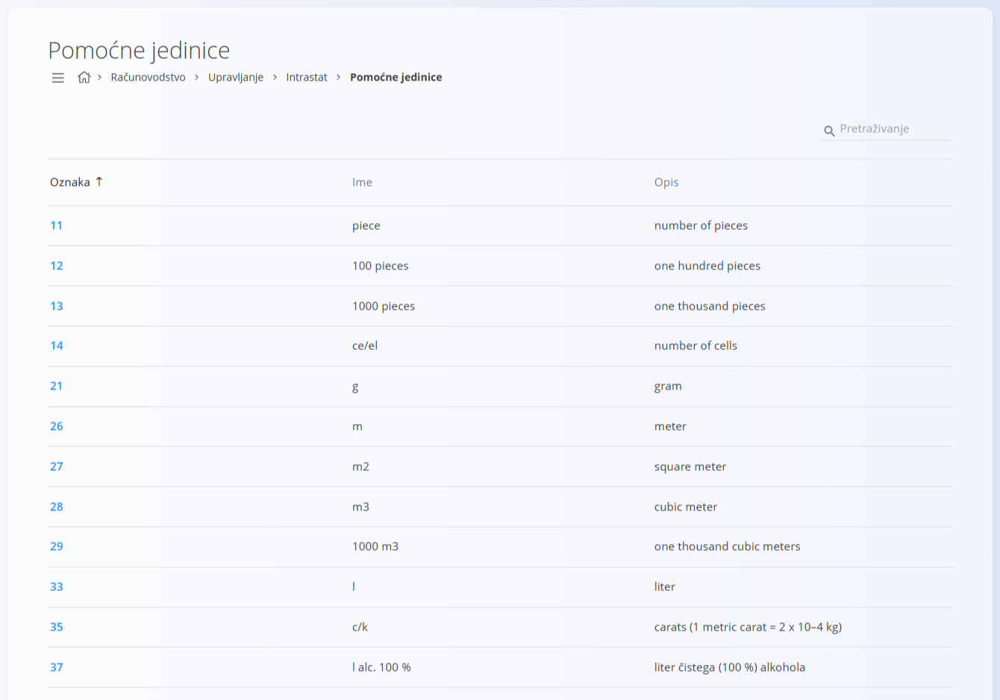
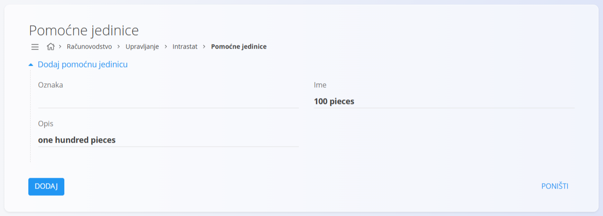

<!-- app_route: /management/intrastat/supplementary-units -->
<!-- app_label: Pomoćne jedinice -->
<!-- canonical_source_url: https://github.com/Tom-PIT/Connected.Docs/blob/main/hr/Domene/Racunovodstvo/Upravljanje/Intrastat/PomocneJedinice.md -->
<!-- canonical_source_title: Pomoćne jedinice -->

# Pomoćne jedinice

Pomoćne jedinice su standardizirane mjerne jedinice koje se koriste za Intrastat izvještavanje i dokumente vezane uz logistiku. Na njih se pozivaju dokumenti kao što su [narudžbe kupca](../../../Prodaja/Dokumenti/NarudzbeKupca.md) i [otpremnice](../../../Prodaja/Dokumenti/Otpremnice.md) te druge transakcije u kojima je uz osnovnu količinu potrebna i dodatna statistička jedinica.

Ovom ekranu pristupate odabirom **Računovodstvo / Upravljanje / Intrastat / Pomoćne jedinice** u [navigaciji](../../../../Zajednicko/UI/Navigacija.md).

## Shema

| Polje | Opis |
|------|-------------|
| **Oznaka** | Numerička šifra koja identificira pomoćnu jedinicu (Intrastat standard). |
| **Ime** | Kratki naziv ili oznaka jedinice (npr. `piece`, `m2`, `l`). |
| **Opis** | Čitljivo objašnjenje jedinice. |

## Popis

Popis prikazuje sve dostupne pomoćne jedinice s njihovim oznakama, nazivima i opisima.

Možete:

* pretraživati jedinice pomoću polja za pretraživanje
* sortirati popis prema **Oznaci**
* kliknuti jedinicu da je otvorite u načinu uređivanja

> [!NOTE]
> Nazivi i opisi jedinica na slici podaci su aplikacije, koji su dijelom na engleskom, a dijelom na slovenskom jeziku. Ne mijenjaju se u ovom dokumentu.

## Dodavanje pomoćne jedinice

Kliknite [gumb radnji](../../../../Zajednicko/UI/AkcijskiGumb.md) za stvaranje novog unosa.

Unesite:

* **Oznaku**
* **Ime**
* **Opis**

Kliknite **Dodaj** za spremanje jedinice ili **Poništi** za odbacivanje unosa.

## Uređivanje pomoćne jedinice

Kliknite šifru na popisu da je otvorite u načinu uređivanja. Po potrebi izmijenite **Oznaku**, **Ime** ili **Opis**.

Kliknite **Spremi** za primjenu promjena ili **Poništi** za odbacivanje.

## Brisanje pomoćne jedinice

Otvorite zapis s popisa i kliknite **Izbriši**. Potvrdite radnju u dijaloškom okviru.

> [!NOTE]
> Pomoćna jedinica može se izbrisati samo ako je ne koriste ovisni dokumenti, poput narudžbi kupca, otpremnica ili Intrastat izvješća.
