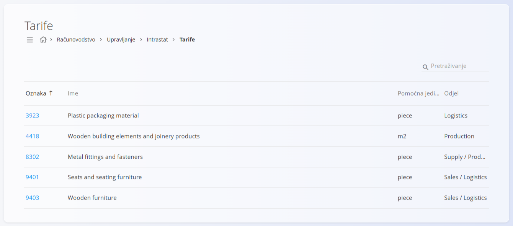
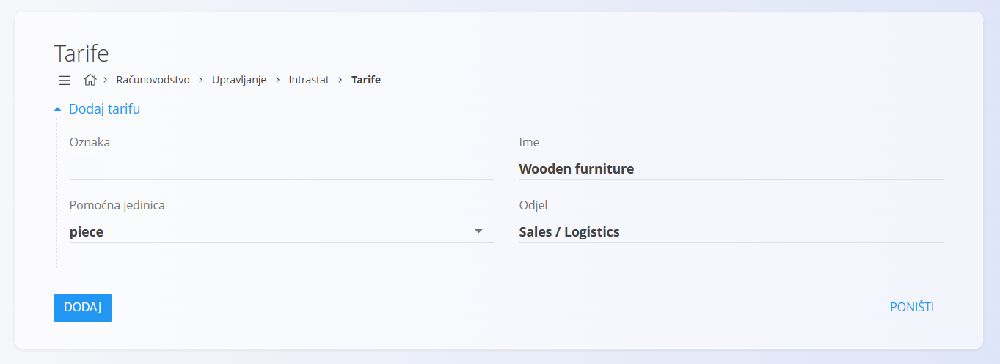

<!-- app_route: /management/intrastat/tariffs -->
<!-- app_label: Tarife -->
<!-- canonical_source_url: https://github.com/Tom-PIT/Connected.Docs/blob/main/hr/Domene/Racunovodstvo/Upravljanje/Intrastat/Tarife.md -->
<!-- canonical_source_title: Tarife -->

# Tarife

Tarife definiraju **šifre klasifikacije robe** koje se koriste za **Intrastat izvještavanje** i druge regulatorne ili statističke svrhe. Svaka tarifa predstavlja kategoriju robe i može odrediti pomoćnu jedinicu i odjel u kojem se primjenjuje.

Ovom ekranu pristupate odabirom **Računovodstvo / Upravljanje / Intrastat / Tarife** u [navigaciji](../../../../Zajednicko/UI/Navigacija.md).

## Shema

| Polje | Opis |
|------|------------|
| **Oznaka** | Šifra tarife koja se koristi za klasifikaciju (obično brojčana). |
| **Ime** | Opis robe obuhvaćene tarifom. |
| **Pomoćna jedinica** | Dodatna jedinica izvještavanja potrebna za Intrastat (na primjer `piece`, `m2`). |
| **Odjel** | Funkcionalno područje u kojem se tarifa primarno koristi (na primjer Prodaja, Logistika, Proizvodnja). |

## Popis

Popis prikazuje sve definirane tarife sa stupcima:

* **Oznaka**
* **Ime**
* **Pomoćna jedinica**
* **Odjel**

Tarife se mogu pretraživati pomoću polja za pretraživanje u gornjem desnom kutu.

> [!NOTE]
> Nazivi tarifa i odjeli na slici podaci su aplikacije i prikazuju se na engleskom jeziku.

## Dodavanje tarife

Kliknite [gumb radnji](../../../../Zajednicko/UI/AkcijskiGumb.md) da stvorite novu tarifu.

Unesite:

* **Oznaku**
* **Ime**
* **Pomoćnu jedinicu**
* **Odjel**

Kliknite **Dodaj** za stvaranje tarife ili **Poništi** za odbacivanje.

## Uređivanje tarife

Kliknite **Oznaku** tarife na popisu da je otvorite u načinu uređivanja. Po potrebi izmijenite **Oznaku**, **Ime**, **Pomoćnu jedinicu** ili **Odjel**.

Kliknite **Spremi** za primjenu promjena ili **Poništi** za odbacivanje.

## Brisanje tarife

Otvorite tarifu s popisa i kliknite **Izbriši**. Potvrdite radnju u dijaloškom okviru.

> [!NOTE]
> Tarifa se može izbrisati samo ako je ne koriste ovisni dokumenti, Intrastat izvješća ni drugi regulatorni zapisi.
