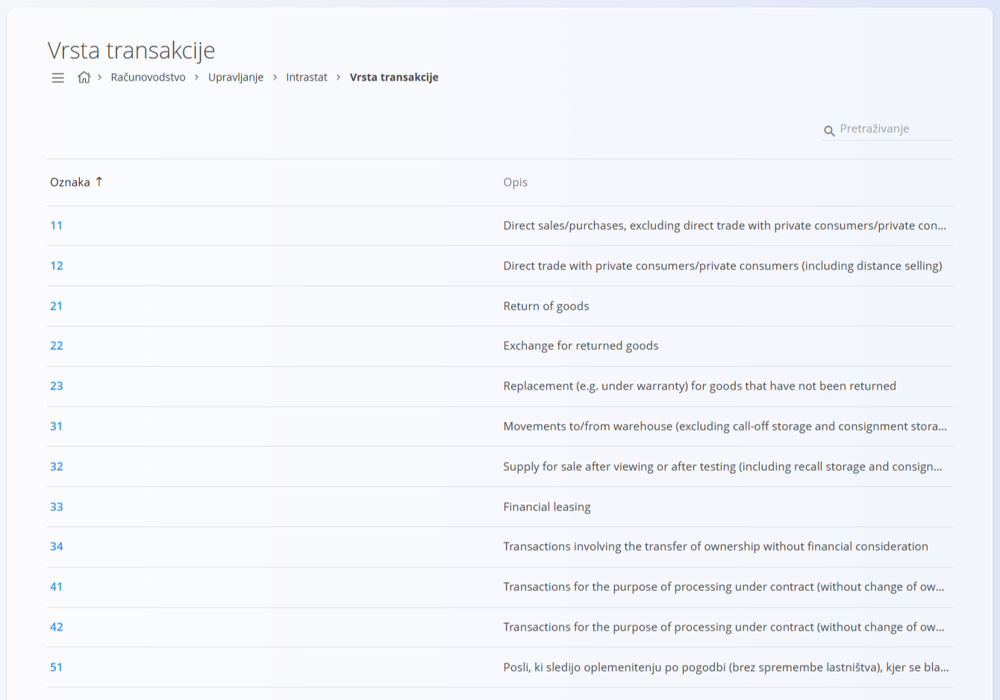
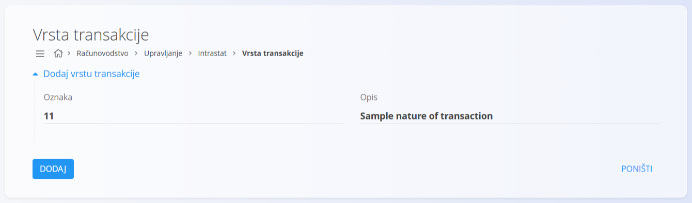

<!-- app_route: /management/intrastat/nature-of-transactions -->
<!-- app_label: Vrsta transakcije -->
<!-- canonical_source_url: https://github.com/Tom-PIT/Connected.Docs/blob/main/hr/Domene/Racunovodstvo/Upravljanje/Intrastat/VrstaTransakcije.md -->
<!-- canonical_source_title: Vrsta transakcije -->

# Vrsta transakcije

Šifarnik **Vrsta transakcije** koristi se za Intrastat i računovodstveno izvještavanje kako bi se razvrstala vrsta transakcije u kojoj se roba otprema ili prima. Svaka šifra predstavlja standardiziranu kategoriju transakcije koju propisuju pravila Intrastata, a potrebna je za statističko i regulatorno izvještavanje.

Ovom ekranu pristupate odabirom **Računovodstvo / Upravljanje / Intrastat / Vrsta transakcije** u [navigaciji](../../../../Zajednicko/UI/Navigacija.md).

## Shema

| Polje | Opis |
|------|-------------|
| **Oznaka** | Numerički identifikator vrste transakcije. |
| **Opis** | Objašnjenje vrste transakcije. |

## Popis

Popis prikazuje sve definirane šifre vrste transakcije. Popis se može pretraživati pomoću polja za pretraživanje u gornjem desnom kutu.

Svaki redak prikazuje:

* **Oznaku**
* **Opis**

Tipični primjeri uključuju:

* izravnu prodaju ili nabavu
* povrat robe
* zamjenu robe (npr. u sklopu jamstva)
* financijski leasing
* obradu po ugovoru

> [!NOTE]
> Opisi na slici podaci su aplikacije. Dio ih je na engleskom, a dio na slovenskom jeziku, kako su uneseni u sustav.

## Radnje

### Dodavanje vrste transakcije

1. Kliknite [gumb radnji](../../../../Zajednicko/UI/AkcijskiGumb.md) za stvaranje novog unosa.
2. Unesite:

   * **Oznaku**
   * **Opis**

3. Kliknite **Dodaj** za spremanje unosa.

### Uređivanje vrste transakcije

Kliknite šifru na popisu da je otvorite u načinu uređivanja. Po potrebi izmijenite **Oznaku** ili **Opis**.

Kliknite **Spremi** za primjenu promjena ili **Poništi** za odbacivanje.

### Brisanje vrste transakcije

Otvorite zapis s popisa i kliknite **Izbriši**. Potvrdite radnju u dijaloškom okviru.

> [!NOTE]
> Šifra se može izbrisati samo ako je ne koriste ovisne Intrastat prijave ni računovodstveni zapisi.
