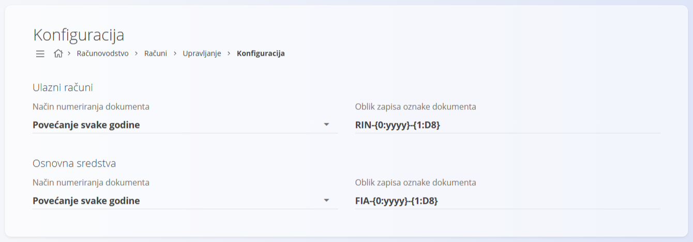

<!-- app_route: /management/accounting/configuration -->
<!-- app_label: Konfiguracija -->
<!-- canonical_source_url: https://github.com/Tom-PIT/Connected.Docs/blob/main/hr/Domene/Racunovodstvo/Upravljanje/Racuni/KonfiguracijaRacuna.md -->
<!-- canonical_source_title: Konfiguracija -->

# Konfiguracija

Konfigurirajte postavke **računa** koje utječu na numeriranje dokumenata. Promjene se spremaju automatski.

Ovoj stranici pristupate odabirom **Računovodstvo / Računi / Upravljanje / Konfiguracija** u [navigaciji](../../../../Zajednicko/UI/Navigacija.md).

## Postavke numeriranja dokumenata

Postavke su odvojene za **Ulazne račune** i **Osnovna sredstva**. Za svaku vrstu dokumenta odaberite model numeriranja i oblik zapisa oznake.

| Polje | Opis |
|------|-------------|
| **Način numeriranja dokumenta** | • **Povećanje svake godine:** numeriranje počinje ispočetka na početku svake godine.   • **Povećanje:** jedan neprekidni niz bez godišnjeg resetiranja. |
| **Oblik zapisa oznake dokumenta** | Predložak koji određuje strukturu oznake dokumenta. |

Na primjer, oblik zapisa **RIN-{0:yyyy}-{1:D8}** određuje strukturu oznake za ulazne račune, a **FIA-{0:yyyy}-{1:D8}** za osnovna sredstva.

> [!NOTE]
> Model numeriranja i oblik zapisa primjenjuju se odmah nakon promjena. Postojeći dokumenti se ne numeriraju iznova.
