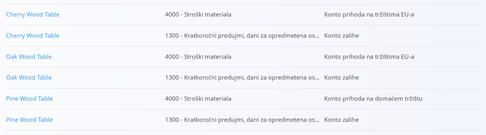
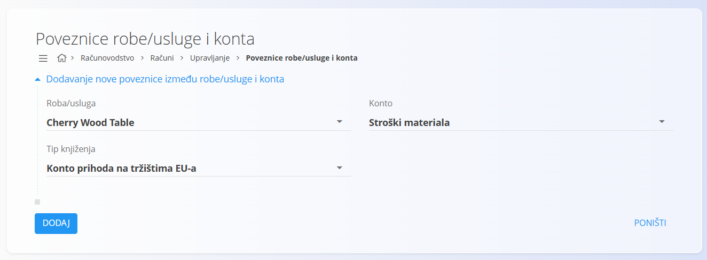

<!-- app_route: /management/ledger/asset-account-connections -->
<!-- app_label: Poveznice robe/usluge i konta -->
<!-- canonical_source_url: https://github.com/Tom-PIT/Connected.Docs/blob/main/hr/Domene/Racunovodstvo/Upravljanje/Racuni/PoveznicaRobeIKonta.md -->
<!-- canonical_source_title: Poveznice robe/usluge i konta -->

# Poveznice robe/usluge i konta

Ekran **Poveznice robe/usluge i konta** određuje kako su pojedina roba i usluge povezane s kontima glavne knjige za knjiženja nastala iz računa. Ta konfiguracija određuje koji se konti koriste kad se roba ili usluga prodaje, nalazi na zalihi ili je na neki drugi način uključena u knjiženja vezana uz račune.

Ovom ekranu pristupate odabirom **Računovodstvo / Računi / Upravljanje / Poveznice robe/usluge i konta** u [navigaciji](../../../../Zajednicko/UI/Navigacija.md).

## Pregled

Poveznice robe/usluge i konta:

* povezuju određenu **robu ili uslugu** s određenim **kontom glavne knjige**
* provjeravaju se pri knjiženju računa
* omogućuju različito knjiženje ovisno o **tipu knjiženja**

Te poveznice ne stvaraju knjiženja same po sebi. Predstavljaju pravila knjiženja koja se primjenjuju pri obradi računa koji se odnose na robu ili uslugu.

## Shema

| Polje | Opis |
|------|-------------|
| **Roba/usluga** | Roba ili usluga na koju se poveznica odnosi. |
| **Tip knjiženja** | Određuje računovodstveni kontekst u kojem se konto koristi. |
| **Konto** | Konto iz [**kontnog plana**](../GlavnaKnjiga/KontniPlan.md) koji se koristi za odabrani tip knjiženja. |

### Tip knjiženja

**Tip knjiženja** određuje *kada* se odabrani konto koristi. Dostupne vrijednosti uključuju:

* **Konto prihoda na domaćem tržištu** – koristi se kad se roba ili usluga prodaje na domaćem tržištu
* **Konto prihoda na tržištima EU-a** – koristi se za prodaju na tržištima Europske unije
* **Konto zalihe** – koristi se za prikaz vrijednosti zaliha robe ili usluge

> [!NOTE]
> Svaki tip knjiženja predstavlja drugačiji računovodstveni scenarij. Za istu robu ili uslugu može se definirati više poveznica, po jedna za svaki tip knjiženja.

## Popis

Popis prikazuje sve definirane poveznice robe/usluge i konta.

Svaki redak prikazuje:

* **Roba/usluga**
* **Konto**
* **Tip knjiženja**

Nazivi roba (npr. *Cherry Wood Table*) i konti na slici podaci su aplikacije.

## Radnje

### Dodavanje poveznice

1. Kliknite [gumb radnji](../../../../Zajednicko/UI/AkcijskiGumb.md) za dodavanje novog unosa.
2. Odaberite **Roba/usluga**.
3. Odaberite **Tip knjiženja**.
4. Odaberite **Konto** koji se koristi za taj tip knjiženja.
5. Kliknite **Dodaj** za spremanje poveznice ili **Poništi** za odbacivanje unosa.

### Primjeri

Sljedeći primjeri prikazuju uobičajene poveznice.

#### Primjer: gotov proizvod – prodaja na domaćem tržištu

* **Roba/usluga:** Cherry Wood Table
* **Tip knjiženja:** Konto prihoda na domaćem tržištu
* **Konto:** konto prihoda za domaće tržište

Ova poveznica određuje koji se konto prihoda koristi kad se roba prodaje na domaćem tržištu.

#### Primjer: gotov proizvod – vrijednost zaliha

* **Roba/usluga:** Cherry Wood Table
* **Tip knjiženja:** Konto zalihe
* **Konto:** konto zaliha

Ova poveznica povezuje robu s kontom zaliha i koristi se za prikaz vrijednosti zaliha.

#### Primjer: gotov proizvod – prodaja u EU-u

* **Roba/usluga:** Oak Wood Table
* **Tip knjiženja:** Konto prihoda na tržištima EU-a
* **Konto:** konto prihoda za tržišta EU-a

Ova poveznica omogućuje različito knjiženje prihoda ovisno o tržištu prodaje.

## Brisanje poveznice

Poveznica se može izbrisati samo ako je ne zahtijevaju postojeća knjiženja računa.

Za brisanje otvorite poveznicu u načinu uređivanja i odaberite **Izbriši**.

> [!WARNING]
> Uklanjanje poveznica može onemogućiti ispravno knjiženje računa koji se odnose na robu ili uslugu.
