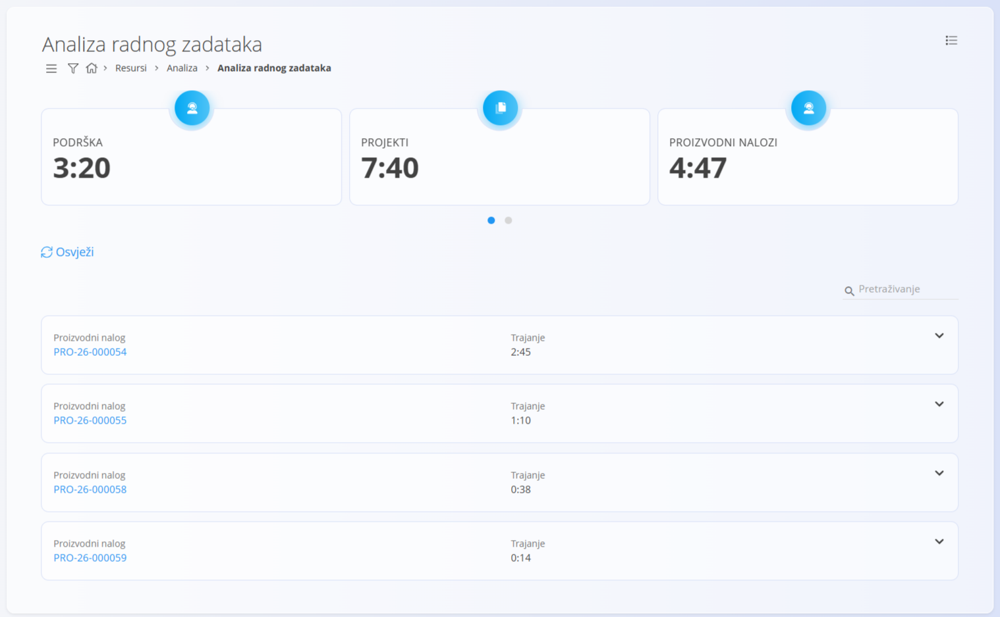
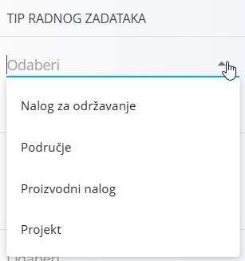

<!-- app_route: /resources/views/work-item-analysis -->
<!-- app_label: Analiza radnog zadataka -->
<!-- canonical_source_url: https://github.com/Tom-PIT/Connected.Docs/blob/main/hr/Domene/Resursi/Analiza/AnalizaRadnogZadatka.md -->
<!-- canonical_source_title: Analiza radnog zadataka -->

# Analiza radnog zadataka

## Uvod

**Analiza radnog zadataka** pruža analitički pregled evidentiranog radnog vremena u sustavu. Zbraja trud evidentiran na različitim radnim zadacima (projektima, proizvodnim nalozima, nalozima za održavanje, poslovima u uredu) i prikazuje **sažete pokazatelje** i **detaljne raščlambe**.

Ovaj se prikaz uglavnom koristi za razumijevanje načina na koji je vrijeme raspodijeljeno po vrstama radnih zadataka i pojedinim radnim zadacima u odabranom razdoblju.

Do ovog prikaza dolazite tako da u [navigaciji](../../../Zajednicko/UI/Navigacija.md) odaberete **Resursi / Analiza / Analiza radnog zadataka**.

## Pokazatelji na vrhu

Na vrhu zaslona kartice sažeto prikazuju ukupno evidentirano trajanje po vrsti radnog zadatka, na primjer:

- Podrška
- Projekti
- Proizvodni nalozi
- Nalozi za održavanje

Te se vrijednosti automatski ažuriraju prema aktivnim filterima.

## Popis radnih zadataka

Ispod sažetih pokazatelja prikazuje se popis radnih zadataka s ukupnim evidentiranim trajanjem.

Svaki unos prikazuje:
- **Vrstu radnog zadatka** (Projekt, Proizvodni nalog, Nalog za održavanje i sl.)
- **Oznaku radnog zadatka** (šifru ili naziv)
- **Ukupno trajanje** evidentirano u odabranom razdoblju

Klik na radni zadatak otvara njegov detaljni prikaz.

Stavke se mogu proširiti da biste pregledali njihovu unutarnju raščlambu ako je dostupna. Kada se stavka proširi, prikazuje se njezina unutarnja struktura (na primjer operacije koje pripadaju nalogu za održavanje ili proizvodnom nalogu) zajedno s trajanjem evidentiranim za svaki element.

## Filteri

Panel s lijeve strane omogućuje suženje analize pomoću sljedećih filtera:

- **Datumi**
  Odaberite prilagođeni raspon datuma za analizu.

- **Vrsta datuma**
  Unaprijed određeni rasponi: **Trenutni mjesec** i **Današnji dan**.

- **Tip radnog zadataka**
  Filtrirajte prema:
  - Nalog za održavanje
  - Područje
  - Proizvodni nalog
  - Projekt

- **Aktivnost**
  Ograničite analizu na određeni radni zadatak.

- **Ljudski resursi**
  Filtrirajte prema jednom ili više korisnika čije se radno vrijeme treba uključiti.

Promjena bilo kojeg filtera odmah ponovno izračunava pokazatelje i popis.

## Osvježavanje podataka

Radnja **Osvježi** ponovno učitava podatke analize prema trenutno odabranim filterima.

## Izbornik

Izbornik nudi dodatne radnje dostupne na ovom prikazu.

Dostupne radnje:

- **Izvoz detalja troškova truda u CSV**

Dobivena datoteka prikazuje troškove povezane s evidentiranim radnim vremenom.

Pojedinosti o radnjama izbornika potražite u odjeljku [**Radnje izbornika**](../../../Zajednicko/Koncepti/RadnjeIzbornika.md).
