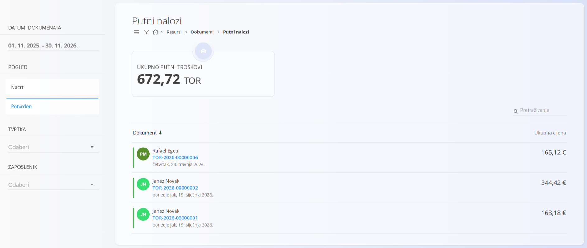
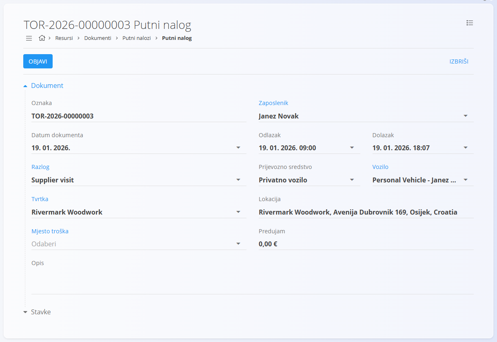
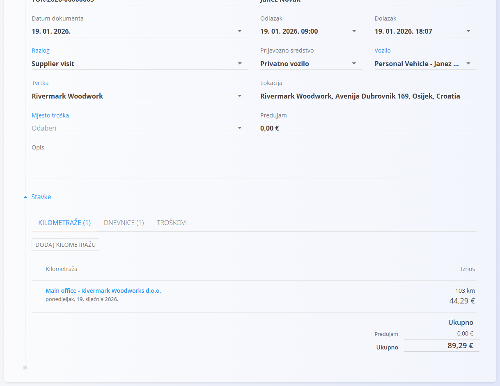
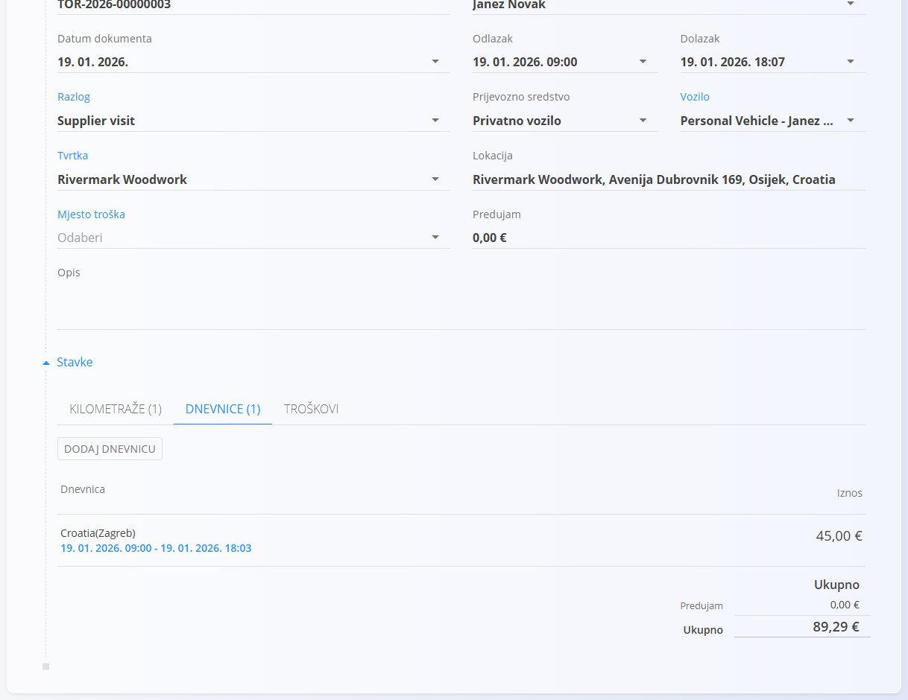
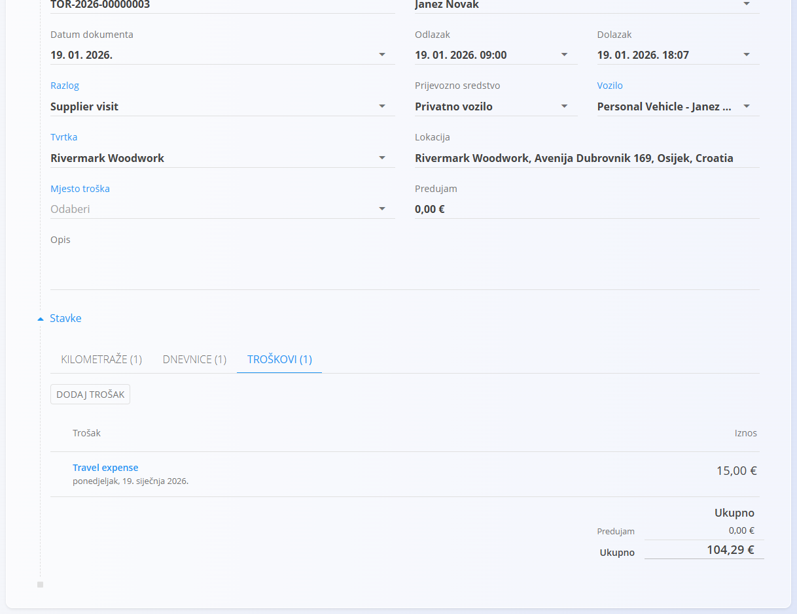

<!-- app_route: /resources/documents/travel-orders -->
<!-- app_label: Putni nalozi -->
<!-- canonical_source_url: https://github.com/Tom-PIT/Connected.Docs/blob/main/hr/Domene/Resursi/Dokumenti/TravelOrders.md -->
<!-- canonical_source_title: Putni nalozi -->

# Putni nalozi

**Putni nalozi** služe za evidentiranje i upravljanje službenim putovanjima zaposlenika. Objedinjuju kilometražu, dnevnice i troškove te izračunavaju ukupni trošak putovanja.

Do ovog ekrana dolazite tako da u [navigaciji](../../../Zajednicko/UI/Navigacija.md) odaberete **Resursi / Dokumenti / Putni nalozi**.

## Shema

| Polje | Opis |
|------|------|
| **Oznaka** | Automatski generirana oznaka putnog naloga (samo za čitanje). |
| **Zaposlenik** | Zaposlenik za kojeg se putni nalog izrađuje. |
| **Datum dokumenta** | Datum putnog naloga. |
| **Odlazak** | Datum i vrijeme odlaska. |
| **Dolazak** | Datum i vrijeme dolaska. |
| **Razlog** | Razlog putovanja iz popisa [**Razlozi putovanja**](../Upravljanje/TravelOrderReasons.md). |
| **Prijevozno sredstvo** | Prijevoz koji se koristi za putovanje (na primjer privatno vozilo). |
| **Vozilo** | Vozilo kao [resurs](../Upravljanje/Resources.md); dostupni su samo neljudski resursi označeni oznakom `vehicle`. |
| **Tvrtka** | Tvrtka odabrana iz poslovnog imenika. |
| **Lokacija** | Odredište putovanja. |
| **Mjesto troška** | [Mjesto troška](../../../Zajednicko/Upravljanje/MjestaTroska.md) dodijeljeno putnom nalogu. |
| **Predujam** | Iznos predujma (neobavezno). |
| **Opis** | Dodatne napomene (neobavezno). |

### Kilometraža

| Polje | Opis |
|------|------|
| **Destination** | Odredište iz popisa [**Odredišta**](../Upravljanje/TravelDestinations.md). |
| **Date** | Datum putovanja. |
| **Price (per unit)** | Cijena po jedinici udaljenosti (na primjer €/km). |
| **Distance** | Udaljenost putovanja. |
| **Return trip** | Označava povratno putovanje. |
| **Price total** | Automatski izračunat trošak kilometraže (samo za čitanje). |
| **Description** | Neobavezni opis. |

### Dnevnice

| Polje | Opis |
|------|------|
| **Start date** | Datum i vrijeme početka razdoblja dnevnice. |
| **End date** | Datum i vrijeme završetka razdoblja dnevnice. |
| [**Dnevnica**](../Upravljanje/SubsistenceAllowances.md) | Dnevnica iz popisa **Dnevnice**. |
| **Include breakfast** | Uključuje doručak u izračun. |
| **Include lunch** | Uključuje ručak u izračun. |
| **Include dinner** | Uključuje večeru u izračun. |

Iznosi dnevnica (smanjeni, polovični i puni) izračunavaju se automatski prema trajanju i uključenim obrocima.

### Troškovi

| Polje | Opis |
|------|------|
| [**Trošak**](../../Nabava/Upravljanje/Troskovi.md) | Vrsta troška. |
| **Date** | Datum troška. |
| **Price** | Iznos troška. |
| **Description** | Neobavezni opis. |
| **Attachment** | Učitani račun ili prateći dokument. |

## Upravljanje

### Popis putnih naloga

Popis prikazuje sve putne naloge i pruža pregled ukupnih putnih troškova.

#### Filtri

- **Datumi dokumenata**
- **Pogled** – Nacrt / Potvrđen
- **Tvrtka** – filtriranje po tvrtki
- **Zaposlenik** – filtriranje po zaposleniku

## Radnje

Pri stvaranju ili uređivanju putnog naloga dostupna su polja opisana u odjeljku [**Shema**](#shema) iznad.

### Stvaranje novog putnog naloga

1. Kliknite [gumb radnji](../../../Zajednicko/UI/AkcijskiGumb.md) da biste stvorili novi putni nalog.
2. Unesite podatke o putnom nalogu.
3. Po potrebi dodajte kilometražu, dnevnice i troškove.
4. Kliknite **Objavi**.

#### Dodavanje stavki putnom nalogu

Svaki putni nalog može sadržavati **kilometražu**, **dnevnice** i **troškove**. Te se stavke upravljaju iz odjeljka **Stavke** putnog naloga i pridonose ukupnom trošku putovanja.

##### Dodavanje kilometraže

1. Proširite odjeljak **Stavke** i odaberite karticu **Kilometraže**.
2. Kliknite **Dodaj kilometražu**.
3. Odaberite odredište iz unaprijed definiranih [**Odredišta**](../Upravljanje/TravelDestinations.md). Ukupan iznos izračunava se automatski na temelju udaljenosti, cijene po jedinici i oznake povratnog putovanja.

##### Dodavanje dnevnice

1. Proširite odjeljak **Stavke** i odaberite karticu **Dnevnice**.
2. Kliknite **Dodaj dnevnicu**.
3. Odaberite dnevnicu iz popisa [**Dnevnice**](../Upravljanje/SubsistenceAllowances.md). Sustav automatski izračunava smanjeni, polovični i puni iznos dnevnice prema odabranom razdoblju i uključenim obrocima.

##### Dodavanje troška

1. Proširite odjeljak **Stavke** i odaberite karticu **Troškovi**.
2. Kliknite **Dodaj trošak**.
3. Odaberite trošak iz popisa [**Troškovi**](../../Nabava/Upravljanje/Troskovi.md). Prateći dokumenti mogu se priložiti uz stavku.
4. Unesite iznos troška, opis i prilog, zatim kliknite **Dodaj**. Ukupni troškovi izračunavaju se automatski.

#### Posebna ponašanja i provjere

- Objavljivanjem putnog naloga postaje **samo za čitanje**.
- Ukupni iznosi kilometraže, dnevnica i troškova izračunavaju se **automatski**.
- Popis vozila sadrži samo **neljudske resurse** označene oznakom `vehicle`.

### Uređivanje putnog naloga

Otvorite putni nalog s popisa da biste uredili njegove podatke dok je u statusu **Nacrt**. Objavite putni nalog da bi postao **samo za čitanje**. Nacrt možete izbrisati ako više nije potreban.

### Brisanje putnog naloga

Putni nalozi mogu se brisati samo dok su u statusu **Nacrt**.

Kliknite putni nalog na popisu da biste otvorili njegove pojedinosti, zatim odaberite **Izbriši**. Nakon potvrde brisanja putni nalog se trajno uklanja iz sustava.

Obrisani putni nalozi trajno se uklanjaju i više se ne pojavljuju na popisu.
