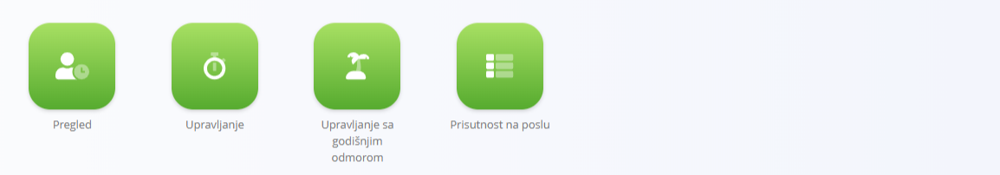

<!-- app_route: /sitemap/resources.timeLogs -->
<!-- app_label: Dnevnik prisutnosti -->
<!-- canonical_source_url: https://github.com/Tom-PIT/Connected.Docs/blob/main/hr/Domene/Resursi/Pogledi/TimeLogs.md -->
<!-- canonical_source_title: Dnevnik prisutnosti -->

# Dnevnik prisutnosti

Odjeljak **Dnevnik prisutnosti** pruža pristup svim pogledima vezanima uz vrijeme za resurse.
Koristi se za pregled evidentiranog radnog vremena, upravljanje unosima vremena i odsutnostima te praćenje prisutnosti na poslu.

Do ovog odjeljka dolazite tako da u [navigaciji](../../../Zajednicko/UI/Navigacija.md) odaberete **Resursi / Dnevnik prisutnosti**.

## Dostupni pogledi

Odjeljak Dnevnik prisutnosti sastoji se od nekoliko zasebnih pogleda, od kojih svaki pokriva određeni aspekt praćenja vremena i prisutnosti:

- **[Pregled](Pregled.md)** – pregled evidentiranih unosa vremena, za pregled zabilježenog rada i podataka o vremenu.

- **[Upravljanje](UpravljanjePrisutnoscu.md)** – upravljanje dnevnikom vremena, uključujući uređivanje, ispravljanje i administriranje evidentiranih unosa.

- **[Upravljanje sa godišnjim odmorom](UpravljanjeSaGodisnjimOdmorom.md)** – administracija unosa plaćenog odsustva, kao što su godišnji odmor ili drugi odobreni izostanci.

- **[Prisutnost na poslu](PrisutnostNaPoslu.md)** – pregled prisutnosti, koji prikazuje dolaske i obrasce rada resursa.

Svaki pogled usmjeren je na određeni tijek rada, pa su praćenje vremena, upravljanje odsustvima i praćenje prisutnosti jasno odvojeni.
