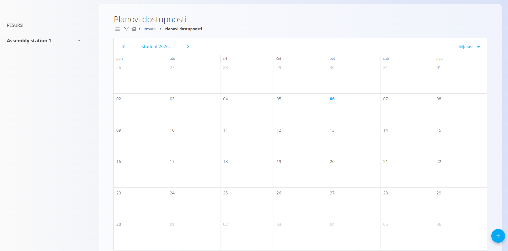
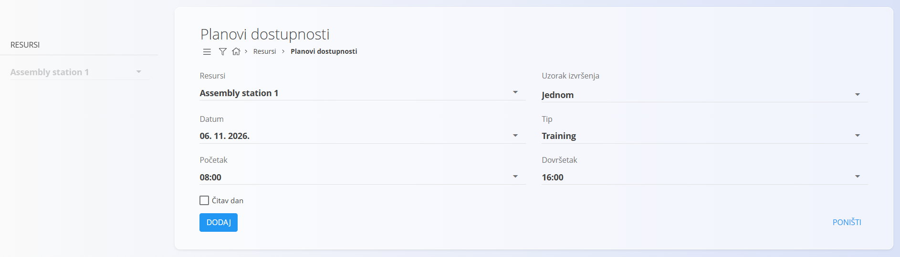

<!-- app_route: /management/resources/availabilty-plans -->
<!-- app_label: Planovi dostupnosti -->
<!-- canonical_source_url: https://github.com/Tom-PIT/Connected.Docs/blob/main/hr/Domene/Resursi/Pogledi/PlanoviDostupnosti.md -->
<!-- canonical_source_title: Planovi dostupnosti -->

# Planovi dostupnosti

Planovi dostupnosti pružaju pregled dostupnosti resursa za rad prikazan u kalendaru. Obično se koriste za evidentiranje planiranih odsutnosti, obuke ili drugih neradnih razdoblja koja utječu na dostupnost resursa.

Do ovog pogleda dolazite tako da u [navigaciji](../../../Zajednicko/UI/Navigacija.md) odaberete **Resursi / Pogledi / Planovi dostupnosti**.

## Shema

| Polje | Opis |
|------|------|
| **Resursi** | Resurs ili resursi za koje se plan dostupnosti stvara (na primjer korisnik ili tim). |
| **Uzorak izvršenja** | Određuje hoće li se plan izvršiti **Jednom** ili slijediti ponavljajući uzorak. |
| **Datum** | Datum plana dostupnosti (sidrišni datum za uzorak izvršenja). |
| **Čitav dan** | Označava da plan obuhvaća cijeli dan. |
| **Tip** | Vrsta dostupnosti (na primjer obuka, odsutnost ili drugo). |
| **Početak** | Početno vrijeme razdoblja dostupnosti (ako nije čitav dan). |
| **Dovršetak** | Završno vrijeme razdoblja dostupnosti (ako nije čitav dan). |

## Kalendarski prikaz

Glavni ekran prikazuje kalendar u prikazu **Dan**, **Tjedan** ili **Mjesec**. S lijeve strane odaberite jedan ili više **resursa** da biste prikazali njihove planove u kalendaru.

Svaki unos predstavlja planirano razdoblje dostupnosti ili nedostupnosti resursa.

## Radnje

Kliknite [gumb radnji](../../../Zajednicko/UI/AkcijskiGumb.md) da biste stvorili novi plan dostupnosti.

Pri stvaranju ili uređivanju plana dostupna su polja opisana u odjeljku [**Shema**](#shema) iznad.

### Dodavanje plana dostupnosti

1. Kliknite gumb **+**.
2. Odaberite **Resursi** i **Tip**.
3. Po potrebi postavite **Uzorak izvršenja**, **Datum**, **Čitav dan**, **Početak** i **Dovršetak**.
4. Kliknite **Dodaj** da biste spremili.

### Uređivanje plana dostupnosti

Kliknite unos u kalendaru da biste otvorili obrazac za uređivanje. Prilagodite **Datum**, vremenski raspon, **Tip** ili **Uzorak izvršenja** i spremite.

### Brisanje plana dostupnosti

Planove dostupnosti možete obrisati iz **dijaloga za uređivanje**.

Za brisanje plana:
1. Dvaput kliknite unos plana u kalendaru da biste otvorili ekran za uređivanje.
2. Kliknite **Izbriši**.
3. Potvrdite brisanje.

Ako plan koristi uzorak izvršenja **Više puta**, prikazuje se dodatna potvrda:
- **„Želite li ukloniti i sve buduće unose?"**

Nakon toga prikazuje se završni dijalog za potvrdu:
- **„Jeste li sigurni da želite izbrisati pojedinost plana dostupnosti?"**

Nakon potvrde plan se trajno uklanja.
